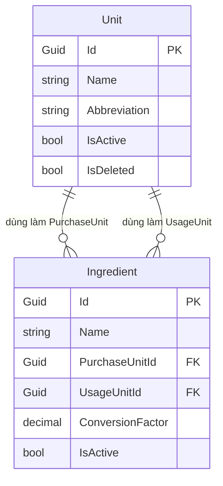

# Mô hình Dữ liệu (Data Model): Quản lý Đơn vị tính (Units) (RM-004)

**Tính năng**: `004-rm-004-units`
**Ngày tạo**: 2026-10-08
**Trạng thái**: Hoàn thành (Complete)

---

## 1. Thực thể Cốt lõi: `Unit` (Bảng `Units`)

Thực thể `Unit` đại diện cho một đơn vị đo lường trong nhà hàng, kế thừa lớp cơ sở `FullAuditedAggregateRoot<Guid>` của ABP Framework.

### Thuộc tính của Thực thể

| Tên thuộc tính | Kiểu dữ liệu | Bắt buộc | Mặc định | Giới hạn | Mô tả |
|:---|:---|:---:|:---:|:---|:---|
| `Id` | `Guid` | Có | Tự sinh | Primary Key | Định danh duy nhất của đơn vị tính |
| `Name` | `string` | Có | `""` | Max 64 chars | Tên đầy đủ của đơn vị tính (ví dụ: "Kilogram", "Lít", "Thùng") |
| `Abbreviation` | `string` | Có | `""` | Max 16 chars | Ký hiệu viết tắt (ví dụ: "Kg", "L", "Thùng"). Nếu bỏ trống lúc nhập, tự động lấy bằng `Name`. |
| `IsActive` | `bool` | Có | `true` | Boolean | Cờ trạng thái hoạt động: `true` = Đang dùng, `false` = Tạm ngưng |
| `IsDeleted` | `bool` | Có | `false` | Boolean | Cờ xóa mềm (Soft Delete của ABP) |
| `DeleterId` | `Guid?` | Không | `null` | Audit | Id người thực hiện thao tác xóa |
| `DeletionTime`| `DateTime?` | Không | `null` | Audit | Thời điểm xóa mềm |
| `CreationTime`| `DateTime` | Có | `Now` | Audit | Thời điểm tạo bản ghi |
| `CreatorId` | `Guid?` | Không | `null` | Audit | Id người tạo |
| `LastModificationTime` | `DateTime?` | Không | `null` | Audit | Thời điểm chỉnh sửa gần nhất |
| `LastModifierId` | `Guid?` | Không | `null` | Audit | Id người chỉnh sửa gần nhất |

---

## 2. Mô hình Đối tượng Truyền tải Dữ liệu (DTOs)

### `UnitDto` (Dùng cho Get & List responses)
```csharp
public class UnitDto : AuditedEntityDto<Guid>
{
    public string Name { get; set; } = string.Empty;
    public string Abbreviation { get; set; } = string.Empty;
    public bool IsActive { get; set; } = true;
}
```

### `CreateUpdateUnitDto` (Dùng cho Create & Update requests)
```csharp
public class CreateUpdateUnitDto
{
    [Required(ErrorMessage = "::Unit:NameIsRequired")]
    [StringLength(64, ErrorMessage = "::Unit:NameExceedMaxLength")]
    public string Name { get; set; } = string.Empty;

    [StringLength(16, ErrorMessage = "::Unit:AbbreviationExceedMaxLength")]
    public string? Abbreviation { get; set; }

    public bool IsActive { get; set; } = true;
}
```

---

## 3. Mối quan hệ với các Phân hệ khác (Entity Relationships)



- **Mối quan hệ 1 - N**: Một `Unit` có thể được gán làm `PurchaseUnit` (đơn vị mua vào) hoặc `UsageUnit` (đơn vị định lượng tiêu hao) cho nhiều bản ghi `Ingredient`.
- **Ràng buộc khóa ngoại**: Không cho phép xóa cứng hoặc xóa mềm `Unit` nếu tồn tại ít nhất 1 bản ghi `Ingredient` đang trỏ tới `Unit.Id`.

---

## 4. Các Quy tắc Bất biến Nghiệp vụ (Business Invariants)

1. **Tính Duy nhất của Tên (`Name Uniqueness`)**:
   - `cleanName = Name.Trim()`
   - Bất kỳ thao tác Tạo mới hoặc Chỉnh sửa nào đều không được phép trùng lặp tên với một đơn vị khác: `x.Name.ToLower() == cleanName.ToLower()`.
   - Nếu vi phạm: ném `UserFriendlyException($"Đơn vị tính '{cleanName}' đã tồn tại!")`.
2. **Cơ chế Fallback Ký hiệu viết tắt (`Abbreviation Fallback`)**:
   - Nếu `string.IsNullOrWhiteSpace(Abbreviation)`: tự động gán `Abbreviation = cleanName`.
3. **Danh mục Đơn vị tính Mặc định Cốt lõi (`System Default Units`)**:
   - Danh sách đơn vị tính mặc định gồm: `"Kilogram"`, `"Gam"`, `"Lít"`, `"Mililit"`, `"Chai"`, `"Thùng"`, `"Lon"`, `"Gói"`, `"Quả"`, `"Đĩa"`.
   - Các đơn vị tính này không được phép xóa khỏi hệ thống. Khi gọi `DeleteAsync`, `UnitManager` kiểm tra nếu tên thuộc danh sách trên thì ném `UserFriendlyException("Không thể xóa đơn vị tính mặc định của hệ thống!")`.
4. **Kiểm tra Toàn vẹn Tham chiếu trước khi Xóa (`CheckCanDeleteAsync`)**:
   - Kiểm tra xem `UnitId` có tồn tại trong bất kỳ `Ingredient` nào hay không. Nếu có: ném `UserFriendlyException("Không thể xóa đơn vị tính này vì đang được sử dụng bởi các nguyên liệu trong hệ thống!")`.

---

## 5. Dữ liệu Khởi tạo Mẫu (Seed Data)

Khi ứng dụng khởi chạy lần đầu, `UnitDataSeederContributor` sẽ nạp sẵn các đơn vị tính cơ bản vào cơ sở dữ liệu:

| Tên đơn vị (`Name`) | Ký hiệu viết tắt (`Abbreviation`) | Trạng thái (`IsActive`) |
|:---|:---|:---:|
| Kilogram | Kg | `true` |
| Gam | g | `true` |
| Lít | L | `true` |
| Mililit | ml | `true` |
| Chai | Chai | `true` |
| Thùng | Thùng | `true` |
| Lon | Lon | `true` |
| Gói | Gói | `true` |
| Quả | Quả | `true` |
| Đĩa | Đĩa | `true` |
