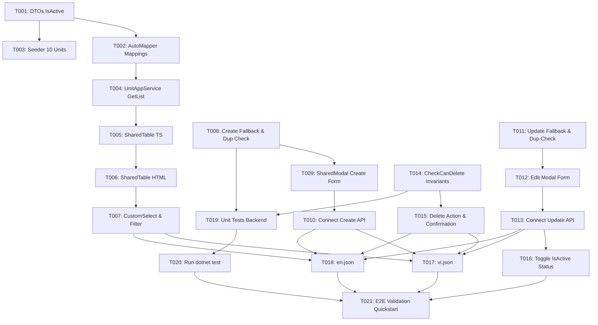

# Danh sách Tác vụ (Tasks): Quản lý Đơn vị tính (Units) (RM-004)

**Đầu vào (Input)**: Tài liệu thiết kế từ `specs/004-rm-004-units/` (gồm `spec.md`, `plan.md`, `research.md`, `data-model.md`, `contracts/unit-api.md`, `quickstart.md`)

**Quy ước định dạng**: `[ID] [P?] [Story] Mô tả`
- `[P]`: Có thể thực hiện song song (các file độc lập, không có phụ thuộc chặn).
- `[Story]`: User Story tương ứng (`US1`, `US2`, `US3`, `US4`, `US5`).

---

## Phase 1: Nền tảng Backend (Foundational Prerequisites)

**Mục tiêu**: Hoàn thiện các điều kiện tiên quyết tầng Domain, Application, DTOs và Seeder trước khi triển khai các nghiệp vụ trên giao diện.

- [x] T001 [Backend] Cập nhật `UnitDtos.cs` bổ sung trường `public bool IsActive { get; set; } = true;` cho cả `UnitDto` và `CreateUpdateUnitDto` tại [`src/Acme.TooHungry.Application.Contracts/Units/UnitDtos.cs`](file:///d:/DFT/Acme.TooHungry/src/Acme.TooHungry.Application.Contracts/Units/UnitDtos.cs).
- [x] T002 [Backend] Đăng ký ánh xạ AutoMapper `CreateMap<Unit, UnitDto>()` và `CreateMap<CreateUpdateUnitDto, Unit>()` tại [`src/Acme.TooHungry.Application/TooHungryApplicationMappers.cs`](file:///d:/DFT/Acme.TooHungry/src/Acme.TooHungry.Application/TooHungryApplicationMappers.cs).
- [x] T003 [Backend] Cập nhật `UnitDataSeederContributor.cs` nạp đầy đủ 10 đơn vị tính chuẩn hệ thống (Kilogram, Gam, Lít, Mililit, Chai, Thùng, Lon, Gói, Quả, Đĩa) tại [`src/Acme.TooHungry.Domain/Units/UnitDataSeederContributor.cs`](file:///d:/DFT/Acme.TooHungry/src/Acme.TooHungry.Domain/Units/UnitDataSeederContributor.cs).

---

## Phase 2: User Story 1 - Xem danh sách Đơn vị tính (Ưu tiên: P1) 🎯 MVP Core

**Mục tiêu**: Người dùng có thể xem danh sách tất cả các đơn vị tính trên bảng dữ liệu hiện đại, hỗ trợ phân trang và tìm kiếm theo tên hoặc viết tắt.
**Kiểm thử Độc lập**: Truy cập `/units`, bảng hiển thị đầy đủ danh sách đơn vị tính với trạng thái hoạt động và các công cụ lọc/sắp xếp.

- [x] T004 [US1] [Backend] Kiểm tra API `UnitAppService.GetListAsync` đảm bảo trả về dữ liệu `UnitDto` đầy đủ `IsActive`, hỗ trợ phân trang (`SkipCount`, `MaxResultCount`) và sắp xếp (`Sorting`) tại [`src/Acme.TooHungry.Application/Units/UnitAppService.cs`](file:///d:/DFT/Acme.TooHungry/src/Acme.TooHungry.Application/Units/UnitAppService.cs).
- [x] T005 [US1] [Frontend] Tái cấu trúc `unit.component.ts`: Loại bỏ hoàn toàn phụ thuộc `ngx-datatable`, import và sử dụng `SharedTableComponent` từ RM-002, cấu hình danh sách cột bảng (Tên, Viết tắt, Trạng thái, Thao tác) tại [`angular/src/app/unit/unit.component.ts`](file:///d:/DFT/Acme.TooHungry/angular/src/app/unit/unit.component.ts).
- [x] T006 [US1] [Frontend] Tái cấu trúc template `unit.component.html` tích hợp `<app-shared-table>` với custom badge trạng thái `IsActive` (Active: xanh lá/cam, Inactive: xám) tại [`angular/src/app/unit/unit.component.html`](file:///d:/DFT/Acme.TooHungry/angular/src/app/unit/unit.component.html).
- [x] T007 [US1] [Frontend] Tích hợp thanh tìm kiếm và bộ chọn số dòng hiển thị `<app-custom-select>` theo phong cách Cam & Trắng tại [`angular/src/app/unit/unit.component.ts`](file:///d:/DFT/Acme.TooHungry/angular/src/app/unit/unit.component.ts).

---

## Phase 3: User Story 2 - Thêm mới Đơn vị tính (Ưu tiên: P1)

**Mục tiêu**: Cho phép tạo mới một đơn vị tính với tự động kiểm tra trùng lặp và tự động fallback viết tắt (`Abbreviation = Name`).
**Kiểm thử Độc lập**: Mở modal, nhập tên đơn vị tính mới, kiểm tra lưu thành công (cả trường hợp có viết tắt và để trống viết tắt), kiểm tra báo lỗi khi trùng tên.

- [x] T008 [US2] [Backend] Tinh chỉnh `UnitManager.CreateAsync`: Xử lý tự động fallback `Abbreviation = cleanName` nếu người dùng để trống hoặc null; kiểm tra trùng tên không phân biệt hoa/thường tại [`src/Acme.TooHungry.Domain/Units/UnitManager.cs`](file:///d:/DFT/Acme.TooHungry/src/Acme.TooHungry.Domain/Units/UnitManager.cs).
- [x] T009 [US2] [Frontend] Tích hợp `<app-shared-modal>` cho form Thêm mới Đơn vị tính với các trường: Tên (bắt buộc, max 64), Ký hiệu viết tắt (tùy chọn, max 16), Trạng thái kích hoạt (mặc định bật) tại [`angular/src/app/unit/unit.component.html`](file:///d:/DFT/Acme.TooHungry/angular/src/app/unit/unit.component.html).
- [x] T010 [US2] [Frontend] Xử lý sự kiện lưu form Thêm mới, gọi API `UnitService.create`, hiển thị toast thông báo thành công và reload danh sách, xử lý hiển thị lỗi nghiệp vụ khi trùng tên tại [`angular/src/app/unit/unit.component.ts`](file:///d:/DFT/Acme.TooHungry/angular/src/app/unit/unit.component.ts).

---

## Phase 4: User Story 3 - Cập nhật Đơn vị tính (Ưu tiên: P1)

**Mục tiêu**: Người dùng có thể chỉnh sửa tên, ký hiệu viết tắt hoặc trạng thái của một đơn vị tính đã có.
**Kiểm thử Độc lập**: Nhấn nút Sửa trên dòng dữ liệu, thay đổi thông tin và Lưu, dòng trên bảng được cập nhật ngay lập tức.

- [x] T011 [US3] [Backend] Tinh chỉnh `UnitManager.UpdateAsync`: Xử lý fallback `Abbreviation = cleanName` nếu người dùng xóa trống viết tắt; kiểm tra trùng tên loại trừ chính Id đang sửa tại [`src/Acme.TooHungry.Domain/Units/UnitManager.cs`](file:///d:/DFT/Acme.TooHungry/src/Acme.TooHungry.Domain/Units/UnitManager.cs).
- [x] T012 [US3] [Frontend] Thêm hành động "Sửa" trên cột thao tác của `<app-shared-table>`, mở `<app-shared-modal>` và nạp dữ liệu hiện tại của đơn vị tính vào form tại [`angular/src/app/unit/unit.component.ts`](file:///d:/DFT/Acme.TooHungry/angular/src/app/unit/unit.component.ts).
- [x] T013 [US3] [Frontend] Xử lý sự kiện submit cập nhật, gọi API `UnitService.update`, cập nhật trạng thái dữ liệu bảng và đóng modal tại [`angular/src/app/unit/unit.component.ts`](file:///d:/DFT/Acme.TooHungry/angular/src/app/unit/unit.component.ts).

---

## Phase 5: User Story 4 - Xóa Đơn vị tính An toàn (Ưu tiên: P2)

**Mục tiêu**: Xóa an toàn đơn vị tính không sử dụng, chặn tuyệt đối việc xóa các đơn vị tính mặc định hệ thống hoặc đơn vị đang được gán cho nguyên liệu.
**Kiểm thử Độc lập**: Thử xóa đơn vị tính mặc định (Kilogram -> báo lỗi), xóa đơn vị đang gán nguyên liệu (báo lỗi), xóa đơn vị tự tạo chưa dùng (xóa thành công).

- [x] T014 [US4] [Backend] Nâng cấp `UnitManager.CheckCanDeleteAsync`:
  - Kiểm tra nếu `Unit.Name` thuộc danh mục 10 đơn vị tính mặc định hệ thống -> Ném `UserFriendlyException("Không thể xóa đơn vị tính mặc định của hệ thống!")`.
  - Inject `IRepository<Ingredient, Guid>` để kiểm tra nếu đơn vị tính đang được tham chiếu bởi bất kỳ bản ghi `Ingredient` nào làm `PurchaseUnitId` hoặc `UsageUnitId` -> Ném `UserFriendlyException("Không thể xóa đơn vị tính này vì đang được sử dụng bởi các nguyên liệu trong hệ thống!")` tại [`src/Acme.TooHungry.Domain/Units/UnitManager.cs`](file:///d:/DFT/Acme.TooHungry/src/Acme.TooHungry.Domain/Units/UnitManager.cs).
- [x] T015 [US4] [Frontend] Thêm nút hành động "Xóa" trên bảng, hiển thị popup xác nhận xóa với nội dung cảnh báo rõ ràng (`ConfirmationService`), gọi API `UnitService.delete`, và bắt lỗi hiển thị toast cảnh báo nếu bị chặn xóa tại [`angular/src/app/unit/unit.component.ts`](file:///d:/DFT/Acme.TooHungry/angular/src/app/unit/unit.component.ts).

---

## Phase 6: User Story 5 - Đổi trạng thái Kích hoạt (Ưu tiên: P2)

**Mục tiêu**: Cho phép tạm ngưng (`IsActive = false`) đơn vị tính để ẩn khỏi các dropdown chọn đơn vị ở màn hình Nguyên liệu mới mà không cần xóa bản ghi.
**Kiểm thử Độc lập**: Đổi trạng thái đơn vị tính sang Tạm ngưng, kiểm tra hiển thị badge màu xám trên bảng.

- [x] T016 [US5] [Frontend] Cho phép thay đổi nhanh trạng thái `IsActive` trong modal chỉnh sửa, cập nhật hiển thị badge trạng thái trên bảng danh sách tại [`angular/src/app/unit/unit.component.ts`](file:///d:/DFT/Acme.TooHungry/angular/src/app/unit/unit.component.ts).

---

## Phase 7: Quốc tế hóa (I18N), Kiểm thử Tự động & Xác minh E2E

**Mục tiêu**: Đảm bảo 100% văn bản hỗ trợ song ngữ Tiếng Việt và Tiếng Anh, độ phủ kiểm thử tự động toàn diện, và vượt qua toàn bộ kịch bản nghiệm thu.

- [x] T017 [P] [I18N] Cập nhật đầy đủ các khóa dịch thuật cho Quản lý Đơn vị tính vào từ điển tiếng Việt tại [`src/Acme.TooHungry.Domain.Shared/Localization/TooHungry/vi.json`](file:///d:/DFT/Acme.TooHungry/src/Acme.TooHungry.Domain.Shared/Localization/TooHungry/vi.json).
- [x] T018 [P] [I18N] Cập nhật đồng bộ 100% các khóa dịch thuật tương ứng vào từ điển tiếng Anh tại [`src/Acme.TooHungry.Domain.Shared/Localization/TooHungry/en.json`](file:///d:/DFT/Acme.TooHungry/src/Acme.TooHungry.Domain.Shared/Localization/TooHungry/en.json).
- [x] T019 [P] [Test] Mở [`test/Acme.TooHungry.Application.Tests/Units/UnitAppService_Tests.cs`](file:///d:/DFT/Acme.TooHungry/test/Acme.TooHungry.Application.Tests/Units/UnitAppService_Tests.cs), bổ sung các test cases kiểm thử:
  - Test case: Tự động fallback viết tắt bằng tên khi để trống (`Should_Fallback_Abbreviation_To_Name`).
  - Test case: Chặn tạo trùng tên đơn vị tính (`Should_Not_Allow_Duplicate_Name`).
  - Test case: Chặn xóa đơn vị tính mặc định của hệ thống (`Should_Not_Allow_Deleting_System_Unit`).
- [x] T020 [Test] Chạy lệnh `dotnet test` cho project `Acme.TooHungry.Application.Tests` đảm bảo toàn bộ bài test đều Passed.
- [x] T021 [E2E] Thực hiện kiểm thử toàn diện trên trình duyệt theo 6 kịch bản tại [`specs/004-rm-004-units/quickstart.md`](file:///d:/DFT/Acme.TooHungry/specs/004-rm-004-units/quickstart.md) và xác minh độ hoàn thiện của giao diện Cam & Trắng.

---

## Sơ đồ Phụ thuộc (Dependencies Graph)

---

## Chiến lược Triển khai (Implementation Strategy)

1. **Khối Tăng trưởng 1 (MVP - US1 & US2)**:
   - Hoàn thành T001 → T010.
   - Kết quả: Người dùng có thể xem danh sách đơn vị tính và thêm mới đơn vị tính với tự động fallback ký hiệu viết tắt trên giao diện Shared UI.
2. **Khối Tăng trưởng 2 (Chỉnh sửa & Xóa an toàn - US3, US4, US5)**:
   - Hoàn thành T011 → T016.
   - Kết quả: Cho phép sửa thông tin, đổi trạng thái kích hoạt, và bảo vệ an toàn khi xóa đơn vị tính.
3. **Khối Tăng trưởng 3 (Hoàn thiện & Nghiệm thu - Phase 7)**:
   - Hoàn thành T017 → T021.
   - Kết quả: Song ngữ 100%, kiểm thử tự động xanh toàn bộ, sẵn sàng đưa vào vận hành.
