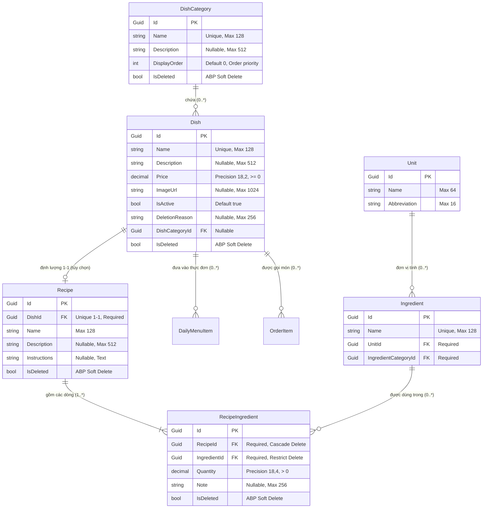
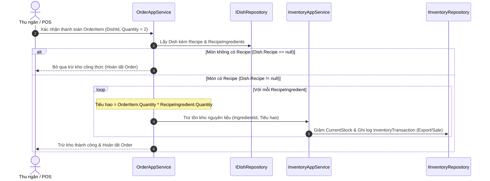

# Mô hình Dữ liệu (Data Model): Dishes, Categories & Recipe Linkage

**Tính năng**: `006-rm-006-dishes-and-dish-categories`
**Focus**: Quản lý Món ăn (Dish), Danh mục (DishCategory) và Liên kết Công thức (Recipe)  
**Ngày cập nhật**: 2026-10-08

---

## 1. Sơ đồ mối quan hệ thực thể (ERD)

---

## 2. Chi tiết Thuộc tính & Ràng buộc (Entity Details)

### 2.1. `DishCategory` (Gốc tổng hợp)
- **Bảng**: `AppDishCategories`
- **Lớp cơ sở**: `FullAuditedAggregateRoot<Guid>`
- **Các trường**:
  | Trường | Kiểu dữ liệu | Bắt buộc | Ràng buộc / Index | Mô tả |
  |---|---|:---:|---|---|
  | `Id` | `Guid` | Có | Primary Key | Khóa chính duy nhất |
  | `Name` | `string` | Có | Max 128, Unique Index (Case-insensitive) | Tên danh mục món ăn |
  | `Description`| `string?` | Không | Max 512 | Mô tả danh mục |
- **Thuộc tính điều hướng**:
  - `ICollection<Dish> Dishes` (1 - N)
- **Xóa**: Chặn xóa nếu còn `Dish` trực thuộc (`Dishes.Any()`).

---

### 2.2. `Dish` (Gốc tổng hợp)
- **Bảng**: `AppDishes`
- **Lớp cơ sở**: `FullAuditedAggregateRoot<Guid>`
- **Các trường**:
  | Trường | Kiểu dữ liệu | Bắt buộc | Ràng buộc / Index | Mô tả |
  |---|---|:---:|---|---|
  | `Id` | `Guid` | Có | Primary Key | Khóa chính duy nhất |
  | `Name` | `string` | Có | Max 128, Unique Index (Case-insensitive) | Tên món ăn |
  | `Description`| `string?` | Không | Max 512 | Mô tả hương vị/thành phần |
  | `Price` | `decimal` | Có | Precision(18, 2), `>= 0` | Đơn giá bán (VND) |
  | `ImageUrl` | `string?` | Không | Max 1024 | URL ảnh đại diện |
  | `IsActive` | `bool` | Có | Default `true` | Trạng thái phục vụ |
  | `DeletionReason` | `string?` | Không | Max 256 | Lý do xóa món kiểm toán |
  | `DishCategoryId` | `Guid?` | Không | Foreign Key -> `AppDishCategories` | Mã danh mục (cho phép null) |
- **Thuộc tính điều hướng**:
  - `DishCategory? DishCategory` (N - 1)
  - `Recipe? Recipe` (1 - 1, Nullable)
  - `ICollection<DailyMenuItem> DailyMenuItems` (1 - N)
- **Xóa**: Soft Delete, lưu `DeletionReason`, đánh dấu ngừng phục vụ trên các `DailyMenuItem` tương ứng.

---

### 2.3. `Recipe` (Aggregate Root - Trọng tâm Mục 3)
- **Bảng**: `AppRecipes`
- **Lớp cơ sở**: `FullAuditedAggregateRoot<Guid>`
- **Các trường**:
  | Trường | Kiểu dữ liệu | Bắt buộc | Ràng buộc / Index | Mô tả |
  |---|---|:---:|---|---|
  | `Id` | `Guid` | Có | Primary Key | Khóa chính duy nhất |
  | `DishId` | `Guid` | Có | Unique Foreign Key -> `AppDishes` | Mã món ăn định lượng (1-1) |
  | `Name` | `string` | Có | Max 128 | Tên công thức chuẩn |
  | `Description`| `string?` | Không | Max 512 | Mô tả công thức |
  | `Instructions`| `string?` | Không | Text không giới hạn | Hướng dẫn các bước chế biến |
- **Thuộc tính điều hướng**:
  - `Dish? Dish` (1 - 1 với Dish)
  - `ICollection<RecipeIngredient> RecipeIngredients` (1 - N với RecipeIngredient, Cascade Delete)
- **Quy tắc Nghiệp vụ**:
  - Mỗi `Dish` tối đa chỉ có 1 `Recipe`.
  - Khi xóa `Dish` (Soft Delete), `Recipe` tương ứng cũng được Soft Delete theo (Cascade).

---

### 2.4. `RecipeIngredient` (Entity - Trọng tâm Mục 3)
- **Bảng**: `AppRecipeIngredients`
- **Lớp cơ sở**: `FullAuditedEntity<Guid>`
- **Các trường**:
  | Trường | Kiểu dữ liệu | Bắt buộc | Ràng buộc / Index | Mô tả |
  |---|---|:---:|---|---|
  | `Id` | `Guid` | Có | Primary Key | Khóa chính |
  | `RecipeId` | `Guid` | Có | Foreign Key -> `AppRecipes` | Mã công thức sở hữu |
  | `IngredientId` | `Guid` | Có | Foreign Key -> `AppIngredients` | Mã nguyên liệu thô |
  | `Quantity` | `decimal` | Có | Precision(18, 4), `> 0` | Số lượng định lượng |
  | `Note` | `string?` | Không | Max 256 | Quy cách sơ chế/chế biến |
- **Thuộc tính điều hướng**:
  - `Recipe? Recipe` (N - 1)
  - `Ingredient? Ingredient` (N - 1, AutoInclude để lấy Tên & Đơn vị tính `Unit`)
- **Quy tắc Nghiệp vụ**:
  - Trong cùng 1 `Recipe`, không được có 2 dòng trùng cùng 1 `IngredientId` (Unique Composite: `[RecipeId, IngredientId]`).
  - Định lượng `Quantity` phải lớn hơn 0.

---

## 3. Quy trình Trừ kho Tự động khi Bán món (Logic Flow)

