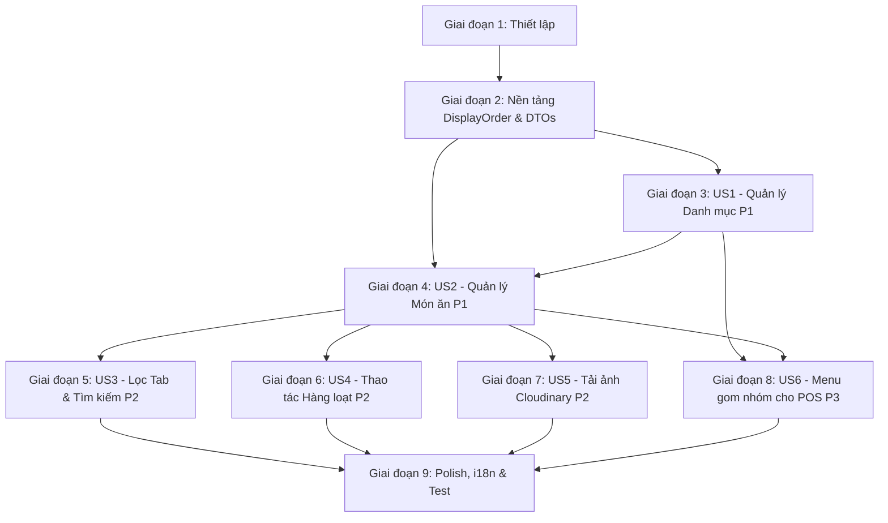

# Tác vụ (Tasks): Quản lý Món ăn & Danh mục (Dishes) (RM-006)

**Tính năng**: `006-rm-006-dishes-and-dish-categories`  
**Kế hoạch**: [plan.md](plan.md) | **Đặc tả**: [spec.md](spec.md) | **Mô hình Dữ liệu**: [data-model.md](data-model.md)  
**Ngày cập nhật**: 2026-10-08

---

## Giai đoạn 1: Thiết lập & Môi trường (Setup)

**Mục đích**: Chuẩn bị cấu hình hệ thống, kiểm tra môi trường và các gói phụ thuộc dùng chung.

- [x] T001 Xác minh cấu trúc dự án và môi trường runtime theo [plan.md](plan.md)
- [x] T002 [P] Khai báo cấu hình Cloudinary credentials (CloudName, ApiKey, ApiSecret) trong `src/Acme.TooHungry.HttpApi.Host/appsettings.json`
- [x] T003 [P] Rà soát cấu hình quyền hạn `TooHungryPermissions.Dishes` trong `src/Acme.TooHungry.Application.Contracts/Permissions/TooHungryPermissions.cs` và `src/Acme.TooHungry.Application.Contracts/Permissions/TooHungryPermissionDefinitionProvider.cs`

---

## Giai đoạn 2: Nền tảng (Foundational - Blocking Prerequisites)

**Mục đích**: Xây dựng cấu trúc dữ liệu nền tảng, cập nhật thuộc tính thực thể, EF Core DbContext và tạo Migration trước khi triển khai các User Story.

**⚠️ CRITICAL**: Phải hoàn thành Giai đoạn 2 trước khi bắt đầu thực hiện các User Story.

- [x] T004 [P] Bổ sung thuộc tính `DisplayOrder` (kiểu `int`, mặc định `0`) vào Domain Entity `DishCategory` trong `src/Acme.TooHungry.Domain/Dishes/DishCategory.cs`
- [x] T005 [P] Rà soát cấu hình EF Core DbContext cho `Dish` và `DishCategory` (Index duy nhất tên không phân biệt hoa thường, độ chính xác `decimal(18, 2)` cho `Dish.Price`) trong `src/Acme.TooHungry.EntityFrameworkCore/EntityFrameworkCore/TooHungryDbContext.cs`
- [x] T006 Tạo EF Core Migration bổ sung `DisplayOrder` cho `DishCategory` bằng lệnh `dotnet ef migrations add Add_DisplayOrder_To_DishCategories` tại `src/Acme.TooHungry.EntityFrameworkCore`
- [x] T007 Cập nhật cơ sở dữ liệu qua công cụ `Acme.TooHungry.DbMigrator` hoặc `dotnet ef database update`
- [x] T008 [P] Cập nhật DTO `DishCategoryDto` và `CreateUpdateDishCategoryDto` bổ sung trường `DisplayOrder` trong `src/Acme.TooHungry.Application.Contracts/Dishes/DishDtos.cs`
- [x] T009 [P] Định nghĩa DTO `BulkToggleActiveDishDto` và `BulkActionResultDto` trong `src/Acme.TooHungry.Application.Contracts/Dishes/DishDtos.cs`
- [x] T010 [P] Cập nhật AutoMapper profile ánh xạ `DisplayOrder` giữa `DishCategory` và `DishCategoryDto` trong `src/Acme.TooHungry.Application/TooHungryApplicationMappers.cs`

**Trạm kiểm tra (Checkpoint)**: Nền tảng dữ liệu, Migration và DTOs đã sẵn sàng 100%.

---

## Giai đoạn 3: User Story 1 - Quản lý Danh mục Món ăn & Thứ tự Hiển thị (Priority: P1) 🎯 MVP Part 1

**Mục tiêu**: Quản lý tạo mới, sửa, xem danh sách có sắp xếp theo `DisplayOrder` tăng dần và xóa danh mục món ăn (chặn xóa khi đang có món ăn trực thuộc).

**Kiểm thử Độc lập**: Tạo danh mục "Khai vị" (`displayOrder = 1`) và "Đồ uống" (`displayOrder = 10`), kiểm tra thứ tự trả về trên danh sách, xác thực chặn xóa danh mục khi có món ăn liên kết.

### Kiểm thử cho User Story 1 🧪
- [x] T011 [P] [US1] Bổ sung Unit Test kiểm tra tính duy nhất tên danh mục và chặn xóa danh mục có món ăn trong `test/Acme.TooHungry.Domain.Tests/Dishes/EfCoreDishDomainTests.cs`
- [x] T012 [P] [US1] Bổ sung Integration Test cho `DishCategoryAppService` kiểm tra CRUD danh mục và sắp xếp theo `DisplayOrder ASC, Name ASC` trong `test/Acme.TooHungry.Application.Tests/Dishes/DishCategoryAppService_Tests.cs`

### Triển khai cho User Story 1
- [x] T013 [US1] Cập nhật `DishCategoryManager` hỗ trợ cập nhật `DisplayOrder` và kiểm tra chặn xóa an toàn trong `src/Acme.TooHungry.Domain/Dishes/DishCategoryManager.cs`
- [x] T014 [US1] Cập nhật `DishCategoryAppService.GetListAsync` sắp xếp truy vấn theo `DisplayOrder ASC, Name ASC` trong `src/Acme.TooHungry.Application/Dishes/DishAppServices.cs`
- [x] T015 [US1] Cập nhật `DishCategoryAppService.CreateAsync` và `UpdateAsync` tiếp nhận và lưu `DisplayOrder` trong `src/Acme.TooHungry.Application/Dishes/DishAppServices.cs`
- [x] T016 [US1] Cập nhật giao diện quản lý danh mục `DishCategoryComponent` (`dish-category.component.html|ts`): bổ sung cột hiển thị `DisplayOrder` và trường nhập liệu trong modal thêm/sửa danh mục sử dụng `SharedModal`

**Trạm kiểm tra (Checkpoint)**: User Story 1 hoàn thành và kiểm thử độc lập thành công.

---

## Giai đoạn 4: User Story 2 - Quản lý Món ăn trong Thực đơn (Priority: P1) 🎯 MVP Part 2

**Mục tiêu**: Quản lý thông tin món ăn (`Dish`), đơn giá Gross Price (VND), gán danh mục, hỗ trợ chuyển đổi trạng thái `IsActive` và xóa mềm bắt buộc nhập lý do `DeletionReason`.

**Kiểm thử Độc lập**: Tạo món "Phở Bò Đặc Biệt" giá `65.000 đ`, chọn danh mục, gạt bật/tắt `IsActive`, và thực hiện xóa món có nhập lý do kiểm toán.

### Kiểm thử cho User Story 2 🧪
- [x] T017 [P] [US2] Bổ sung Unit Test cho `DishManager` kiểm tra duy nhất tên món, chặn giá âm `< 0` trong `test/Acme.TooHungry.Domain.Tests/Dishes/EfCoreDishDomainTests.cs`
- [x] T018 [P] [US2] Bổ sung Integration Test cho `DishAppService` kiểm tra tạo món, cập nhật thông tin và xóa kèm lý do `DeleteWithReasonAsync` trong `test/Acme.TooHungry.Application.Tests/Dishes/DishAppService_Tests.cs`

### Triển khai cho User Story 2
- [x] T019 [US2] Rà soát và hoàn thiện Domain Service `DishManager` (kiểm tra tên duy nhất không phân biệt hoa thường, `DeleteWithReasonAsync` gắn tag `[Đã ngừng phục vụ]` cho `DailyMenuItem`) trong `src/Acme.TooHungry.Domain/Dishes/DishManager.cs`
- [x] T020 [US2] Hoàn thiện `DishAppService` (Create, Update, Get, DeleteWithReason) trong `src/Acme.TooHungry.Application/Dishes/DishAppServices.cs`
- [x] T021 [US2] Hoàn thiện `DishController` (`api/app/dish`) hỗ trợ đầy đủ các endpoint CRUD và DeleteWithReason trong `src/Acme.TooHungry.HttpApi/Controllers/DishController.cs`
- [x] T022 [US2] Xây dựng form thêm/sửa món ăn sử dụng `SharedModal` với validation Reactive Form (tên bắt buộc, giá >= 0 định dạng VND, dropdown chọn danh mục) trong `angular/src/app/dish/dish.component.html|ts`
- [x] T023 [US2] Xây dựng modal xác nhận xóa món ăn bắt buộc nhập `DeletionReason` trong `angular/src/app/dish/dish.component.html|ts`

**Trạm kiểm tra (Checkpoint)**: User Story 2 hoàn tất. Món ăn có thể tạo, sửa, gán danh mục và xóa mềm kèm lý do an toàn.

---

## Giai đoạn 5: User Story 3 - Tìm kiếm, Lọc theo Tab & Sắp xếp Món ăn (Priority: P2)

**Mục tiêu**: Tìm kiếm nhanh món ăn theo từ khóa, lọc theo danh mục, chuyển đổi linh hoạt giữa các Tab "Đang phục vụ", "Tạm ngưng", và "Tất cả" kèm huy hiệu đếm số lượng món.

**Kiểm thử Độc lập**: Nhập từ khóa "bò", chọn danh mục "Món chính", bấm qua lại giữa Tab "Đang phục vụ" và "Tạm ngưng", danh sách lọc đúng tiêu chí dưới 200ms.

- [x] T024 [P] [US3] Kiểm tra logic lọc đa tiêu chí (Filter, DishCategoryId, IsActive, Sorting, Paging) trong `DishAppService.GetListAsync` tại `src/Acme.TooHungry.Application/Dishes/DishAppServices.cs`
- [x] T025 [US3] Thiết kế hệ thống Tab trạng thái ("Đang phục vụ", "Tạm ngưng", "Tất cả") kèm badge count đếm số món trên từng tab trong `angular/src/app/dish/dish.component.html|ts`
- [x] T026 [US3] Tích hợp thanh tìm kiếm debounce và dropdown lọc theo danh mục (`CustomSelectComponent`) trong `angular/src/app/dish/dish.component.html|ts`
- [x] T027 [US3] Bổ sung nút gạt Switch hoặc nút thao tác nhanh chuyển đổi `IsActive` trực tiếp trên từng dòng món ăn trong `angular/src/app/dish/dish.component.html|ts`

**Trạm kiểm tra (Checkpoint)**: Bộ lọc Tab, tìm kiếm và phân trang hoạt động đồng bộ, mượt mà.

---

## Giai đoạn 6: User Story 4 - Thao tác Hàng loạt (Bulk Operations) trên Món ăn (Priority: P2)

**Mục tiêu**: Hỗ trợ tích chọn checkbox nhiều món ăn và Bật/Tạm ngưng phục vụ đồng loạt (`Bulk Activate` / `Bulk Deactivate`) qua thanh tác vụ hàng loạt.

**Kiểm thử Độc lập**: Chọn 3 món ăn bằng checkbox, bấm "Tạm ngưng phục vụ" trên thanh Bulk Actions Bar, kiểm tra API cập nhật trạng thái cả 3 món thành công.

### Kiểm thử cho User Story 4 🧪
- [x] T028 [P] [US4] Bổ sung Integration Test cho endpoint `BulkToggleActiveAsync` trong `test/Acme.TooHungry.Application.Tests/Dishes/DishAppService_Tests.cs`

### Triển khai cho User Story 4
- [x] T029 [US4] Khai báo phương thức `Task<BulkActionResultDto> BulkToggleActiveAsync(BulkToggleActiveDishDto input)` trên `IDishAppService` trong `src/Acme.TooHungry.Application.Contracts/Dishes/IDishAppServices.cs`
- [x] T030 [US4] Triển khai phương thức `BulkToggleActiveAsync` trong `src/Acme.TooHungry.Application/Dishes/DishAppServices.cs` (cập nhật hàng loạt `IsActive`, lưu audit log)
- [x] T031 [US4] Bổ sung endpoint `[HttpPost("bulk-toggle-active")]` trong `src/Acme.TooHungry.HttpApi/Controllers/DishController.cs`
- [x] T032 [US4] Cập nhật Angular service proxy hoặc service gọi API `bulkToggleActive` trong `angular/src/app/proxy/controllers/dish.service.ts`
- [x] T033 [US4] Thiết kế thanh công cụ Bulk Actions Bar nổi bật khi có ít nhất 1 dòng được chọn, bổ sung nút "Kích hoạt đã chọn" và "Tạm ngưng đã chọn" trong `angular/src/app/dish/dish.component.html|ts|scss`

**Trạm kiểm tra (Checkpoint)**: Thao tác hàng loạt hoạt động chính xác, cập nhật trạng thái đồng loạt an toàn.

---

## Giai đoạn 7: User Story 5 - Upload & Tối ưu Ảnh Món ăn Cloudinary CDN (Priority: P2)

**Mục tiêu**: Tải ảnh trực tiếp lên Cloudinary CDN qua `MediaController`, hiển thị khung xem trước theo thời gian thực và xử lý ảnh thay thế dự phòng khi đường dẫn lỗi.

**Kiểm thử Độc lập**: Chọn tệp ảnh tải lên Cloudinary, ảnh xem trước hiển thị sắc nét trong modal; nhập đường dẫn ảnh 404 kiểm tra tự động hiển thị ảnh placeholder SVG.

- [x] T034 [P] [US5] Rà soát endpoint tải ảnh lên Cloudinary trong `src/Acme.TooHungry.HttpApi/Controllers/MediaController.cs`
- [x] T035 [US5] Tích hợp khung tải ảnh (File Input / Drag & Drop) kèm xem trước (Image Preview) trong form thêm/sửa món ăn tại `angular/src/app/dish/dish.component.html|ts`
- [x] T036 [US5] Bổ sung xử lý sự kiện `(error)` trên thẻ `` để tự động hiển thị ảnh placeholder SVG dự phòng khi link ảnh bị lỗi trong `angular/src/app/dish/dish.component.html`

**Trạm kiểm tra (Checkpoint)**: Tải ảnh, xem trước và dự phòng ảnh hoàn thiện 100%.

---

## Giai đoạn 8: User Story 6 - Cung cấp Dữ liệu Thực đơn Gom nhóm cho POS (Priority: P3)

**Mục tiêu**: Cung cấp API chuyên dụng `GetMenuForPosAsync` trả về danh sách món đang kinh doanh (`IsActive == true`), gom nhóm theo thứ tự `DisplayOrder` của danh mục phục vụ màn hình POS Order.

**Kiểm thử Độc lập**: Gọi API thực đơn POS, xác nhận kết quả trả về các danh mục được sắp xếp theo `DisplayOrder` tăng dần và các món không có danh mục được gom vào "Chưa phân loại".

- [x] T037 [US6] Cập nhật logic sắp xếp trong `DishAppService.GetMenuForPosAsync()`: ưu tiên nhóm theo `DishCategory.DisplayOrder ASC` rồi đến `DishCategory.Name ASC`, sau đó sắp xếp theo tên món `Name ASC` trong `src/Acme.TooHungry.Application/Dishes/DishAppServices.cs`
- [x] T038 [US6] Bổ sung Integration Test cho `GetMenuForPosAsync` xác minh thứ tự danh mục theo `DisplayOrder` trong `test/Acme.TooHungry.Application.Tests/Dishes/DishAppService_Tests.cs`

**Trạm kiểm tra (Checkpoint)**: Nguồn dữ liệu thực đơn POS tối ưu và sẵn sàng kết nối module POS (RM-010).

---

## Giai đoạn 9: Trau chuốt (Polish), Cross-Cutting & Nghiệm thu

**Mục đích**: Hoàn thiện đa ngôn ngữ, menu điều hướng, kiểm tra chất lượng và chạy toàn bộ kịch bản kiểm thử.

- [x] T039 [P] Bổ sung 100% các khóa song ngữ mới cho RM-006 (`DisplayOrder`, `BulkActions`, `BulkActivate`, `BulkDeactivate`, `Serving`, `Suspended`, `AllStatuses`, v.v.) vào `src/Acme.TooHungry.Domain.Shared/Localization/TooHungry/vi.json` và `en.json`
- [x] T040 [P] Cấu hình menu điều hướng trên giao diện Angular (Thực đơn -> Món ăn & Danh mục món) trong `angular/src/app/route.provider.ts`
- [x] T041 Chạy toàn bộ các bài kiểm thử tự động xUnit bằng lệnh `dotnet test` đảm bảo 100% test cases Pass
- [x] T042 Thực thi xác minh 7 kịch bản kiểm thử nghiệp vụ từ [quickstart.md](quickstart.md)
- [x] T043 Cập nhật trạng thái item `RM-006` thành `xong` trong [docs/roadmap.md](../../docs/roadmap.md)

---

## Phụ thuộc (Dependencies) & Thứ tự Thực thi

### Chiến lược Phân phối Tăng dần (Incremental Delivery):
1. **MVP (P1)**: Hoàn thành Giai đoạn 1 + 2 + 3 (Danh mục & DisplayOrder) + 4 (Món ăn CRUD & Xóa kèm lý do). Nhà hàng có thể thiết lập thực đơn chuẩn.
2. **Giai đoạn 2 (P2)**: Hoàn thành Giai đoạn 5 (Bộ lọc Tab & Tìm kiếm) + 6 (Thao tác hàng loạt Bulk Toggle) + 7 (Tải ảnh Cloudinary CDN).
3. **Giai đoạn 3 (P3)**: Hoàn thành Giai đoạn 8 (API POS Menu) + 9 (Đa ngôn ngữ song ngữ & Chạy toàn bộ test suites).
