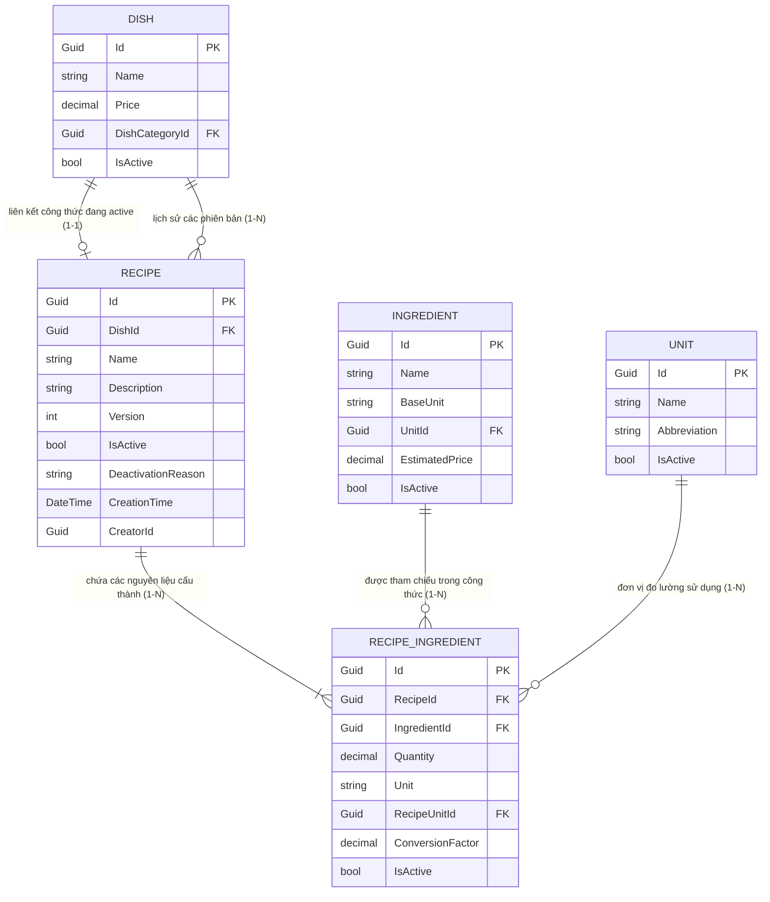

# Mô hình Dữ liệu (Data Model): Quản lý Công thức Món ăn (Recipes) (RM-007)

**Tính năng**: `007-rm-007-recipe-inventory-consumption` — Quản lý Công thức Món ăn (RM-007)  
**Ngày cập nhật**: 2026-10-09  

---

## 1. Sơ đồ Quan hệ Thực thể (Entity Relationship Diagram - ERD)



---

## 2. Chi tiết Thực thể Domain (Domain Entities)

### 2.1. Thực thể Gốc: `Recipe` (Aggregate Root)

- **Lớp cơ sở**: `FullAuditedAggregateRoot<Guid>` (hỗ trợ đầy đủ Soft Delete, CreatorId, CreationTime, LastModifierId, DeleterId).
- **Không gian tên (Namespace)**: `Acme.TooHungry.Recipes`
- **Bảng Cơ sở dữ liệu**: `AppRecipes`

| Tên Thuộc tính | Kiểu Dữ liệu | Bắt buộc | Mặc định | Mô tả & Ràng buộc Nghiệp vụ |
| :--- | :--- | :---: | :---: | :--- |
| `Id` | `Guid` | Có | `GuidGenerator` | Khóa chính duy nhất của công thức. |
| `DishId` | `Guid` | Có | — | Khóa ngoại tham chiếu đến món ăn (`Dish`). |
| `Name` | `string` | Có | — | Tên công thức (tối đa 256 ký tự). Mặc định là *"Công thức [Tên món]"*. |
| `Description` | `string?` | Không | `null` | Mô tả lưu ý chế biến, cách làm (tối đa 2048 ký tự). |
| `Version` | `int` | Có | `1` | Số phiên bản công thức (số nguyên dương >= 1). Tự động tăng khi cập nhật. |
| `IsActive` | `bool` | Có | `true` | Trạng thái hiệu lực của công thức. |
| `DeactivationReason` | `string?` | Có (khi Inactive) | `null` | Lý do tạm ngưng công thức (tối đa 512 ký tự). Bắt buộc khi `IsActive = false`. |
| `Ingredients` | `ICollection<RecipeIngredient>` | Có | `new List<...>()` | Danh sách tập hợp các nguyên liệu cấu thành công thức. |

#### Các Phương thức Nghiệp vụ Chính của Thực thể:
- `void SetName(string name)`: Kiểm tra chuỗi hợp lệ không rỗng, cắt khoảng trắng thừa (`Trim()`).
- `RecipeIngredient AddIngredient(Guid id, Guid ingredientId, decimal quantity, string unit, decimal conversionFactor = 1.0m)`: Thêm mới hoặc cập nhật định lượng nếu nguyên liệu đã tồn tại trong công thức.
- `void RemoveIngredient(Guid ingredientId)`: Xóa một nguyên liệu khỏi công thức.
- `void BumpVersion()`: Tự động nâng phiên bản (`Version += 1`) khi có sửa đổi định lượng.
- `void Deactivate(string reason)`: Tạm ngưng công thức kèm theo lý do bắt buộc.
- `void Reactivate()`: Kích hoạt lại công thức, xóa bỏ lý do tạm ngưng.

---

### 2.2. Thực thể Con: `RecipeIngredient` (Entity)

- **Lớp cơ sở**: `Entity<Guid>`
- **Không gian tên (Namespace)**: `Acme.TooHungry.Recipes`
- **Bảng Cơ sở dữ liệu**: `AppRecipeIngredients`

| Tên Thuộc tính | Kiểu Dữ liệu | Bắt buộc | Mặc định | Mô tả & Ràng buộc Nghiệp vụ |
| :--- | :--- | :---: | :---: | :--- |
| `Id` | `Guid` | Có | `GuidGenerator` | Khóa chính duy nhất của dòng nguyên liệu. |
| `RecipeId` | `Guid` | Có | — | Khóa ngoại tham chiếu đến `Recipe` sở hữu. |
| `IngredientId` | `Guid` | Có | — | Khóa ngoại tham chiếu đến `Ingredient`. |
| `Quantity` | `decimal` | Có | — | Định lượng nguyên liệu cho 1 suất ăn. Ràng buộc: `Quantity > 0` (độ chính xác 18, 4). |
| `Unit` | `string` | Có | — | Tên đơn vị dùng trong công thức (ví dụ: "g", "ml", "Muỗng", tối đa 64 ký tự). |
| `RecipeUnitId` | `Guid?` | Không | `null` | Khóa ngoại tham chiếu đến danh mục đơn vị tính chuẩn `Unit` (RM-004). |
| `ConversionFactor` | `decimal` | Có | `1.0m` | Hệ số quy đổi về `BaseUnit` của nguyên liệu. Ràng buộc: `ConversionFactor > 0` (độ chính xác 18, 6). |
| `IsActive` | `bool` | Có | `true` | Trạng thái sử dụng của dòng nguyên liệu trong công thức. |

#### Các Phương thức Nghiệp vụ Chính:
- `void SetQuantity(decimal quantity)`: Ném lỗi `RecipeIngredient:QuantityMustBePositive` nếu `<= 0`.
- `void SetUnit(string unit)`: Kiểm tra chuỗi đơn vị không rỗng.
- `void SetConversionFactor(decimal conversionFactor)`: Ném lỗi `RecipeIngredient:ConversionFactorMustBePositive` nếu `<= 0`.
- `decimal CalculateBaseQuantity()`: Tính toán định lượng quy đổi: `Quantity * ConversionFactor`.

---

## 3. Các Bất biến & Quy tắc Toàn vẹn Nghiệp vụ (Invariants)

1. **Ràng buộc Duy nhất Active Recipe**: Tại một thời điểm, mỗi món ăn (`DishId`) chỉ được phép có tối đa một công thức ở trạng thái `IsActive = true`.
   - Được bảo đảm bởi phương thức `RecipeManager.CreateAsync`, `RecipeManager.ReactivateAsync`.
   - Ném lỗi nghiệp vụ `Recipe:DishAlreadyHasActiveRecipe` khi vi phạm.
2. **Không trùng lặp Nguyên liệu trong cùng một Công thức**: Trong một `Recipe`, mỗi `IngredientId` chỉ xuất hiện tối đa một lần.
   - Khi người dùng thêm lại nguyên liệu đã có, hệ thống cập nhật lại số lượng và hệ số quy đổi thay vì thêm dòng mới.
3. **Giá trị Số học Dương**:
   - `Quantity > 0`
   - `ConversionFactor > 0`
4. **Bảo toàn Tính Bất biến Lịch sử**: Khi cập nhật định lượng công thức, hệ thống tự động tăng `Version` lên 1. Các đơn hàng POS trong quá khứ giữ nguyên số liệu tiêu hao theo phiên bản tại thời điểm phát sinh.
5. **Ràng buộc Xóa an toàn**:
   - Chặn xóa nguyên liệu tại RM-005 nếu nguyên liệu đang nằm trong ít nhất một công thức.
   - Khi xóa món ăn tại RM-006 (Soft Delete), công thức của món ăn tự động chuyển sang Inactive.

---

## 4. Mô hình Đối tượng Chuyển giao Dữ liệu (DTOs)

### 4.1. `RecipeDto` (Đầy đủ thông tin trả về)
```csharp
public class RecipeDto : FullAuditedEntityDto<Guid>
{
    public Guid DishId { get; set; }
    public string DishName { get; set; } = string.Empty;
    public decimal DishPrice { get; set; }
    public string Name { get; set; } = string.Empty;
    public string? Description { get; set; }
    public int Version { get; set; }
    public bool IsActive { get; set; }
    public string? DeactivationReason { get; set; }
    public decimal TotalEstimatedCost { get; set; }
    public decimal FoodCostPercentage { get; set; }
    public bool HasDeactivatedIngredients { get; set; }
    public List<RecipeIngredientDto> Ingredients { get; set; } = new();
}
```

### 4.2. `RecipeIngredientDto`
```csharp
public class RecipeIngredientDto : EntityDto<Guid>
{
    public Guid RecipeId { get; set; }
    public Guid IngredientId { get; set; }
    public string IngredientName { get; set; } = string.Empty;
    public string BaseUnit { get; set; } = string.Empty;
    public decimal EstimatedPrice { get; set; }
    public decimal Quantity { get; set; }
    public string Unit { get; set; } = string.Empty;
    public Guid? RecipeUnitId { get; set; }
    public decimal ConversionFactor { get; set; }
    public decimal BaseQuantity { get; set; }
    public decimal ItemEstimatedCost { get; set; }
    public bool IsActive { get; set; }
    public bool IsIngredientActive { get; set; }
}
```

### 4.3. `CreateRecipeDto` & `UpdateRecipeDto`
```csharp
public class CreateRecipeDto
{
    public Guid DishId { get; set; }
    public string? Name { get; set; }
    public string? Description { get; set; }
    public List<CreateRecipeIngredientDto> Ingredients { get; set; } = new();
}

public class UpdateRecipeDto
{
    public string? Name { get; set; }
    public string? Description { get; set; }
    public List<CreateRecipeIngredientDto> Ingredients { get; set; } = new();
}

public class CreateRecipeIngredientDto
{
    public Guid IngredientId { get; set; }
    public decimal Quantity { get; set; }
    public string? Unit { get; set; }
    public Guid? RecipeUnitId { get; set; }
    public decimal ConversionFactor { get; set; } = 1.0m;
}

public class DeactivateRecipeDto
{
    public string Reason { get; set; } = string.Empty;
}
```

### 4.4. `RecipeFilterDto` (Bộ lọc và phân trang)
```csharp
public class RecipeFilterDto : PagedAndSortedResultRequestDto
{
    public Guid? DishId { get; set; }
    public Guid? DishCategoryId { get; set; }
    public bool? IsActive { get; set; }
    public string? Filter { get; set; }
}
```
