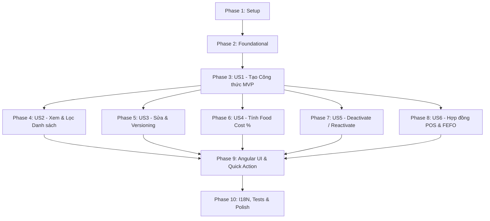

# Danh sách Tác vụ (Tasks): Quản lý Công thức Món ăn (Recipes) (RM-007)

**Tính năng**: `007-rm-007-recipe-inventory-consumption` — Quản lý Công thức Món ăn (RM-007)  
**Tài liệu tham chiếu**: [plan.md](./plan.md) | [spec.md](./spec.md) | [data-model.md](./data-model.md) | [contracts/api-contracts.md](./contracts/api-contracts.md) | [quickstart.md](./quickstart.md)  
**Ngày cập nhật**: 2026-10-09  

---

## Phase 1: Thiết lập & Chuẩn bị (Setup)

**Mục tiêu**: Chuẩn bị môi trường, rà soát phụ thuộc Master Data và cấu hình phân quyền cho module Recipes.

- [x] T001 Xác minh cấu trúc dự án và các phụ thuộc RM-004 (`Units`), RM-005 (`Ingredients`), RM-006 (`Dishes`) theo `specs/007-rm-007-recipe-inventory-consumption/plan.md`
- [x] T002 [P] Khai báo các hằng số phân quyền `TooHungryPermissions.Recipes` (`Default`, `Create`, `Edit`, `Delete`) trong `src/Acme.TooHungry.Application.Contracts/Permissions/TooHungryPermissions.cs`
- [x] T003 [P] Đăng ký định nghĩa quyền hạn Recipes trong `src/Acme.TooHungry.Application.Contracts/Permissions/TooHungryPermissionDefinitionProvider.cs`
- [x] T004 [P] Bổ sung các bản dịch ngôn ngữ ban đầu cho nhóm quyền Recipes trong `src/Acme.TooHungry.Domain.Shared/Localization/TooHungry/vi.json` và `src/Acme.TooHungry.Domain.Shared/Localization/TooHungry/en.json`

**Trạm kiểm tra (Checkpoint)**: Môi trường và quyền hạn ABP đã sẵn sàng cho tầng nghiệp vụ.

---

## Phase 2: Nền tảng Kỹ thuật (Foundational)

**Mục tiêu**: Hoàn thiện cấu trúc Domain Entities, DTOs, Mapping và cấu hình lưu trữ EF Core cho `Recipe` và `RecipeIngredient`.

- [x] T005 [P] Chuẩn hóa Aggregate Root `Recipe` trong `src/Acme.TooHungry.Domain/Recipes/Recipe.cs`:
  - Kế thừa `FullAuditedAggregateRoot<Guid>`
  - Thuộc tính: `DishId`, `Name` (max 256, required), `Description` (max 2048), `Version` (int >= 1), `IsActive` (bool), `DeactivationReason` (max 512, required when `IsActive=false`), `Ingredients: ICollection<RecipeIngredient>`
  - Nghiệp vụ: `SetName`, `AddIngredient`, `RemoveIngredient`, `BumpVersion`, `Deactivate`, `Reactivate`
- [x] T006 [P] Chuẩn hóa Entity `RecipeIngredient` trong `src/Acme.TooHungry.Domain/Recipes/RecipeIngredient.cs`:
  - Kế thừa `Entity<Guid>`
  - Thuộc tính: `RecipeId`, `IngredientId`, `Quantity` (decimal > 0, precision 18, 4), `Unit` (string, max 64), `RecipeUnitId` (Guid?, liên kết RM-004), `ConversionFactor` (decimal > 0, precision 18, 6, default 1.0), `IsActive` (bool)
  - Nghiệp vụ: `SetQuantity`, `SetUnit`, `SetConversionFactor`, `CalculateBaseQuantity`
- [x] T007 [P] Cấu hình Fluent API và DbContext trong `src/Acme.TooHungry.EntityFrameworkCore/EntityFrameworkCore/TooHungryDbContext.cs`:
  - Cấu hình bảng `AppRecipes` và `AppRecipeIngredients`
  - Thiết lập độ chính xác `HasPrecision(18, 4)` cho `Quantity` và `HasPrecision(18, 6)` cho `ConversionFactor`
  - Cấu hình chỉ mục `Index(DishId, IsActive)`
- [x] T008 [P] Chuẩn hóa DTOs trong `src/Acme.TooHungry.Application.Contracts/Recipes/RecipeDtos.cs`:
  - `RecipeDto`, `RecipeIngredientDto`, `CreateRecipeDto`, `UpdateRecipeDto`, `CreateOrUpdateRecipeDto`, `RecipeFilterDto`
- [x] T009 [P] Chuẩn hóa Hợp đồng `IRecipeAppService` trong `src/Acme.TooHungry.Application.Contracts/Recipes/IRecipeAppService.cs`

**Trạm kiểm tra (Checkpoint)**: Nền tảng Domain, DTOs và EF Core hoàn tất, sẵn sàng triển khai từng User Story.

---

## Phase 3: User Story 1 - Khai báo Công thức Món ăn Mới (Ưu tiên: P1) 🎯 MVP

**Mục tiêu**: Bếp trưởng tạo công thức định lượng nguyên liệu cho món ăn, quy đổi về `BaseUnit` qua `ConversionFactor` và chặn trùng active recipe cho cùng 1 món.

### Kiểm thử Tự động (Test-First)
- [x] T010 [P] [US1] Viết Unit Test tạo công thức mới và chặn trùng active recipe trong `test/Acme.TooHungry.Domain.Tests/Recipes/RecipeManager_Tests.cs`
- [x] T011 [P] [US1] Viết Unit Test xác thực tính toán `BaseQuantity = Quantity * ConversionFactor` không làm tròn trung gian trong `test/Acme.TooHungry.Domain.Tests/Recipes/RecipeManager_Tests.cs`

### Triển khai Backend
- [x] T012 [US1] Triển khai phương thức tạo công thức `CreateAsync` trong `src/Acme.TooHungry.Domain/Recipes/RecipeManager.cs` (kiểm tra `Dish` tồn tại, chặn trùng active recipe qua `Recipe:DishAlreadyHasActiveRecipe`, gộp trùng nguyên liệu)
- [x] T013 [US1] Triển khai `CreateAsync` và `CreateOrUpdateAsync` trong `src/Acme.TooHungry.Application/Recipes/RecipeAppService.cs`
- [x] T014 [US1] Ánh xạ endpoint HTTP `POST /api/app/recipe` trong `src/Acme.TooHungry.HttpApi/Controllers/RecipeController.cs` kèm bảo vệ quyền `TooHungryPermissions.Recipes.Create`

**Trạm kiểm tra (Checkpoint)**: MVP hoàn chỉnh - API cho phép tạo công thức định lượng cho món ăn thành công và an toàn.

---

## Phase 4: User Story 2 - Xem Danh sách & Trạng thái Công thức theo Món ăn (Ưu tiên: P1)

**Mục tiêu**: Quản lý xem danh sách toàn bộ món ăn kèm trạng thái đã có/chưa có công thức, lọc theo danh mục món, và tìm kiếm theo tên món.

### Kiểm thử Tự động (Test-First)
- [x] T015 [P] [US2] Viết Integration Test truy vấn danh sách phân trang và lọc trạng thái trong `test/Acme.TooHungry.Application.Tests/Recipes/RecipeAppService_Tests.cs`

### Triển khai Backend
- [x] T016 [US2] Triển khai phương thức `GetListAsync` trong `src/Acme.TooHungry.Application/Recipes/RecipeAppService.cs` hỗ trợ phân trang, sắp xếp, lọc theo `DishId`, `DishCategoryId`, `IsActive`, và tìm kiếm `Filter`
- [x] T017 [US2] Triển khai phương thức `GetAsync` trong `src/Acme.TooHungry.Application/Recipes/RecipeAppService.cs` nạp đầy đủ thông tin `Dish`, `Ingredients`, đơn vị kho cơ sở và giá tham khảo
- [x] T018 [US2] Ánh xạ các endpoint HTTP `GET /api/app/recipe` và `GET /api/app/recipe/{id}` trong `src/Acme.TooHungry.HttpApi/Controllers/RecipeController.cs`

**Trạm kiểm tra (Checkpoint)**: Bảng danh sách và chi tiết công thức hoạt động mượt mà với khả năng lọc đa chiều.

---

## Phase 5: User Story 3 - Chỉnh sửa Công thức & Nâng Phiên bản Tự động (Ưu tiên: P2)

**Mục tiêu**: Bếp trưởng chỉnh sửa định lượng hoặc thành phần công thức, hệ thống tự động tăng `Version` lên 1 và bảo toàn dữ liệu lịch sử cũ.

### Kiểm thử Tự động (Test-First)
- [x] T019 [P] [US3] Viết Unit Test xác thực tự động tăng `Version` khi update công thức trong `test/Acme.TooHungry.Domain.Tests/Recipes/RecipeManager_Tests.cs`
- [x] T020 [P] [US3] Viết Integration Test kiểm tra lịch sử phiên bản `GetHistoryByDishIdAsync` trong `test/Acme.TooHungry.Application.Tests/Recipes/RecipeAppService_Tests.cs`

### Triển khai Backend
- [x] T021 [US3] Hoàn thiện phương thức `UpdateAsync` trong `src/Acme.TooHungry.Domain/Recipes/RecipeManager.cs` tự động gọi `BumpVersion()`, cập nhật thêm/sửa/xóa dòng nguyên liệu
- [x] T022 [US3] Triển khai phương thức `GetHistoryByDishIdAsync` trong `src/Acme.TooHungry.Application/Recipes/RecipeAppService.cs` sắp xếp theo `Version desc`
- [x] T023 [US3] Ánh xạ các endpoint HTTP `PUT /api/app/recipe/{id}` và `GET /api/app/recipe/history/{dishId}` trong `src/Acme.TooHungry.HttpApi/Controllers/RecipeController.cs`

**Trạm kiểm tra (Checkpoint)**: Cơ chế Recipe Versioning hoạt động chính xác, đảm bảo vết kiểm toán lịch sử bất biến.

---

## Phase 6: User Story 4 - Ước tính Chi phí Giá vốn (Food Cost) theo Định lượng (Ưu tiên: P2)

**Mục tiêu**: Hệ thống tự động tính toán tổng chi phí nguyên liệu lý thuyết từ `Ingredient.EstimatedPrice` và tính tỷ lệ Food Cost % so với `Dish.Price`.

### Kiểm thử Tự động (Test-First)
- [x] T024 [P] [US4] Viết Unit Test kiểm tra tính toán tổng giá vốn và tỷ lệ Food Cost % trong `test/Acme.TooHungry.Application.Tests/Recipes/RecipeAppService_Tests.cs`

### Triển khai Backend
- [x] T025 [US4] Cài đặt hàm tính toán `PopulateAdditionalIngredientDataAsync` trong `src/Acme.TooHungry.Application/Recipes/RecipeAppService.cs`:
  - Tính `ItemEstimatedCost = BaseQuantity * EstimatedPrice` cho từng dòng nguyên liệu
  - Tính `TotalEstimatedCost = Sum(ItemEstimatedCost)`
  - Tính `FoodCostPercentage = (TotalEstimatedCost / Dish.Price) * 100` (xử lý an toàn khi `Dish.Price = 0`)
  - Gắn cờ `HasDeactivatedIngredients` nếu có nguyên liệu bị tạm ngưng (`Ingredient.IsActive = false`)

**Trạm kiểm tra (Checkpoint)**: Giá vốn lý thuyết và tỷ lệ Food Cost % được tính toán tự động và chuẩn xác tuyệt đối.

---

## Phase 7: User Story 5 - Vô hiệu hóa và Kích hoạt lại Công thức An toàn (Ưu tiên: P1)

**Mục tiêu**: Quản lý tạm ngưng công thức bắt buộc nhập lý do (`DeactivationReason`), và kích hoạt lại (`Reactivate`) an toàn khi món chưa có công thức active khác.

### Kiểm thử Tự động (Test-First)
- [x] T026 [P] [US5] Viết Unit Test cho vòng đời Deactivate (bắt buộc lý do) và Reactivate (chặn trùng active) trong `test/Acme.TooHungry.Domain.Tests/Recipes/RecipeManager_Tests.cs`

### Triển khai Backend
- [x] T027 [US5] Triển khai `DeactivateAsync` và `ReactivateAsync` trong `src/Acme.TooHungry.Domain/Recipes/RecipeManager.cs`
- [x] T028 [US5] Triển khai `DeactivateAsync` và `ReactivateAsync` trong `src/Acme.TooHungry.Application/Recipes/RecipeAppService.cs`
- [x] T029 [US5] Ánh xạ endpoint HTTP `POST /api/app/recipe/{id}/deactivate` và `POST /api/app/recipe/{id}/reactivate` trong `src/Acme.TooHungry.HttpApi/Controllers/RecipeController.cs`

**Trạm kiểm tra (Checkpoint)**: Vòng đời tạm ngưng và kích hoạt lại công thức được kiểm soát chặt chẽ.

---

## Phase 8: User Story 6 - Hợp đồng Tiêu hao Kho Hạ nguồn cho POS & FEFO (Ưu tiên: P1)

**Mục tiêu**: Cung cấp API chuẩn mực `GetActiveByDishIdAsync` phục vụ cho bán hàng POS (RM-010) và xuất kho FEFO (RM-011).

### Kiểm thử Tự động (Test-First)
- [x] T030 [P] [US6] Viết Integration Test cho `GetActiveByDishIdAsync` (trả về Recipe kèm `BaseQuantity` khi active, trả về `null` khi chưa có hoặc inactive) trong `test/Acme.TooHungry.Application.Tests/Recipes/RecipeAppService_Tests.cs`

### Triển khai Backend
- [x] T031 [US6] Triển khai phương thức `GetActiveByDishIdAsync` trong `src/Acme.TooHungry.Application/Recipes/RecipeAppService.cs` tối ưu truy vấn EF Core (`AsNoTracking`)
- [x] T032 [US6] Ánh xạ endpoint HTTP `GET /api/app/recipe/by-dish/{dishId}` trong `src/Acme.TooHungry.HttpApi/Controllers/RecipeController.cs`

**Trạm kiểm tra (Checkpoint)**: Hợp đồng dữ liệu định lượng cho POS và Kho vận sẵn sàng 100%.

---

## Phase 9: Giao diện Người dùng Angular & Điểm vào (UI/UX) (Ưu tiên: P1)

**Mục tiêu**: Xây dựng màn hình `/recipes`, Modal cấu hình công thức với UI Cam & Trắng, và nút hành động nhanh trên màn hình món ăn `/dishes`.

### Client Proxies & Định tuyến
- [x] T033 [P] [UI] Cập nhật models TypeScript trong `angular/src/app/proxy/recipes/models.ts` đồng bộ với DTOs backend
- [x] T034 [P] [UI] Cập nhật proxy service trong `angular/src/app/proxy/recipes/recipe.service.ts`
- [x] T035 [UI] Cấu hình route `/recipes` với Route Guard bảo vệ quyền `TooHungryPermissions.Recipes.Default` trong `angular/src/app/app.routes.ts` và đăng ký menu sidebar trong `angular/src/app/route.provider.ts`

### Modal Công thức (`RecipeModalComponent`)
- [x] T036 [UI] Hoàn thiện `angular/src/app/recipe/recipe-modal/recipe-modal.component.ts`:
  - Form thêm/sửa công thức với danh sách nguyên liệu động
  - Dropdown chọn nguyên liệu từ RM-005, dropdown chọn đơn vị từ RM-004
  - Tự động hiển thị `BaseUnit`, gợi ý `ConversionFactor`, tính toán tức thời `TotalEstimatedCost` và `FoodCostPercentage`
- [x] T037 [UI] Hoàn thiện template và style trong `angular/src/app/recipe/recipe-modal/recipe-modal.component.html` và `recipe-modal.component.scss` theo phong cách Cam & Trắng (`#EA580C`, `#FFF3E8`, bo góc 12px)

### Màn hình Quản lý Danh sách Công thức (`RecipeComponent`)
- [x] T038 [UI] Hoàn thiện `angular/src/app/recipe/recipe.component.ts`:
  - Tải danh sách món ăn kèm công thức, phân trang, lọc theo danh mục món ăn
  - Lọc theo tab trạng thái: Tất cả / Đã có công thức / Chưa có công thức
  - Xử lý mở modal tạo, sửa, và modal nhập lý do tạm ngưng công thức
- [x] T039 [UI] Hoàn thiện template bảng dữ liệu `SharedTable` trong `angular/src/app/recipe/recipe.component.html` và style `recipe.component.scss`
  - Hiển thị huy hiệu xanh lá *"Đã có công thức"* (kèm số nguyên liệu & v1/v2), huy hiệu cam *"Chưa có công thức"*
  - Hiển thị huy hiệu cảnh báo vàng/cam *"Chứa nguyên liệu tạm ngưng"* khi `hasDeactivatedIngredients = true`

### Điểm vào Thao tác Nhanh trên Màn hình Món ăn (`/dishes`)
- [x] T040 [UI] Thêm nút hành động nhanh `[Công thức]` trên bảng món ăn trong `angular/src/app/dish/dish.component.html` và kết nối mở `RecipeModalComponent` trong `angular/src/app/dish/dish.component.ts`

**Trạm kiểm tra (Checkpoint)**: Toàn bộ trải nghiệm giao diện người dùng liền mạch, đúng chuẩn thiết kế và hỗ trợ 2 điểm vào.

---

## Phase 10: Trau chuốt (Polish), Quốc tế hóa (I18N) & Kiểm chứng Toàn diện

**Mục tiêu**: Đảm bảo 100% song ngữ, kiểm thử tự động toàn diện và kiểm tra kịch bản quickstart.

- [x] T041 [P] Bổ sung đầy đủ 100% các chuỗi văn bản UI, nhãn form, thông điệp lỗi và toaster vào `src/Acme.TooHungry.Domain.Shared/Localization/TooHungry/vi.json`
- [x] T042 [P] Bổ sung đầy đủ 100% các chuỗi văn bản tương ứng vào `src/Acme.TooHungry.Domain.Shared/Localization/TooHungry/en.json`
- [x] T043 [P] Thực thi toàn bộ test suite: `dotnet test --filter "FullyQualifiedName~Recipe"` và xác nhận 100% passed
- [x] T044 Chạy kiểm chứng toàn diện 5 kịch bản trong `specs/007-rm-007-recipe-inventory-consumption/quickstart.md`
- [x] T045 Cập nhật lộ trình phát triển `docs/roadmap.md` chuyển trạng thái RM-007 thành `đang` / `xong`

---

## Phụ thuộc (Dependencies) & Thứ tự Thực thi

### Cơ hội Thực thi Song song (Parallel Opportunities)
- **T002, T003, T004**: Thiết lập phân quyền và i18n permissions có thể chạy song song.
- **T005, T006, T007, T008, T009**: Các tác vụ tầng Domain, EF Core và DTOs có thể thực hiện song song.
- **T010, T011, T015, T019, T020, T024, T026, T030**: Toàn bộ các test suite độc lập có thể được viết song song trước khi triển khai code.
- **T033, T034**: Tạo models và proxy Angular có thể chạy song song.
- **T041, T042**: Cập nhật tệp ngôn ngữ `vi.json` và `en.json` chạy song song.

---

## Chiến lược Triển khai (Implementation Strategy)

1. **MVP Trước tiên**: Hoàn tất Phase 1, Phase 2 và Phase 3 (Tạo công thức, định lượng và quy đổi đơn vị). Dừng lại kiểm chứng độc lập US1.
2. **Gia tăng Tính năng**: Bổ sung tuần tự tra cứu danh sách (US2), versioning (US3), tính giá vốn (US4), vòng đời tạm ngưng (US5), và hợp đồng POS (US6).
3. **Hoàn thiện Trải nghiệm Frontend**: Hoàn tất màn hình `/recipes`, modal động, và nút tắt tiện lợi trên bảng `/dishes`.
4. **Bàn giao Chất lượng**: Rà soát song ngữ i18n 100%, chạy toàn bộ test tự động và cập nhật roadmap.
