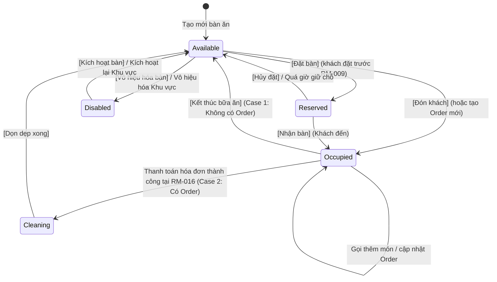

# Mô hình Dữ liệu & Thiết kế Miền: Quản lý Khu vực Ăn uống & Bàn ăn (RM-008)

**Tính năng**: `008-rm-008-dining-areas-and-tables`  
**Ngày**: 2026-10-09  
**Trạng thái**: Đã hoàn thành  

---

## 1. Thực thể Miền (Domain Entities)

### 1.1. DiningArea (Khu vực ăn uống)
- **Tầng**: `Acme.TooHungry.Domain.DiningAreas`
- **Kế thừa**: `FullAuditedAggregateRoot<Guid>` (Hỗ trợ tự động Audit Logs: Created, LastModified, SoftDelete `IsDeleted`)
- **Bảng CSDL**: `AppDiningAreas`

| Tên thuộc tính | Kiểu dữ liệu | Ràng buộc | Mô tả |
| :--- | :--- | :--- | :--- |
| `Id` | `Guid` | Primary Key | Định danh duy nhất của khu vực |
| `Name` | `string` | Required, MaxLength(128) | Tên khu vực (ví dụ: "Tầng 1", "Phòng VIP 1", "Sân vườn") |
| `Description` | `string?` | Nullable, MaxLength(512) | Mô tả chi tiết về đặc điểm không gian |
| `IsActive` | `bool` | Required, Default: `true` | Cờ trạng thái khả dụng. Khi `false`, khu vực ngừng hoạt động |
| `Tables` | `ICollection<RestaurantTable>` | Navigation Property | Danh sách các bàn ăn trực thuộc khu vực này |

---

### 1.2. RestaurantTable (Bàn ăn)
- **Tầng**: `Acme.TooHungry.Domain.Tables`
- **Kế thừa**: `FullAuditedAggregateRoot<Guid>`
- **Bảng CSDL**: `AppTables`

| Tên thuộc tính | Kiểu dữ liệu | Ràng buộc | Mô tả |
| :--- | :--- | :--- | :--- |
| `Id` | `Guid` | Primary Key | Định danh duy nhất của bàn ăn |
| `Name` | `string` | Required, MaxLength(128), **Unique** | Tên hoặc số hiệu bàn (duy nhất toàn hệ thống) |
| `Capacity` | `int` | Required, Range(1, 100), Default: 4 | Sức chứa / Số chỗ ngồi tối đa của bàn |
| `Status` | `TableStatus` | Required, Default: `Available` | Trạng thái vòng đời hiện tại của bàn ăn |
| `DiningAreaId` | `Guid?` | Foreign Key (`AppDiningAreas`) | Mã khu vực ăn uống mà bàn này trực thuộc |
| `DiningArea` | `DiningArea?` | Navigation Property | Đối tượng khu vực ăn uống liên kết |
| `Location` | `string?` | Nullable, MaxLength(128) | Ghi chú vị trí cụ thể (ví dụ: "Gần cửa sổ") |
| `ReservedCustomerName` | `string?` | Nullable, MaxLength(128) | Tên khách hàng đặt trước (tích hợp RM-009) |
| `ReservedCustomerPhone`| `string?` | Nullable, MaxLength(32) | Số điện thoại khách đặt trước |
| `ReservedTime` | `DateTime?` | Nullable | Thời điểm khách hẹn đến |
| `ReservedGuestCount` | `int?` | Nullable | Số lượng khách đặt trước |
| `ReservedNote` | `string?` | Nullable, MaxLength(512) | Ghi chú lịch đặt bàn |
| `Orders` | `ICollection<Order>`| Navigation Property | Danh sách các đơn hàng đã/đang mở tại bàn |

---

## 2. Kiểu Dữ liệu Liệt kê (Enums)

### Trạng thái Bàn ăn (`TableStatus`)
- **Tầng**: `Acme.TooHungry.Domain.Shared.Tables`

```csharp
namespace Acme.TooHungry.Tables;

public enum TableStatus
{
    Available = 0,    // Bàn trống, sẵn sàng đón khách
    Occupied = 1,     // Đang có khách ngồi (kể cả Occupied + No Order)
    Reserved = 2,     // Đã được đặt trước
    Disabled = 3,     // Vô hiệu hóa / Tạm ngưng phục vụ (INACTIVE)
    Cleaning = 4      // Đang dọn dẹp sau khi khách thanh toán rời đi
}
```

---

## 3. Sơ đồ Chuyển đổi Trạng thái Bàn (State Transition Diagram)



---

## 4. Các Ràng buộc & Bất biến Nghiệp vụ (Domain Invariants & Rules)

1. **Bất biến Tên duy nhất toàn hệ thống**: Tên bàn ăn `RestaurantTable.Name` phải là duy nhất trên toàn bộ cơ sở dữ liệu `AppTables`. Trùng tên sẽ bị chặn bởi cả Validation tầng Service và Unique Index tại Database.
2. **Bất biến Sức chứa**: `Capacity` bắt buộc phải là số nguyên dương $\ge 1$ và $\le 100$.
3. **Bất biến Vô hiệu hóa Khu vực**:
   - Chỉ được phép vô hiệu hóa (`IsActive = false`) khi không có bàn nào trong khu vực đang ở trạng thái `Occupied` hoặc có đơn hàng chưa đóng.
   - Khi `DiningArea.IsActive` chuyển thành `false`, toàn bộ bàn trực thuộc tự động chuyển sang trạng thái `Disabled` (`INACTIVE`).
   - Trên giao diện `/waiter/tables`, các khu vực có `IsActive = false` hoàn toàn bị ẩn khỏi thanh tab của nhân viên phục vụ.
4. **Bất biến Xóa Bàn**:
   - Bàn đang ở trạng thái `Occupied` hoặc đang có đơn hàng mở (`Order.Status != Completed && Order.Status != Cancelled`) tuyệt đối KHÔNG được phép xóa.
5. **Bất biến Bảo toàn Trạng thái Bàn khi Thanh toán**:
   - Khi nhân viên bấm `[Kết thúc bữa ăn]` cho bàn có Order và chuyển hướng sang màn hình Thanh toán (RM-016), trạng thái bàn **vẫn duy trì `Occupied`** cho tới khi sự kiện thanh toán thành công phát ra mới tự động đổi sang `Cleaning`.
6. **Bất biến Kiểm soát Xung đột Đồng thời (Atomic Check)**:
   - Thao tác đổi trạng thái bàn phải kiểm tra trạng thái kỳ vọng (`expectedCurrentStatus`). Nếu trạng thái thực tế trong database đã bị thay đổi, hệ thống từ chối cập nhật và trả thông báo xung đột.
