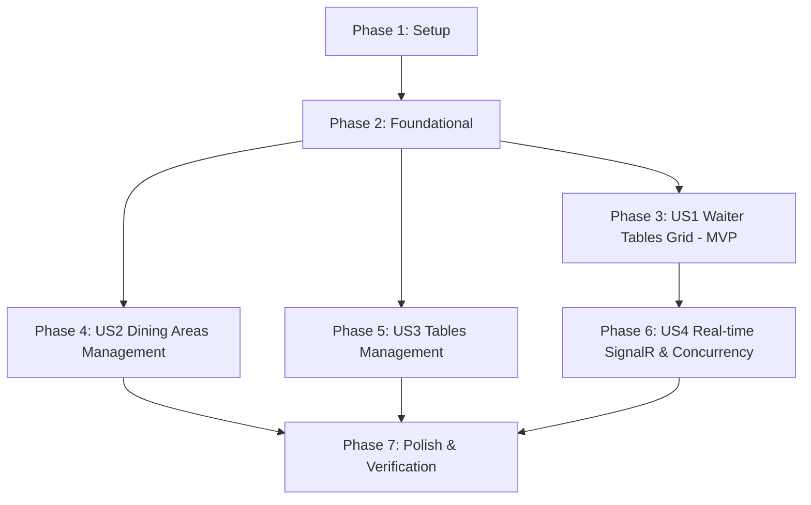

# Tác vụ Triển khai (Tasks): Quản lý Khu vực Ăn uống & Bàn ăn (RM-008)

**Nhánh Tính năng**: `008-rm-008-dining-areas-and-tables` | **Ngày**: 2026-10-09  
**Đặc tả**: [spec.md](spec.md) | **Kế hoạch**: [plan.md](plan.md)  

---

## Phase 1: Thiết lập & Cơ sở Hạ tầng Dùng chung (Setup)

**Mục đích**: Cài đặt các gói phụ thuộc và chuẩn hóa các kiểu dữ liệu, enum dùng chung trong toàn hệ thống.

- [x] T001 [P] Kiểm tra và cấu hình gói `Volo.Abp.AspNetCore.SignalR` trong `src/Acme.TooHungry.HttpApi.Host/Acme.TooHungry.HttpApi.Host.csproj`
- [x] T002 [P] Kiểm tra thư viện `@microsoft/signalr` trong `angular/package.json`
- [x] T003 [P] Chuẩn hóa enum `TableStatus` (Available = 0, Occupied = 1, Reserved = 2, Disabled = 3, Cleaning = 4) trong `src/Acme.TooHungry.Domain.Shared/Tables/TableStatus.cs`

---

## Phase 2: Nền tảng (Foundational - Database, Permissions & Contracts)

**Mục đích**: Xây dựng hạ tầng cơ sở dữ liệu, phân quyền và hợp đồng giao tiếp làm điều kiện tiên quyết cho tất cả các User Stories.

- [x] T004 [P] Định nghĩa các quyền hạn `DiningAreas.Manage`, `Tables.Manage`, `Tables.UpdateStatus` trong `src/Acme.TooHungry.Application.Contracts/Permissions/TooHungryPermissions.cs` và `src/Acme.TooHungry.Application.Contracts/Permissions/TooHungryPermissionDefinitionProvider.cs`
- [x] T005 [P] Cập nhật thực thể `DiningArea` với thuộc tính `IsActive` (bool, default true) trong `src/Acme.TooHungry.Domain/DiningAreas/DiningArea.cs`
- [x] T006 [P] Cấu hình ánh xạ EF Core (cột `IsActive` bảng `AppDiningAreas` và Unique Index `Name` bảng `AppTables`) trong `src/Acme.TooHungry.EntityFrameworkCore/EntityFrameworkCore/TooHungryDbContext.cs`
- [x] T007 Tạo EF Core Migration và xác thực đồng bộ cơ sở dữ liệu qua `src/Acme.TooHungry.DbMigrator/Program.cs`
- [x] T008 [P] Định nghĩa interface `ITableRealtimeNotifier` và DTO `TableStatusChangedDto` trong `src/Acme.TooHungry.Application.Contracts/Tables/ITableRealtimeNotifier.cs`
- [x] T009 [P] Khai báo DTOs cho Khu vực ăn uống (`DiningAreaDto`, `CreateUpdateDiningAreaDto`, `GetDiningAreasInput`) trong `src/Acme.TooHungry.Application.Contracts/DiningAreas/DiningAreaDtos.cs`
- [x] T010 [P] Khai báo DTOs cho Bàn ăn (`TableDto`, `CreateUpdateTableDto`, `GetTablesInput`, `ChangeTableStatusDto`) trong `src/Acme.TooHungry.Application.Contracts/Tables/TableDtos.cs`

**Trạm kiểm tra (Checkpoint)**: Nền tảng CSDL, phân quyền và DTOs đã sẵn sàng – có thể tiến hành phát triển User Story 1 (MVP).

---

## Phase 3: User Story 1 - Vận hành Sơ đồ Bàn chuyên biệt cho Waiter (`/waiter/tables`) (Priority: P1) 🎯 MVP

**Mục tiêu**: Cung cấp giao diện `/waiter/tables` dạng Card Grid chuẩn 4 thẻ trên mỗi hàng, hỗ trợ 5 trạng thái bàn (`AVAILABLE`, `OCCUPIED`, `RESERVED`, `CLEANING`, `INACTIVE`), bộ lọc tab khu vực hoạt động, nhóm nút hành động theo ngữ cảnh (đón khách tức thì, đặt bàn, vô hiệu hóa/kích hoạt bàn, chuyển order, kết thúc bữa ăn 2 nhánh, dọn dẹp xong).

**Kiểm thử Độc lập**: Truy cập `/waiter/tables`, duyệt danh sách bàn dạng lưới 4 thẻ/hàng, lọc theo tab tầng/khu vực; thực hiện đón khách (`AVAILABLE` → `OCCUPIED`), kết thúc bữa ăn không có món (`OCCUPIED` → `AVAILABLE`), hoặc hoàn tất dọn dẹp (`CLEANING` → `AVAILABLE`).

### Kiểm thử cho User Story 1 (TDD)
- [x] T011 [P] [US1] Viết Integration Tests kiểm tra logic chuyển đổi trạng thái bàn và kiểm tra trạng thái hợp lệ `OCCUPIED + No Order` trong `test/Acme.TooHungry.Application.Tests/Tables/TableAppService_Status_Tests.cs`

### Triển khai User Story 1
- [x] T012 [P] [US1] Triển khai phương thức `ChangeStatusAsync` và `SetAreaTablesStatusAsync` trong `src/Acme.TooHungry.Application/Tables/TableAppService.cs`
- [x] T013 [P] [US1] Định nghĩa và cấu hình routing `/waiter/tables` trong `angular/src/app/app.routes.ts`
- [x] T014 [US1] Xây dựng component TypeScript `WaiterTablesComponent` quản lý state danh sách bàn, bộ lọc tab khu vực hoạt động và các action handler trong `angular/src/app/waiter/tables/waiter-tables.component.ts`
- [x] T015 [US1] Xây dựng template HTML `waiter-tables.component.html` với bố cục Card Grid chuẩn 4 thẻ/hàng, status badges (5 trạng thái) và nhóm nút hành động theo ngữ cảnh trong `angular/src/app/waiter/tables/waiter-tables.component.html`
- [x] T016 [US1] Thiết kế phong cách giao diện SCSS Cam & Trắng đặc trưng (Orange & White Theme) cho thẻ bàn, badges mã màu và hiệu ứng micro-animations trong `angular/src/app/waiter/tables/waiter-tables.component.scss`
- [x] T017 [US1] Cài đặt dialog xác nhận Kết thúc bữa ăn 2 nhánh (Case 1: không có order -> dialog xác nhận giải phóng bàn về `AVAILABLE`; Case 2: có order -> dialog xác nhận điều hướng sang `/payment/:orderId`) trong `angular/src/app/waiter/tables/waiter-tables.component.ts`
- [x] T018 [US1] Định nghĩa 100% các chuỗi ngôn ngữ (nút bấm, nhãn trạng thái, dialog xác nhận) trong `src/Acme.TooHungry.Domain.Shared/Localization/TooHungry/vi.json` và `en.json`

**Trạm kiểm tra (Checkpoint)**: User Story 1 hoàn tất đầy đủ chức năng và có thể kiểm thử độc lập – đạt mốc MVP cốt lõi.

---

## Phase 4: User Story 2 - Quản lý Cấu hình Khu vực Ăn uống (Dining Areas) (Priority: P2)

**Mục tiêu**: Cho phép Quản lý tạo mới, cập nhật thông tin, kích hoạt hoặc vô hiệu hóa mềm khu vực ăn uống; chặn xóa cứng và chặn vô hiệu hóa khi có bàn đang phục vụ khách.

**Kiểm thử Độc lập**: Quản lý tạo khu vực "Sân vườn", bấm vô hiệu hóa khu vực -> hệ thống cập nhật `IsActive = false` và chuyển toàn bộ bàn bên trong sang `INACTIVE`. Khi có bàn `OCCUPIED`, thao tác vô hiệu hóa bị chặn lại.

### Kiểm thử cho User Story 2 (TDD)
- [x] T019 [P] [US2] Viết Integration Tests kiểm tra quy tắc tạo, sửa, vô hiệu hóa khu vực và chặn vô hiệu hóa khi có bàn đang phục vụ khách trong `test/Acme.TooHungry.Application.Tests/DiningAreas/DiningAreaAppService_Tests.cs`

### Triển khai User Story 2
- [x] T020 [P] [US2] Khai báo các phương thức `GetLookupAsync`, `DeactivateAsync`, `ActivateAsync` trong `src/Acme.TooHungry.Application.Contracts/DiningAreas/IDiningAreaAppService.cs`
- [x] T021 [US2] Cài đặt `DiningAreaAppService` (xử lý `DeactivateAsync` kiểm tra bàn có khách, cập nhật bàn sang `Disabled`, `ActivateAsync`, `GetLookupAsync`) trong `src/Acme.TooHungry.Application/DiningAreas/DiningAreaAppService.cs`
- [x] T022 [US2] Cập nhật giao diện Quản lý Khu vực Angular: bảng danh sách khu vực `SharedTable`, nút Kích hoạt / Vô hiệu hóa và modal cảnh báo trong `angular/src/app/dining-area/dining-area.component.ts` và `angular/src/app/dining-area/dining-area.component.html`
- [x] T023 [US2] Bổ sung bản dịch đa ngôn ngữ cho chức năng quản lý khu vực trong `src/Acme.TooHungry.Domain.Shared/Localization/TooHungry/vi.json` và `en.json`

**Trạm kiểm tra (Checkpoint)**: User Story 2 hoàn tất độc lập và kiểm thử thành công.

---

## Phase 5: User Story 3 - Thiết lập & Quản lý Danh mục Bàn ăn (Restaurant Tables) (Priority: P2)

**Mục tiêu**: Quản lý thêm mới bàn ăn, chỉnh sửa thông tin bàn, sức chứa (1-100), ràng buộc tên bàn duy nhất toàn hệ thống và chặn xóa bàn khi bàn đang có khách hoặc order mở.

**Kiểm thử Độc lập**: Tạo bàn "Bàn 01" với sức chứa 4; thử tạo bàn khác cùng tên "Bàn 01" -> hệ thống từ chối do trùng tên; thử xóa bàn đang `OCCUPIED` -> hệ thống chặn thao tác xóa.

### Kiểm thử cho User Story 3 (TDD)
- [x] T024 [P] [US3] Viết Integration Tests kiểm tra tính duy nhất toàn hệ thống của tên bàn và chặn xóa bàn khi có khách/order mở trong `test/Acme.TooHungry.Application.Tests/Tables/TableAppService_Tests.cs`

### Triển khai User Story 3
- [x] T025 [P] [US3] Khai báo các phương thức CRUD bàn ăn trong `src/Acme.TooHungry.Application.Contracts/Tables/ITableAppService.cs`
- [x] T026 [US3] Cài đặt `TableAppService` (kiểm tra tên bàn duy nhất qua Domain Exception, kiểm soát xóa bàn an toàn, lọc theo khu vực/trạng thái) trong `src/Acme.TooHungry.Application/Tables/TableAppService.cs`
- [x] T027 [US3] Cập nhật giao diện Quản trị Bàn ăn Angular: bảng CRUD, modal tạo/sửa bàn, dropdown chọn khu vực đang hoạt động (`IsActive = true`) trong `angular/src/app/table/table.component.ts` và `angular/src/app/table/table.component.html`
- [x] T028 [US3] Bổ sung bản dịch đa ngôn ngữ cho chức năng cấu hình bàn ăn trong `src/Acme.TooHungry.Domain.Shared/Localization/TooHungry/vi.json` và `en.json`

**Trạm kiểm tra (Checkpoint)**: User Story 1, 2 và 3 kết hợp hoạt động hoàn chỉnh, đáp ứng trọn vẹn cả luồng vận hành của Waiter lẫn cấu hình của Manager.

---

## Phase 6: User Story 4 - Đồng bộ Thời gian thực & Kiểm soát Xung đột Đồng thời (Priority: P3)

**Mục tiêu**: Cập nhật tức thì trạng thái bàn trên `/waiter/tables` qua SignalR khi có sự thay đổi từ thiết bị khác hoặc từ module Order/Payment; xử lý xung đột cạnh tranh (Concurrency Conflict) theo cơ chế Atomic Status Check.

**Kiểm thử Độc lập**: Mở hai cửa sổ `/waiter/tables`; cửa sổ 1 bấm đón khách, cửa sổ 2 tự động chuyển màu đỏ trong vòng dưới 1 giây mà không cần F5; khi cả hai cửa sổ cùng thao tác trên 1 bàn thì cửa sổ thao tác sau nhận thông báo lỗi giải thích và tự cập nhật thẻ bàn.

### Triển khai User Story 4
- [x] T029 [P] [US4] Cài đặt `TableHub : AbpHub` tại endpoint `/signalr-hubs/table` trong `src/Acme.TooHungry.HttpApi.Host/Hubs/TableHub.cs`
- [x] T030 [P] [US4] Triển khai `SignalRTableRealtimeNotifier : ITableRealtimeNotifier` phát sự kiện `TableStatusChanged` qua `IHubContext<TableHub>` trong `src/Acme.TooHungry.HttpApi.Host/Realtime/SignalRTableRealtimeNotifier.cs`
- [x] T031 [US4] Cấu hình nạp SignalR Hub và đăng ký `SignalRTableRealtimeNotifier` trong `src/Acme.TooHungry.HttpApi.Host/TooHungryHttpApiHostModule.cs`
- [x] T032 [US4] Bổ sung kiểm tra nguyên tử (Atomic Status Check) trong `TableAppService.ChangeStatusAsync` và ném mã lỗi nghiệp vụ khi xảy ra xung đột đồng thời trong `src/Acme.TooHungry.Application/Tables/TableAppService.cs`
- [x] T033 [US4] Xây dựng service Angular `TableSignalrService` duy trì kết nối WebSocket, tự động kết nối lại và phát luồng Observable sự kiện trong `angular/src/app/shared/services/table-signalr.service.ts`
- [x] T034 [US4] Tích hợp `TableSignalrService` vào `WaiterTablesComponent` để cập nhật trực tiếp state thẻ bàn khi nhận sự kiện `TableStatusChanged` trong `angular/src/app/waiter/tables/waiter-tables.component.ts`

**Trạm kiểm tra (Checkpoint)**: Hệ thống đồng bộ thời gian thực mượt mà và kiểm soát xung đột đồng thời an toàn 100%.

---

## Phase 7: Hoàn thiện (Polish) & Cross-Cutting Concerns

**Mục đích**: Hoàn thiện kiểm thử hồi quy toàn diện, rà soát chuẩn thiết kế Cam & Trắng và cập nhật tài liệu lộ trình dự án.

- [x] T035 [P] Chạy toàn bộ kiểm thử tự động của solution (`dotnet test`) đảm bảo 100% test case PASS
- [x] T036 Thực hiện kiểm thử thủ công E2E theo kịch bản trong `specs/008-rm-008-dining-areas-and-tables/quickstart.md`
- [x] T037 [P] Kiểm tra tính nhất quán của bộ nhận diện Cam & Trắng (màu sắc, border-radius, hiệu ứng hover, responsive 4 cards) trên các trình duyệt Desktop và Tablet
- [x] T038 Đồng bộ trạng thái tính năng RM-008 trong `docs/roadmap.md`

---

## Phụ thuộc (Dependencies) & Thứ tự Thực thi

### Phụ thuộc giữa các Phase
- **Setup (Phase 1)**: Không phụ thuộc – thực thi ngay.
- **Foundational (Phase 2)**: Phụ thuộc Phase 1 – CHẶN (BLOCKS) tất cả các User Story.
- **User Story 1 (Phase 3 - MVP)**: Phụ thuộc Phase 2 – có thể phát triển và kiểm thử độc lập ngay.
- **User Story 2 (Phase 4)** & **User Story 3 (Phase 5)**: Phụ thuộc Phase 2 – có thể thực hiện song song với US1.
- **User Story 4 (Phase 6)**: Phụ thuộc US1 (cần UI thẻ bàn để gắn luồng SignalR và kiểm tra xung đột).
- **Polish (Phase 7)**: Thực thi sau khi hoàn tất các User Story.

---

## Tóm tắt Kế hoạch Triển khai (Implementation Summary)

- **Tổng số tác vụ**: 38 tác vụ (T001 $\rightarrow$ T038).
- **Tác vụ phân theo User Story**:
  - Setup (Phase 1): 3 tác vụ (T001 - T003)
  - Foundational (Phase 2): 7 tác vụ (T004 - T010)
  - **US1 - Waiter Tables Grid (Phase 3 - MVP)**: 8 tác vụ (T011 - T018)
  - **US2 - Dining Areas Management (Phase 4)**: 5 tác vụ (T019 - T023)
  - **US3 - Tables Management (Phase 5)**: 5 tác vụ (T024 - T028)
  - **US4 - Real-time SignalR & Concurrency (Phase 6)**: 6 tác vụ (T029 - T034)
  - Polish & Verification (Phase 7): 4 tác vụ (T035 - T038)
- **Cơ hội thực thi song song**: 17 tác vụ được đánh dấu `[P]`.
- **Phạm vi MVP Khuyến nghị**: Hoàn thành Phase 1 + Phase 2 + Phase 3 (US1: Màn hình vận hành `/waiter/tables` với Card Grid 4 cột và 5 trạng thái bàn).
