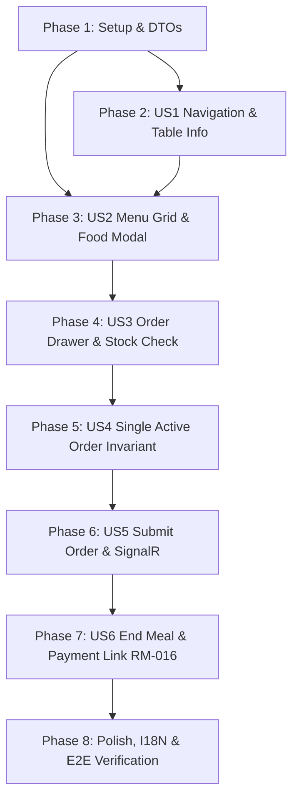

# Danh sách Công việc Triển khai (Tasks): RM-010 POS / Đơn hàng

**Tính năng**: `RM-010 — POS / Đơn hàng (POS Ordering & Dining Session Management)`  
**Nhánh (Branch)**: `010-rm-010-pos-ordering-and-billing` | **Ngày**: 2026-10-09  
**Đặc tả (Spec)**: [spec.md](spec.md) | **Kế hoạch (Plan)**: [plan.md](plan.md)

---

## Phase 1: Thiết lập & Nền tảng Dùng chung (Setup & Foundation)

**Mục tiêu**: Chuẩn bị các hợp đồng DTO, cấu hình filtered unique index, và tín hiệu SignalR nền tảng cho phân hệ POS / Đơn hàng.

- [x] T001 [P] Định nghĩa các DTOs (`SubmitOrderInputDto`, `SubmitOrderItemDto`, `CancelOrderInputDto`, `ValidateOrderStockInputDto`, `StockValidationResultDto`, `StockShortageItemDto`) và cập nhật `IOrderAppService` trong `src/Acme.TooHungry.Application.Contracts/Orders/OrderDtos.cs` và `IOrderAppService.cs`
- [x] T002 [P] Bổ sung quyền phân hệ đơn hàng nếu cần trong `src/Acme.TooHungry.Application.Contracts/Permissions/TooHungryPermissions.cs`
- [x] T003 Cấu hình Filtered Unique Index trên `TableId` cho các đơn hàng `Pending` (`[Status] = 0 AND [IsDeleted] = 0`) trong `src/Acme.TooHungry.EntityFrameworkCore/EntityFrameworkCore/TooHungryDbContext.cs`
- [x] T004 [P] Bổ sung phương thức `NotifyTableOrderUpdatedAsync(Guid tableId, bool hasActiveOrder, Guid? orderId)` vào `ITableRealtimeNotifier` và cài đặt trong `src/Acme.TooHungry.Application/Tables/TableRealtimeNotifier.cs` và `TableHub.cs`
- [x] T005 [P] Bổ sung bộ từ điển song ngữ i18n cho toàn bộ nhãn, thông báo và modal của module POS Order trong `src/Acme.TooHungry.Domain.Shared/Localization/TooHungry/en.json` và `vi.json`

**Trạm kiểm tra (Checkpoint)**: Nền tảng backend, DTOs và cấu hình database đã sẵn sàng cho các User Stories.

---

## Phase 2: User Story 1 - Điều hướng Gọi món & Định vị Bàn ăn cho Waiter (Priority: P1) 🎯 MVP Core

**Mục tiêu**: Cung cấp tuyến đường `/waiter/order/:tableId`, nạp thông tin bàn ăn hiển thị Table Information Card ở đầu Sidebar (Tên bàn, Sức chứa, Trạng thái `OCCUPIED`), danh mục món mở rộng và Header điều hướng.  
**Kiểm thử Độc lập**: Bấm `[Order]` trên bàn `OCCUPIED` tại `/waiter/tables` $\rightarrow$ điều hướng sang `/waiter/order/:tableId`, Sidebar hiển thị đúng tên bàn và sức chứa, Header có nút Back và nút Giỏ hàng.

### Kiểm thử cho User Story 1 (TDD)
- [x] T006 [P] [US1] Viết Unit Tests kiểm tra điều phối và nạp thông tin bàn ăn cho trang Order trong `test/Acme.TooHungry.Application.Tests/Orders/OrderAppService_TableInfo_Tests.cs`

### Triển khai User Story 1
- [x] T007 [P] [US1] Đăng ký Route `/waiter/order/:tableId` với `authGuard` và `smartPermissionGuard` trong `angular/src/app/app.routes.ts`
- [x] T008 [US1] Cập nhật phương thức `goToOrder(table)` trong `angular/src/app/waiter/tables/waiter-tables.component.ts` để điều hướng trực tiếp sang `/waiter/order/${table.id}`
- [x] T009 [US1] Khởi tạo component `WaiterOrderComponent` tại `angular/src/app/waiter/order/waiter-order.component.ts`, `.html`, `.scss`:
  - Khai báo Header Card: Tiêu đề, nút `[← Back]` quay về `/waiter/tables` và nút `[🛒]` giỏ hàng kèm badge số lượng
  - Khai báo Sidebar Trái: **Table Information Card** (Tên bàn, Sức chứa, Badge `OCCUPIED`) ở đầu trang; bên dưới là Menu Categories mở rộng mặc định

**Trạm kiểm tra (Checkpoint)**: Waiter có thể điều hướng mượt mà từ sơ đồ bàn sang trang gọi món và định vị chính xác bàn đang phục vụ.

---

## Phase 3: User Story 2 - Duyệt Thực đơn, Xem Chi tiết & Thêm Món vào Giỏ (Priority: P1) 🎯 MVP Core

**Mục tiêu**: Bố cục lưới thực đơn 3 Food Cards trên mỗi hàng (ảnh vuông nền đen, tên món, giá, nút đặt nhanh góc trên phải), thanh tìm kiếm nhanh, và Food Detail Modal xem chi tiết kèm ô nhập ghi chú món ăn.  
**Kiểm thử Độc lập**: Duyệt món ăn dạng lưới 3 cột, gõ tìm kiếm theo tên, bấm vào thẻ món mở Food Detail Modal nhập ghi chú, bấm nút đặt món $\rightarrow$ món được thêm vào giỏ, badge giỏ hàng tăng số lượng.

### Kiểm thử cho User Story 2
- [x] T010 [P] [US2] Viết Integration Tests kiểm tra truy vấn danh mục món và danh sách món khả dụng cho POS trong `test/Acme.TooHungry.Application.Tests/Dishes/DishAppService_PosMenu_Tests.cs`

### Triển khai User Story 2
- [x] T011 [US2] Triển khai giao diện Lưới thực đơn trong `angular/src/app/waiter/order/waiter-order.component.html` và `.scss`:
  - Thanh tìm kiếm nhanh client-side ở đầu lưới (lọc realtime theo tên món kết hợp danh mục món đã chọn)
  - Lưới 3 Food Cards / hàng chuẩn responsive
  - Food Card: Khung ảnh vuông nền đen, Tên món, Giá bán màu cam, Nút đặt nhanh `[+]` ở góc trên bên phải
- [x] T012 [US2] Xây dựng **Food Detail Modal** trong `waiter-order.component.html`:
  - Hiển thị ảnh lớn, tên món, mô tả chi tiết, giá bán
  - Ô nhập Ghi chú chế biến (`Item Note`) cho món
  - Nút đóng `[X]` và nút `[Đặt món]` thêm món kèm ghi chú vào giỏ hàng
- [x] T013 [US2] Xử lý logic thêm món trong `waiter-order.component.ts`: bấm nút đặt nhanh hoặc bấm nút trong modal $\rightarrow$ thêm món vào signal giỏ hàng, cập nhật badge `[🛒]`

**Trạm kiểm tra (Checkpoint)**: Nhân viên phục vụ có thể tìm kiếm, duyệt thực đơn và thêm món ăn kèm ghi chú vào giỏ hàng mượt mà.

---

## Phase 4: User Story 3 - Quản lý Giỏ hàng (Order Drawer) & Kiểm tra Tồn kho Công thức (Priority: P1) 🎯 MVP Core

**Mục tiêu**: Ngăn kéo giỏ hàng trượt ra từ bên phải màn hình khi bấm `[🛒]`, hiển thị danh sách món, cho phép tăng/giảm/xóa món, sửa ghi chú từng món, tự động kiểm tra tồn kho theo công thức (Recipe Validation) và chặn tăng số lượng nếu không đủ nguyên liệu.  
**Kiểm thử Độc lập**: Mở Order Drawer, bấm `[+]` tăng số lượng món: nếu đủ nguyên liệu trong kho thì cho phép tăng và tính lại tiền; nếu thiếu nguyên liệu thì cảnh báo và chặn lại (tuyệt đối không cho âm kho).

### Kiểm thử cho User Story 3 (TDD)
- [x] T014 [P] [US3] Viết Unit Tests kiểm tra logic đối chiếu định lượng Recipe với tồn kho nguyên liệu khả dụng trong `test/Acme.TooHungry.Application.Tests/Orders/OrderAppService_StockValidation_Tests.cs`

### Triển khai User Story 3
- [x] T015 [US3] Cài đặt endpoint `ValidateStockAsync` trong `src/Acme.TooHungry.Application/Orders/OrderAppService.cs`: đối chiếu số lượng món yêu cầu với `Recipe` đang active và `Inventory.CurrentStock`, trả về danh sách thiếu hụt nếu có
- [x] T016 [US3] Xây dựng giao diện **Order Drawer** trong `angular/src/app/waiter/order/waiter-order.component.html` và `.scss`:
  - Hiệu ứng trượt mượt mà từ mép phải (`slide-over drawer`)
  - Danh sách từng dòng món: Tên, đơn giá, nút `[-]`, ô số lượng, nút `[+]`, thành tiền
  - Ô nhập ghi chú chế biến có thể chỉnh sửa trực tiếp dưới mỗi dòng món
  - Nút xóa món (biểu tượng thùng rác)
  - Tổng tiền toàn đơn hiển thị nổi bật ở chân Drawer
- [x] T017 [US3] Tích hợp logic kiểm tra tồn kho tức thời (Instant Stock Check) trong `waiter-order.component.ts`: khi bấm `[+]`, gọi kiểm tra kho; nếu thiếu nguyên liệu hiển thị Toast cảnh báo và chặn tăng số lượng

**Trạm kiểm tra (Checkpoint)**: Order Drawer hoạt động hoàn chỉnh, tính toán chính xác tiền và bảo vệ kho nguyên liệu tuyệt đối không bị âm.

---

## Phase 5: User Story 4 - Quy tắc Active Order Duy nhất & Tiếp tục Gọi món (Priority: P1) 🎯 MVP Core

**Mục tiêu**: Đảm bảo một bàn `OCCUPIED` chỉ có duy nhất một đơn hàng ở trạng thái `PENDING` trong suốt phiên ăn. Khi vào lại bàn, tự động nạp lại toàn bộ đơn này để tiếp tục gọi món (`Continue Order`) mà không tạo đơn mới.  
**Kiểm thử Độc lập**: Bàn 05 có đơn PENDING, Waiter thoát ra rồi bấm lại `[Order]` $\rightarrow$ nạp lại toàn bộ món đã gọi; thêm món mới và lưu $\rightarrow$ cập nhật vào đúng mã Order cũ, không tạo mã mới.

### Kiểm thử cho User Story 4 (TDD)
- [x] T018 [P] [US4] Viết Integration Tests kiểm tra quy tắc một Active Order duy nhất và luồng nạp lại đơn hàng `PENDING` trong `test/Acme.TooHungry.Application.Tests/Orders/OrderAppService_ActiveOrder_Tests.cs`

### Triển khai User Story 4
- [x] T019 [US4] Tối ưu hóa endpoint `GetActiveOrderByTableIdAsync` trong `src/Acme.TooHungry.Application/Orders/OrderAppService.cs` để tải toàn bộ `Items` (kèm `DishName`, `DishPhotoUrl`, `Note`, `UnitPrice`) của đơn `PENDING` theo `TableId`
- [x] T020 [US4] Tích hợp logic khởi tạo trong `angular/src/app/waiter/order/waiter-order.component.ts`: khi load trang theo `tableId`, tự động gọi `getActiveOrderByTableId`; nếu có đơn `PENDING` thì map dữ liệu vào giỏ hàng (`Continue Order`) và lưu giữ `activeOrderId`

**Trạm kiểm tra (Checkpoint)**: Hoàn tất bất biến dữ liệu Active Order duy nhất và tính năng gọi bổ sung món xuyên suốt phiên ăn.

---

## Phase 6: User Story 5 - Xác nhận Đơn hàng (`Submit / Update Order`) & Rời Trang (Priority: P1) 🎯 MVP Core

**Mục tiêu**: Bấm `[Đặt đơn]` kiểm tra giỏ hàng không rỗng, validate kho, lưu/cập nhật đơn PENDING, phát tín hiệu SignalR cập nhật sơ đồ bàn; cung cấp nút `[Hủy đơn hàng]` đưa đơn về `CANCELLED`; cảnh báo thay đổi chưa lưu khi bấm Back.  
**Kiểm thử Độc lập**: Giỏ hàng có 2 món, bấm `[Đặt đơn]` $\rightarrow$ lưu thành công, thông báo Toast, quay về `/waiter/tables` thấy biểu tượng đơn hàng xanh; bấm Back khi chưa lưu $\rightarrow$ hiển thị modal cảnh báo xác nhận.

### Kiểm thử cho User Story 5 (TDD)
- [x] T021 [P] [US5] Viết Integration Tests kiểm tra `SubmitOrderAsync` (tạo mới/cập nhật) và `CancelOrderAsync` trong `test/Acme.TooHungry.Application.Tests/Orders/OrderAppService_SubmitOrder_Tests.cs`

### Triển khai User Story 5
- [x] T022 [US5] Cài đặt endpoint `SubmitOrderAsync` trong `src/Acme.TooHungry.Application/Orders/OrderAppService.cs`:
  - Kiểm tra `Items.Count >= 1` (chặn đơn rỗng)
  - Validate tồn kho nguyên liệu theo Recipe
  - Tạo mới đơn `PENDING` (nếu chưa có) hoặc cập nhật `Items` của đơn `PENDING` hiện tại
  - Cập nhật trạng thái bàn sang `OCCUPIED` (nếu chưa phải)
  - Gọi `_realtimeNotifier.NotifyTableOrderUpdatedAsync(table.Id, true, order.Id)`
- [x] T023 [US5] Cài đặt endpoint `CancelOrderAsync` trong `src/Acme.TooHungry.Application/Orders/OrderAppService.cs`: chuyển đơn sang `CANCELLED`, gọi `NotifyTableOrderUpdatedAsync(table.Id, false, null)`
- [x] T024 [US5] Tích hợp nút `[Đặt đơn]` và nút `[Hủy đơn hàng]` trong `waiter-order.component.html` và `.ts`:
  - Nút `[Đặt đơn]` bị disable khi giỏ hàng rỗng
  - Nút `[Hủy đơn hàng]` chỉ hiển thị khi đơn đã tồn tại trong DB, mở modal xác nhận lý do hủy
  - Cảnh báo xác nhận khi bấm `[← Back]` nếu phát hiện giỏ hàng có thay đổi chưa lưu
- [x] T025 [US5] Cập nhật `angular/src/app/waiter/tables/waiter-tables.component.ts` để lắng nghe sự kiện SignalR `TableOrderUpdated` và cập nhật biểu tượng trạng thái đơn hàng trên thẻ bàn tức thì

**Trạm kiểm tra (Checkpoint)**: Hoàn tất trọn vẹn luồng gửi đơn, cập nhật đơn, hủy đơn và đồng bộ thời gian thực SignalR.

---

## Phase 7: User Story 6 - Chuyển tiếp Bữa ăn sang Phân hệ Thanh toán RM-016 (Priority: P2)

**Mục tiêu**: Tại `/waiter/tables`, khi nhấn nút `[Kết thúc bữa ăn]` của bàn `OCCUPIED` có Active Order, hiển thị modal tóm tắt đơn và điều hướng sang trang Thanh toán `/waiter/payment/:orderId` (RM-016).  
**Kiểm thử Độc lập**: Bấm `[Kết thúc bữa ăn]` trên Bàn 03 có đơn hàng PENDING $\rightarrow$ hiển thị modal xác nhận $\rightarrow$ bấm xác nhận chuyển hướng sang `/waiter/payment/{orderId}`.

### Triển khai User Story 6
- [x] T026 [US6] Tối ưu hóa logic `endMeal(table)` và `confirmEndMeal()` trong `angular/src/app/waiter/tables/waiter-tables.component.ts`: kiểm tra `activeOrderId`, mở modal xác nhận kết thúc bữa ăn và điều hướng sang `/waiter/payment/${orderId}`
- [x] T027 [US6] Kiểm tra xử lý trường hợp bàn `OCCUPIED` nhưng không có đơn hàng: hỏi xác nhận giải phóng bàn về `AVAILABLE` mà không chuyển sang thanh toán

**Trạm kiểm tra (Checkpoint)**: Khép kín mối liên kết giữa phân hệ Gọi món (RM-010) và phân hệ Thanh toán (RM-016).

---

## Phase 8: Trau chuốt (Polish), Nhận diện Cam & Trắng & Xác minh Toàn diện

**Mục đích**: Hoàn thiện giao diện theo bộ nhận diện Cam & Trắng, kiểm tra song ngữ 100%, và chạy toàn bộ kiểm thử tự động.

- [x] T028 [P] Rà soát và hoàn thiện styling SCSS cho `waiter-order.component.scss` tuân thủ nghiêm ngặt bộ nhận diện Cam & Trắng: nền trắng thẻ mềm bo góc `12px`, nút cam gradient (`#EA580C`), bóng đổ tinh tế, hiệu ứng micro-animations mượt mà
- [x] T029 [P] Đồng bộ hóa toàn diện các key bản dịch giữa `en.json` và `vi.json` trong `src/Acme.TooHungry.Domain.Shared/Localization/TooHungry/`
- [x] T030 Chạy toàn bộ test suite backend: `dotnet test test/Acme.TooHungry.Application.Tests/Acme.TooHungry.Application.Tests.csproj`
- [x] T031 Thực thi kịch bản kiểm thử thủ công End-to-End theo hướng dẫn trong `specs/010-rm-010-pos-ordering-and-billing/quickstart.md`

---

## Phụ thuộc (Dependencies) & Thứ tự Thực thi

### Cơ hội Thực thi Song song (Parallel Opportunities)
- **T001, T002, T004, T005**: Có thể thực hiện song song trong Phase 1 (các file khác nhau).
- **T006 (Test US1), T007 (Route)**: Có thể thực hiện song song trong Phase 2.
- **T010 (Test US2), T011 (HTML/SCSS Grid)**: Có thể thực hiện song song trong Phase 3.
- **T014 (Test US3), T015 (BE Validation), T016 (Drawer HTML)**: Có thể thực hiện song song trong Phase 4.
- **T028 (SCSS Polish), T029 (I18N Sync)**: Có thể thực hiện song song trong Phase 8.

---

## Chiến lược Phân phối Tăng dần (Incremental Delivery)

1. **Giao điểm MVP (Hoàn thành Phase 1 đến Phase 6)**:
   - Nhân viên phục vụ bấm `[Order]` từ bàn `OCCUPIED` $\rightarrow$ Mở `/waiter/order/:tableId`.
   - Xem thông tin bàn, chọn món, xem chi tiết modal, chỉnh sửa giỏ hàng trong Order Drawer.
   - Kiểm tra tồn kho chống âm kho, bấm `[Đặt đơn]` lưu đơn `PENDING` và cập nhật Realtime sơ đồ bàn.
2. **Mở rộng (Phase 7 & 8)**:
   - Khép kín luồng `[Kết thúc bữa ăn]` chuyển sang Thanh toán (RM-016).
   - Trau chuốt giao diện Cam & Trắng và kiểm thử E2E đạt chuẩn.
