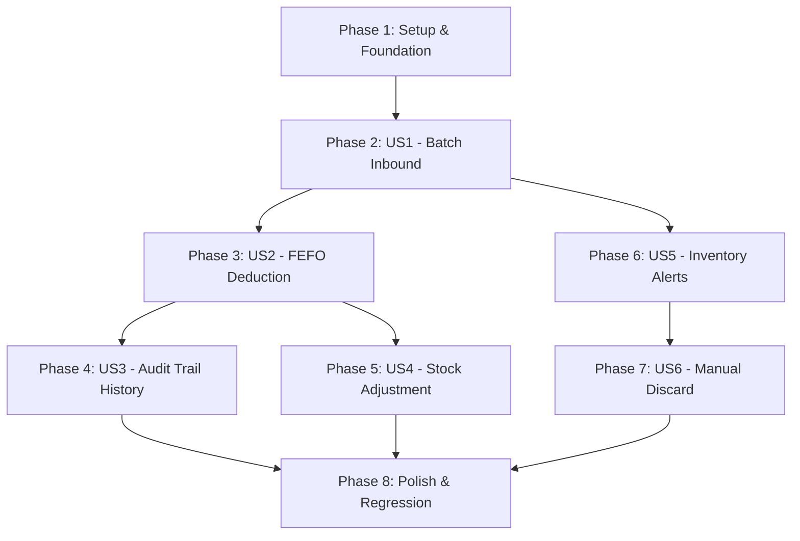

# Danh sách Công việc Triển khai (Tasks): RM-011 Quản lý Tồn kho & Giao dịch

**Tính năng**: `RM-011 — Quản lý Tồn kho & Giao dịch (Inventory Transactions & Batch Management)`  
**Nhánh (Branch)**: `011-rm-011-inventory-transactions` | **Ngày**: 2026-10-09  
**Đặc tả (Spec)**: [spec.md](spec.md) | **Kế hoạch (Plan)**: [plan.md](plan.md)

---

## Phase 1: Thiết lập & Nền tảng Dùng chung (Setup & Foundation)

**Mục tiêu**: Chuẩn bị cấu trúc thực thể, cấu hình precision cho số thập phân, chỉ mục database, phân quyền và bộ từ điển i18n cho toàn bộ phân hệ Quản lý Tồn kho.

- [x] T001 [P] Bổ sung trường `UnitCost` (decimal) vào thực thể `InventoryTransaction` trong `src/Acme.TooHungry.Domain/Inventories/InventoryTransaction.cs` và cập nhật constructor tương ứng
- [x] T002 [P] Cấu hình kiểu dữ liệu `decimal(18, 4)` cho `Quantity`, `RemainingQuantity`, `ConversionFactor` của `InventoryBatch` và `Quantity` của `InventoryTransaction` trong `src/Acme.TooHungry.EntityFrameworkCore/EntityFrameworkCore/TooHungryDbContext.cs`
- [x] T003 Cấu hình Composite Index trên `InventoryBatch` `(IngredientId, IsActive, RemainingQuantity, ExpiryDate)` và Index trên `InventoryTransaction` `(IngredientId, CreationTime)` trong `src/Acme.TooHungry.EntityFrameworkCore/EntityFrameworkCore/TooHungryDbContext.cs`
- [x] T004 Thêm EF Core Migration `Add_UnitCost_And_Indexes_To_Inventories` trong `src/Acme.TooHungry.EntityFrameworkCore` và cập nhật DbContext
- [x] T005 [P] Khai báo và đăng ký các phân quyền chi tiết trong `src/Acme.TooHungry.Application.Contracts/Permissions/TooHungryPermissions.cs` và `TooHungryPermissionDefinitionProvider.cs` (`Inventories`: `Default`, `Create`, `Adjust`, `Discard`)
- [x] T006 [P] Bổ sung bộ từ điển song ngữ i18n cho toàn bộ nhãn, thông báo lỗi và phân loại cảnh báo tồn kho (`EXPIRING_TODAY`, `EXPIRED_FRESH`, `NEAR_EXPIRY`, `OUT_OF_STOCK`) trong `src/Acme.TooHungry.Domain.Shared/Localization/TooHungry/en.json` và `vi.json`

**Trạm kiểm tra (Checkpoint)**: Cơ sở dữ liệu, Entity, Migration và phân quyền đã sẵn sàng cho việc triển khai các User Stories.

---

## Phase 2: User Story 1 - Nhập hàng vào kho theo Lô (Batch Inbound & Conversion) (Priority: P1) 🎯 MVP Core

**Mục tiêu**: Cung cấp khả năng tạo lô nhập hàng bằng Đơn vị mua (`PurchaseUnit`), tự động quy đổi ra Đơn vị chuẩn (`BaseUnit`) với `ConversionFactor`, tự sinh mã lô nếu rỗng, chặn hàng quá hạn, và tự động sinh giao dịch `IN` lưu kèm `UnitCost`.  
**Kiểm thử Độc lập**: Tạo phiếu nhập kho 3 Thùng thịt bò (1 Thùng = 15 kg, đơn giá 3,000,000đ/thùng) $\rightarrow$ tạo `InventoryBatch` với 45 kg và sinh giao dịch `IN` với 45 kg kèm `UnitCost`.

### Kiểm thử cho User Story 1 (TDD)
- [x] T007 [P] [US1] Viết Unit Test kiểm tra quy đổi đơn vị mua sang đơn vị cơ sở và tạo lô hàng trong `test/Acme.TooHungry.Domain.Tests/Inventories/InventoryBatch_Tests.cs`
- [x] T008 [P] [US1] Viết Integration Test kiểm tra `CreateBatchAsync` sinh đúng `InventoryBatch` và bản ghi `InventoryTransaction` loại `IN` trong `test/Acme.TooHungry.Application.Tests/Inventories/InventoryAppService_Tests.cs`

### Triển khai User Story 1
- [x] T009 [US1] Cập nhật `InventoryAppService.CreateBatchAsync` trong `src/Acme.TooHungry.Application/Inventories/InventoryAppService.cs`:
  - Tự động sinh mã lô theo định dạng `BATCH-yyyyMMddHHmmss` nếu `input.BatchCode` để trống
  - Kiểm tra và chặn thao tác nhập hàng nếu `ExpiryDate <= Today` (ném `BusinessException`)
  - Ghi nhận giao dịch `IN` liên kết `BatchId`, lưu đúng `UnitCost` của lô nhập
- [x] T010 [US1] Expose REST endpoint `POST /api/app/inventory/batches` trong `src/Acme.TooHungry.HttpApi/Controllers/InventoryController.cs` kèm phân quyền `[Authorize(TooHungryPermissions.Inventories.Create)]`
- [x] T011 [US1] Triển khai/tối ưu endpoint `GET /api/app/inventory/batches` hỗ trợ lọc theo `ingredientId`, cờ `onlyAvailable` và sắp xếp FEFO trong `InventoryAppService.cs` và `InventoryController.cs`

**Trạm kiểm tra (Checkpoint)**: Nhân viên có thể lập phiếu nhập kho theo lô, tự động quy đổi số lượng và lưu vết giao dịch nhập kho chuẩn xác.

---

## Phase 3: User Story 2 - Xuất kho nguyên liệu tự động theo FEFO (Priority: P1) 🎯 MVP Core

**Mục tiêu**: Triển khai thuật toán xuất kho FEFO (First Expired, First Out) trong Domain Service `InventoryManager`, tự động bỏ qua lô `StorageType.FRESH` đã quá hạn, ưu tiên các lô `EXPIRING_TODAY` lên đầu danh sách xuất, lưu vết `UnitCost` vào transaction `OUT`, và áp dụng retry Optimistic Concurrency tại Application layer.  
**Kiểm thử Độc lập**: Thiết lập 2 lô nguyên liệu (Lô A hạn gần, Lô B hạn xa). Xuất lượng hàng lớn hơn Lô A $\rightarrow$ Lô A trừ về 0, Lô B trừ phần còn lại; sinh 2 giao dịch `OUT` có mã tham chiếu `ReferenceId`.

### Kiểm thử cho User Story 2 (TDD)
- [x] T012 [P] [US2] Viết Unit Tests kiểm tra thứ tự ưu tiên FEFO, trừ nối tiếp nhiều lô và tự động bỏ qua lô FRESH quá hạn trong `test/Acme.TooHungry.Domain.Tests/Inventories/InventoryManager_Fefo_Tests.cs`
- [x] T013 [P] [US2] Viết Unit Tests kiểm tra ưu tiên xuất trước cho các lô `EXPIRING_TODAY` và lưu vết `UnitCost` vào transaction `OUT` trong `test/Acme.TooHungry.Domain.Tests/Inventories/InventoryManager_Fefo_Tests.cs`

### Triển khai User Story 2
- [x] T014 [US2] Hoàn thiện thuật toán FEFO trong `src/Acme.TooHungry.Domain/Inventories/InventoryManager.cs` (`DeductFefoAsync`):
  - Sắp xếp ưu tiên: Các lô FRESH có `ExpiryDate <= UtcNow.AddHours(24)` được đưa lên đầu danh sách xuất, tiếp theo là `ExpiryDate ASC`, sau đó là `ReceivedAt ASC`
  - Bỏ qua các lô đồ tươi sống (`StorageType.FRESH`) có `ExpiryDate < UtcNow`
  - Khấu trừ nối tiếp qua các lô còn hàng, không làm âm kho và tính toán `ShortageQuantity`
  - Sinh bản ghi `InventoryTransaction` loại `OUT` cho mỗi lô kèm `UnitCost = batch.UnitCost` và `ReferenceId`
- [x] T015 [US2] Triển khai cơ chế retry tương tranh (Optimistic Concurrency) với `ConcurrencyStamp` (tối đa 3 lần với backoff ngắn) khi có `AbpDbConcurrencyException` trong các use case gọi trừ kho tại Application layer

**Trạm kiểm tra (Checkpoint)**: Thuật toán FEFO hoạt động chính xác tuyệt đối, bảo vệ an toàn vệ sinh thực phẩm và không bao giờ làm âm kho.

---

## Phase 4: User Story 3 - Tra cứu & Đối soát Lịch sử Giao dịch Tồn kho (Priority: P2)

**Mục tiêu**: Cung cấp API tra cứu lịch sử biến động kho bất biến (Audit Trail) của từng nguyên liệu, hỗ trợ hiển thị đầy đủ thông tin giao dịch (`UnitCost`, `BatchCode`, `ReferenceId`, `CreatorId`) và chặn sửa/xóa dữ liệu giao dịch.  
**Kiểm thử Độc lập**: Truy vấn lịch sử giao dịch của nguyên liệu $\rightarrow$ danh sách trả về đầy đủ các bản ghi `IN`, `OUT`, `ADJUSTMENT` được sắp xếp theo thời gian mới nhất lên đầu.

### Kiểm thử cho User Story 3
- [x] T016 [P] [US3] Viết Integration Tests kiểm tra truy vấn danh sách giao dịch theo nguyên liệu trong `test/Acme.TooHungry.Application.Tests/Inventories/InventoryAppService_Tests.cs`

### Triển khai User Story 3
- [x] T017 [US3] Hoàn thiện phương thức `GetTransactionsAsync(Guid ingredientId)` trong `src/Acme.TooHungry.Application/Inventories/InventoryAppService.cs`:
  - Nạp đầy đủ thông tin `BatchCode`, `IngredientName`, `UnitCost`, `ReferenceId`, `CreationTime`, `CreatorId`
  - Sắp xếp mặc định theo `CreationTime DESC`
- [x] T018 [US3] Expose REST endpoint `GET /api/app/inventory/transactions/{ingredientId}` trong `src/Acme.TooHungry.HttpApi/Controllers/InventoryController.cs` kèm phân quyền `[Authorize(TooHungryPermissions.Inventories.Default)]`

**Trạm kiểm tra (Checkpoint)**: Dữ liệu biến động kho được lưu vết bất biến và có thể đối soát minh bạch phục vụ kiểm toán kế toán.

---

## Phase 5: User Story 4 - Kiểm kê Kho & Điều chỉnh Tồn kho (Priority: P2)

**Mục tiêu**: Cung cấp chức năng cân đối kho thực tế (`AdjustStockAsync`). Khi hao hụt thiếu kho, bắt buộc chọn đích danh từng lô hàng cụ thể để trừ và sinh `ADJUSTMENT_OUT`; khi thừa kho, tự động tạo lô điều chỉnh tăng và sinh `ADJUSTMENT_IN`.  
**Kiểm thử Độc lập**: Kiểm kê thiếu 2 kg muối $\rightarrow$ chọn lô S1 trừ 2 kg với lý do "Rách bao bì" $\rightarrow$ lô S1 giảm 2 kg, sinh giao dịch `ADJUSTMENT_OUT`.

### Kiểm thử cho User Story 4 (TDD)
- [x] T019 [P] [US4] Viết Unit Tests kiểm tra logic kiểm kê điều chỉnh tồn kho trong `test/Acme.TooHungry.Domain.Tests/Inventories/InventoryManager_Adjustment_Tests.cs`:
  - Chặn điều chỉnh nếu thiếu hụt mà không chọn lô cụ thể
  - Chặn điều chỉnh nếu tổng lượng trừ các lô không khớp mức chênh lệch
  - Tự động sinh lô mới khi thừa kho

### Triển khai User Story 4
- [x] T020 [US4] Cập nhật và tối ưu hóa phương thức `InventoryManager.AdjustStockAsync` trong `src/Acme.TooHungry.Domain/Inventories/InventoryManager.cs`:
  - Lưu đúng `UnitCost` của từng lô vào các bản ghi `ADJUSTMENT_OUT`
  - Đảm bảo trường lý do `Reason` không được để trống
- [x] T021 [US4] Cài đặt endpoint `POST /api/app/inventory/stock-adjustment` trong `src/Acme.TooHungry.Application/Inventories/InventoryAppService.cs` và `InventoryController.cs` kèm phân quyền nghiêm ngặt `[Authorize(TooHungryPermissions.Inventories.Adjust)]` (Chỉ Manager & Admin)

**Trạm kiểm tra (Checkpoint)**: Tính năng kiểm kê kho hoạt động chuẩn xác, bảo đảm tính giải trình khi có chênh lệch tồn kho thực tế.

---

## Phase 6: User Story 5 - Giám sát Hạn sử dụng & Cảnh báo Tồn kho (Priority: P2)

**Mục tiêu**: Cung cấp API quét và phân cấp cảnh báo tồn kho (`GetAlertsAsync`): `EXPIRED_FRESH` (mức danger), `EXPIRING_TODAY` (mức warning cao), `NEAR_EXPIRY` (mức warning 3 ngày) và `OUT_OF_STOCK` / `SHORTAGE`.  
**Kiểm thử Độc lập**: Có lô cá hồi tươi quá hạn và lô sữa tươi hết hạn trong 12h $\rightarrow$ API `GetAlertsAsync` trả về đúng 2 cảnh báo tương ứng với mức độ nguy cấp chuẩn.

### Kiểm thử cho User Story 5
- [x] T022 [P] [US5] Viết Integration Tests kiểm tra bộ lọc quét cảnh báo tồn kho trong `test/Acme.TooHungry.Application.Tests/Inventories/InventoryAppService_Tests.cs`

### Triển khai User Story 5
- [x] T023 [US5] Cập nhật logic phương thức `GetAlertsAsync` trong `src/Acme.TooHungry.Application/Inventories/InventoryAppService.cs`:
  - Quét lô `StorageType.FRESH` có `ExpiryDate < UtcNow` $\rightarrow$ sinh cảnh báo `EXPIRED_FRESH` (mức `danger`)
  - Quét lô `StorageType.FRESH` có `ExpiryDate <= UtcNow.AddHours(24)` và còn hạn $\rightarrow$ sinh cảnh báo `EXPIRING_TODAY` (mức `warning` cao)
  - Quét lô có `ExpiryDate <= UtcNow.AddDays(3)` $\rightarrow$ sinh cảnh báo `NEAR_EXPIRY` (mức `warning`)
  - Quét nguyên liệu có `CurrentStock <= MinStock` $\rightarrow$ sinh cảnh báo `OUT_OF_STOCK` / `SHORTAGE`
- [x] T024 [US5] Expose REST endpoint `GET /api/app/inventory/alerts` trong `src/Acme.TooHungry.HttpApi/Controllers/InventoryController.cs` kèm phân quyền `[Authorize(TooHungryPermissions.Inventories.Default)]`

**Trạm kiểm tra (Checkpoint)**: Hệ thống chủ động cảnh báo các rủi ro hạn dùng và hết hàng để bộ phận vận hành xử lý kịp thời.

---

## Phase 7: User Story 6 - Tiêu hủy Lô Hàng Quá hạn & Dọn kho (Priority: P3)

**Mục tiêu**: Cung cấp API tiêu hủy lô hàng (`DiscardBatchAsync`): đưa `RemainingQuantity` về 0, chuyển `IsActive = false`, sinh giao dịch `ADJUSTMENT_OUT` kèm lý do giải trình bắt buộc và lưu vết người thực hiện.  
**Kiểm thử Độc lập**: Gọi `POST /api/app/inventory/batches/{id}/discard` với lý do "Hàng hỏng mốc" $\rightarrow$ lô hàng cập nhật tồn về 0, `IsActive = false`, sinh 1 giao dịch xuất hủy `ADJUSTMENT_OUT`.

### Kiểm thử cho User Story 6
- [x] T025 [P] [US6] Viết Unit Test cho hành vi `Discard` trên thực thể `InventoryBatch` trong `test/Acme.TooHungry.Domain.Tests/Inventories/InventoryBatch_Tests.cs`
- [x] T026 [P] [US6] Viết Integration Test cho use case `DiscardBatchAsync` trong `test/Acme.TooHungry.Application.Tests/Inventories/InventoryAppService_Tests.cs`

### Triển khai User Story 6
- [x] T027 [US6] Cài đặt phương thức `DiscardBatchAsync(Guid batchId, DiscardBatchInputDto input)` trong `src/Acme.TooHungry.Application/Inventories/InventoryAppService.cs`:
  - Gọi phương thức domain `batch.Discard()`
  - Sinh bản ghi `InventoryTransaction` loại `ADJUSTMENT_OUT` với số lượng bị hủy và `UnitCost` của lô đó
- [x] T028 [US6] Expose REST endpoint `POST /api/app/inventory/batches/{id}/discard` trong `src/Acme.TooHungry.HttpApi/Controllers/InventoryController.cs` kèm phân quyền nghiêm ngặt `[Authorize(TooHungryPermissions.Inventories.Discard)]` (Chỉ Manager & Admin)

**Trạm kiểm tra (Checkpoint)**: Quy trình tiêu hủy thực phẩm hỏng/quá hạn được chuẩn hóa và lưu vết kiểm toán đầy đủ.

---

## Phase 8: Hoàn thiện, Kiểm thử Toàn diện & Tích hợp (Polish & Regression)

**Mục tiêu**: Đảm bảo 100% test suite vượt qua thành công, tích hợp mượt mà với các module bán hàng hạ nguồn, và cập nhật roadmap.

- [x] T029 Chạy toàn bộ test suite tự động của dự án bằng lệnh CLI `dotnet test` (Domain Tests, Application Tests, EntityFrameworkCore Tests) đảm bảo 100% PASS
- [x] T030 Kiểm tra tính tương thích và liên kết của RM-011 với các module hạ nguồn:
  - Xác nhận API `ValidateStockAsync` của POS Đơn hàng (RM-010) đối chiếu chính xác số lượng tồn từ RM-011
  - Xác nhận hợp đồng khấu trừ kho khi hoàn tất thanh toán (RM-016) gọi đúng `InventoryManager.DeductFefoAsync`
- [x] T031 Cập nhật bảng roadmap và trạng thái tính năng RM-011 trong `docs/roadmap.md`

---

## Thứ tự Thực thi & Phụ thuộc giữa các User Stories

