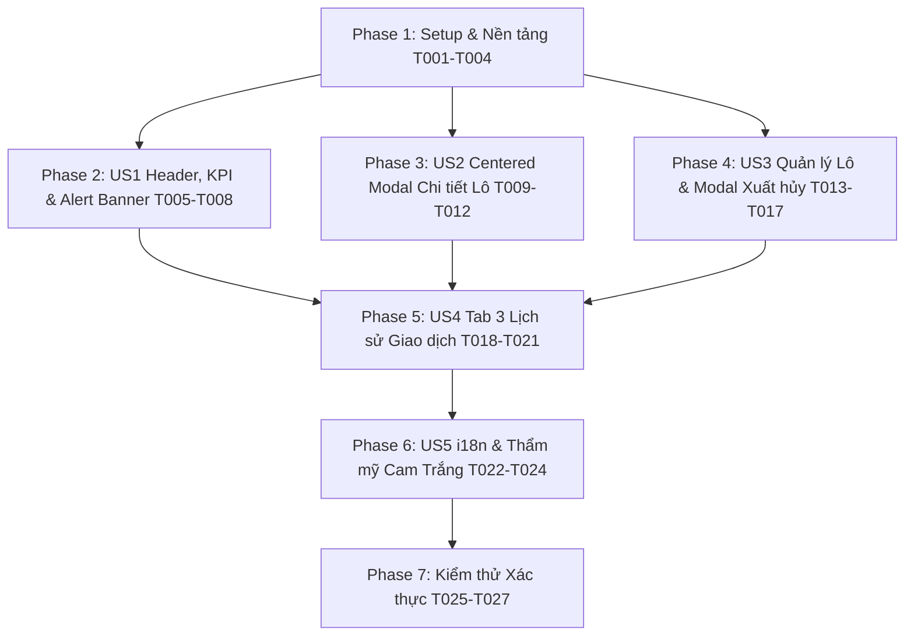

# Danh sách Công việc Triển khai (Tasks Breakdown): RM-012 Tái thiết kế Giao diện Quản lý Tồn kho & Lô hàng

**Mã Tính năng**: `RM-012`  
**Nhánh Tính năng**: `012-rm-012-inventory-ui-redesign`  
**Đặc tả**: [spec.md](spec.md) | **Kế hoạch**: [plan.md](plan.md)  
**Ngày cập nhật**: 2026-10-09  

---

## Tóm tắt & Thứ tự Thực thi

Tài liệu này định nghĩa danh sách 27 công việc cụ thể, được tổ chức tuần tự theo từng User Story nhằm bảo đảm tính độc lập, khả năng kiểm thử độc lập và tuân thủ tuyệt đối Hiến pháp Acme.TooHungry.

- **Phase 1: Thiết lập & Nền tảng** (T001 - T004): Chuẩn hóa API proxy, từ điển i18n song ngữ và ViewModels.
- **Phase 2: User Story 1 — Header một cấp, Thẻ KPI & Alert Banner** (T005 - T008): Giao diện đầu trang tinh gọn, chỉ số KPI và cảnh báo nguy cấp.
- **Phase 3: User Story 2 — Tra cứu Chi tiết Lô hàng Nguyên liệu** (T009 - T012): Centered Modal 'xl' xem danh sách lô FEFO.
- **Phase 4: User Story 3 — Quản lý Lô hàng & Modal Xuất hủy Lô quá hạn** (T013 - T017): Tab 2 chuẩn hóa và modal xuất hủy có lý do mẫu.
- **Phase 5: User Story 4 — Tra cứu Lịch sử Giao dịch & Lối tắt Chuyển tab** (T018 - T021): Tab 3 nhật ký biến động kho và nút tắt từ Tab 1.
- **Phase 6: User Story 5 — Đa ngôn ngữ (i18n) & Nhận diện Cam & Trắng** (T022 - T024): Chuẩn hóa localization và responsive.
- **Phase 7: Kiểm thử Xác thực & Hoàn thiện** (T025 - T027): Build verification, E2E validation và roadmap update.

---

## Phase 1: Thiết lập & Nền tảng (Setup & Foundation)

**Mục tiêu**: Chuẩn bị đầy đủ nền tảng API proxy, ViewModels và từ điển ngôn ngữ i18n làm cơ sở cho tất cả các User Stories.

- [x] T001 Cập nhật API Proxy `InventoryService` trong `angular/src/app/proxy/inventories/inventory.service.ts` để đồng bộ URL `getTransactions(ingredientId)` gọi đúng `/api/app/inventory/transactions/${ingredientId}` và bổ sung phương thức `discardBatch(id, input)`.
- [x] T002 [P] Bổ sung 100% các khóa bản địa hóa Tiếng Việt (KPI, Alert Banner, 3 Tabs, Modal Chi tiết Lô, Modal Xuất hủy, Lịch sử Giao dịch) vào `src/Acme.TooHungry.Domain.Shared/Localization/TooHungry/vi.json`.
- [x] T003 [P] Bổ sung 100% các khóa bản địa hóa Tiếng Anh tương ứng vào `src/Acme.TooHungry.Domain.Shared/Localization/TooHungry/en.json`.
- [x] T004 Định nghĩa các interface ViewModel (`InventoryKpiSummary`, `InventoryAlertsBannerState`) và bổ sung enum/models trong `angular/src/app/inventory/inventory.component.ts`.

**Trạm kiểm tra (Checkpoint)**: Nền tảng API proxy và từ điển song ngữ đã sẵn sàng, không còn thiếu hụt model hay localization key nào.

---

## Phase 2: User Story 1 — Header một cấp, Thẻ KPI & Alert Banner (Ưu tiên: P1)

**Mục tiêu**: Tạo ấn tượng chuyên nghiệp với Header 1 cấp duy nhất, 4 Thẻ chỉ số KPI Tồn kho và Banner cảnh báo nguy cấp thông minh.

**Kiểm thử Độc lập**: Truy cập `/inventory`. Header hiển thị 1 cấp tiêu đề với các nút thao tác chuẩn. 4 thẻ KPI tính toán đúng số lượng nguyên liệu, lô an toàn, cảnh báo thiếu và lô quá hạn. Banner cảnh báo hiển thị tóm tắt lô tươi sống quá hạn kèm nút xem chi tiết và nút đóng.

### Triển khai cho User Story 1
- [x] T005 [US1] Xây dựng phương thức tính toán chỉ số KPI (`calculateKpiSummary`) và fetch dữ liệu cảnh báo từ `inventoryService.getAlerts()` trong `angular/src/app/inventory/inventory.component.ts`.
- [x] T006 [US1] Cải tổ Header thành 1 cấp duy nhất (Tiêu đề, phụ đề, nút Refresh, nút + Thiết lập tồn kho, nút + Nhập kho) và hiển thị 4 Thẻ KPI Tồn kho trong `angular/src/app/inventory/inventory.component.html`.
- [x] T007 [US1] Triển khai Banner Cảnh báo Tồn kho thông minh (hiển thị cảnh báo nguy cấp nhất, nút Xem chi tiết mở rộng/thu gọn, nút Đóng tạm thời) trong `angular/src/app/inventory/inventory.component.html`.
- [x] T008 [US1] Viết styles SCSS cho Header một cấp, 4 Thẻ KPI Tồn kho và Banner Cảnh báo theo nhận diện Cam & Trắng trong `angular/src/app/inventory/inventory.component.scss`.

**Trạm kiểm tra (Checkpoint)**: User Story 1 hoàn thành và có thể kiểm thử trực quan độc lập.

---

## Phase 3: User Story 2 — Tra cứu Chi tiết Lô hàng Nguyên liệu (Ưu tiên: P1)

**Mục tiêu**: Cho phép thủ kho xem chi tiết tất cả các lô hàng của một nguyên liệu theo chuẩn FEFO qua Centered Modal (size 'xl') chỉ trong 1 cú nhấp chuột từ Tab 1.

**Kiểm thử Độc lập**: Nhấn nút `[Xem các lô]` trên dòng nguyên liệu "Cá Hồi Na Uy". Modal `IngredientBatchesModal` mở ra ở giữa màn hình, hiển thị danh sách các lô theo thứ tự FEFO với đầy đủ thông số (Mã lô, Số lượng, Hạn dùng, Giá vốn, Badge hạn dùng).

### Triển khai cho User Story 2
- [x] T009 [P] [US2] Khởi tạo Standalone Component `IngredientBatchesModalComponent` (`ingredient-batches-modal/ingredient-batches-modal.component.ts`) với input `ingredient`, `visible` và output `visibleChange`, `discardRequested`.
- [x] T010 [P] [US2] Xây dựng template HTML cho `IngredientBatchesModalComponent` với bảng sắp xếp FEFO, badge trạng thái hạn dùng `app-expiration-badge`, cột giá vốn và empty state trong `angular/src/app/inventory/ingredient-batches-modal/ingredient-batches-modal.component.html`.
- [x] T011 [P] [US2] Viết styles SCSS cho `IngredientBatchesModalComponent` theo chuẩn Cam & Trắng trong `angular/src/app/inventory/ingredient-batches-modal/ingredient-batches-modal.component.scss`.
- [x] T012 [US2] Tích hợp component `IngredientBatchesModalComponent` vào `angular/src/app/inventory/inventory.component.ts` và thêm nút thao tác `[Xem các lô]` (`fa-boxes-stacked`) trên mỗi dòng nguyên liệu ở Tab 1 trong `angular/src/app/inventory/inventory.component.html`.

**Trạm kiểm tra (Checkpoint)**: User Story 2 hoàn thành và hoạt động mượt mà, độc lập.

---

## Phase 4: User Story 3 — Quản lý Lô hàng Toàn kho & Modal Xuất hủy Lô quá hạn (Ưu tiên: P1)

**Mục tiêu**: Chuẩn hóa Tab 2 (Danh sách Lô hàng) và cung cấp Modal xác nhận xuất hủy chuyên dụng có sẵn danh mục lý do mẫu phục vụ kiểm toán nội bộ.

**Kiểm thử Độc lập**: Lọc các lô quá hạn ở Tab 2, bấm nút `[Xuất hủy]`. Modal `DiscardBatchModal` mở ra, chọn lý do mẫu "Quá hạn sử dụng", nhập ghi chú và xác nhận. Lô hàng chuyển sang trạng thái đã hủy và số lượng tồn về 0.

### Triển khai cho User Story 3
- [x] T013 [P] [US3] Khởi tạo Standalone Component `DiscardBatchModalComponent` (`discard-batch-modal/discard-batch-modal.component.ts`) với form chọn lý do mẫu và textarea ghi chú.
- [x] T014 [P] [US3] Xây dựng template HTML cho `DiscardBatchModalComponent` với giao diện xác nhận cảnh báo an toàn thực phẩm trong `angular/src/app/inventory/discard-batch-modal/discard-batch-modal.component.html`.
- [x] T015 [P] [US3] Viết styles SCSS cho `DiscardBatchModalComponent` trong `angular/src/app/inventory/discard-batch-modal/discard-batch-modal.component.scss`.
- [x] T016 [US3] Chuẩn hóa bảng Tab 2 (xóa bỏ triệt để text tiếng Việt hardcode `<th>NGUYÊN LIỆU</th>`, `<th>VÒNG ĐỜI BẢO QUẢN</th>`), tích hợp nút `[Xuất hủy]` trên từng lô quá hạn trong `angular/src/app/inventory/inventory.component.html`.
- [x] T017 [US3] Kết nối xử lý xuất hủy từ Tab 2, từ `IngredientBatchesModalComponent` và từ nút `[Xuất hủy ngay]` trên Alert Banner tới `DiscardBatchModalComponent` và gọi API `inventoryService.discardBatch` trong `angular/src/app/inventory/inventory.component.ts`.

**Trạm kiểm tra (Checkpoint)**: User Story 3 hoàn thành, xử lý tiêu hủy phế phẩm minh bạch và chuẩn xác.

---

## Phase 5: User Story 4 — Tra cứu Lịch sử Giao dịch & Lối tắt Tab 1 $\rightarrow$ Tab 3 (Ưu tiên: P2)

**Mục tiêu**: Xây dựng Tab 3 (Lịch sử Giao dịch) tự động tải biến động theo nguyên liệu và cung cấp nút lối tắt từ dòng nguyên liệu ở Tab 1 sang Tab 3.

**Kiểm thử Độc lập**: Bấm nút `[Lịch sử biến động]` trên một dòng nguyên liệu ở Tab 1. Giao diện tự động chuyển sang Tab 3, dropdown chọn sẵn nguyên liệu đó và bảng hiển thị chi tiết các giao dịch (+/-).

### Triển khai cho User Story 4
- [x] T018 [US4] Bổ sung logic quản lý Tab 3 (chọn nguyên liệu mặc định, fetch giao dịch qua `inventoryService.getTransactions(ingredientId)`) trong `angular/src/app/inventory/inventory.component.ts`.
- [x] T019 [US4] Thiết kế giao diện Tab 3 trong `angular/src/app/inventory/inventory.component.html`: thanh bộ lọc có `CustomSelectComponent` tìm kiếm nguyên liệu, bảng lịch sử hiển thị badge loại giao dịch, biến động (+/-), mã lô, giá vốn và lý do.
- [x] T020 [US4] Bổ sung nút lối tắt `[Lịch sử biến động]` (`fa-clock-rotate-left`) trên từng dòng nguyên liệu ở Tab 1 trong `angular/src/app/inventory/inventory.component.html`, kích hoạt hàm `navigateToTransactions(ingredient)` trong `angular/src/app/inventory/inventory.component.ts`.
- [x] T021 [US4] Viết styles SCSS cho Tab 3 (Direction colors: xanh lá cho nhập, cam đỏ cho xuất, badge loại giao dịch) trong `angular/src/app/inventory/inventory.component.scss`.

**Trạm kiểm tra (Checkpoint)**: User Story 4 hoàn thành, tra cứu dòng biến động kho tức thì.

---

## Phase 6: User Story 5 — Đa ngôn ngữ (i18n) & Tối ưu Thẩm mỹ Cam & Trắng (Ưu tiên: P2)

**Mục tiêu**: Đảm bảo 100% văn bản giao diện hiển thị đúng chuẩn song ngữ Tiếng Việt & Tiếng Anh, loại bỏ mã thô `::` và hoàn thiện tính thẩm mỹ cao cấp.

**Kiểm thử Độc lập**: Đổi ngôn ngữ giữa Tiếng Việt và Tiếng Anh trên Header chính. Toàn bộ màn hình `/inventory` (các thẻ KPI, Alert Banner, 3 Tabs, Modal Chi tiết Lô, Modal Xuất hủy Lô) chuyển ngữ trơn tru, không có bất kỳ raw key nào.

### Triển khai cho User Story 5
- [x] T022 [US5] Sửa lỗi format selector dòng phân trang `::RowsPerPage` thành label hiển thị chuẩn ngữ nghĩa trong `angular/src/app/inventory/inventory.component.ts`.
- [x] T023 [US5] Rà soát và loại bỏ toàn bộ các chuỗi hardcode và raw localization keys còn sót lại trên template `inventory.component.html`.
- [x] T024 [US5] Tối ưu hóa thiết kế Responsive (Tablet/Desktop), hiệu ứng chuyển tiếp mềm mại (micro-interactions), bo góc 12-16px và đổ bóng chuẩn nhận diện thương hiệu Cam & Trắng trong `angular/src/app/inventory/inventory.component.scss`.

**Trạm kiểm tra (Checkpoint)**: Toàn bộ 5 User Stories đều đạt chuẩn thẩm mỹ cao cấp và song ngữ 100%.

---

## Phase 7: Kiểm thử Xác thực & Hoàn thiện (Verification & Polish)

**Mục tiêu**: Kiểm tra biên dịch, chạy toàn bộ các kịch bản kiểm thử trực quan và cập nhật lộ trình.

- [x] T025 Kiểm tra biên dịch frontend (`npm run build` hoặc type-check không có lỗi) trong thư mục `angular`.
- [x] T026 Chạy kiểm tra xác thực trực quan 6 kịch bản theo tài liệu `specs/012-rm-012-inventory-ui-redesign/quickstart.md`.
- [x] T027 Cập nhật trạng thái tính năng RM-012 trong `docs/roadmap.md` sang trạng thái hoàn thành khi nghiệm thu.

---

## Phụ thuộc (Dependencies) & Thứ tự Thực thi

### Cơ hội Triển khai Song song (Parallel Opportunities)
- **Trong Phase 1**: T002 (`vi.json`) và T003 (`en.json`) có thể làm song song hoàn toàn.
- **Trong Phase 3**: T009, T010, T011 của `IngredientBatchesModalComponent` có thể làm song song với các task khác.
- **Trong Phase 4**: T013, T014, T015 của `DiscardBatchModalComponent` có thể triển khai độc lập trước khi gắn kết nối.

---

## Chiến lược Triển khai (Implementation Strategy)

### MVP Trước tiên (User Story 1 + User Story 2)
1. Hoàn thành Phase 1 (Nền tảng i18n + API Proxy).
2. Hoàn thành Phase 2 (Header một cấp, 4 Thẻ KPI Tồn kho, Banner Cảnh báo).
3. Hoàn thành Phase 3 (Centered Modal 'xl' xem chi tiết lô FEFO từ Tab 1).
4. **DỪNG VÀ XÁC MINH**: Thủ kho đã có thể nắm bắt toàn bộ tình trạng tồn kho và tra cứu lô hàng FEFO 1-click.

### Phân phối Toàn diện (Incremental Full Delivery)
5. Hoàn thành Phase 4 (Chuẩn hóa Tab 2 & Modal Xuất hủy chuyên dụng).
6. Hoàn thành Phase 5 (Tab 3 Lịch sử Giao dịch & Lối tắt từ Tab 1).
7. Hoàn thành Phase 6 (Đa ngôn ngữ 100% & Trau chuốt Cam & Trắng).
8. Hoàn thành Phase 7 (Verification & Roadmap update).
