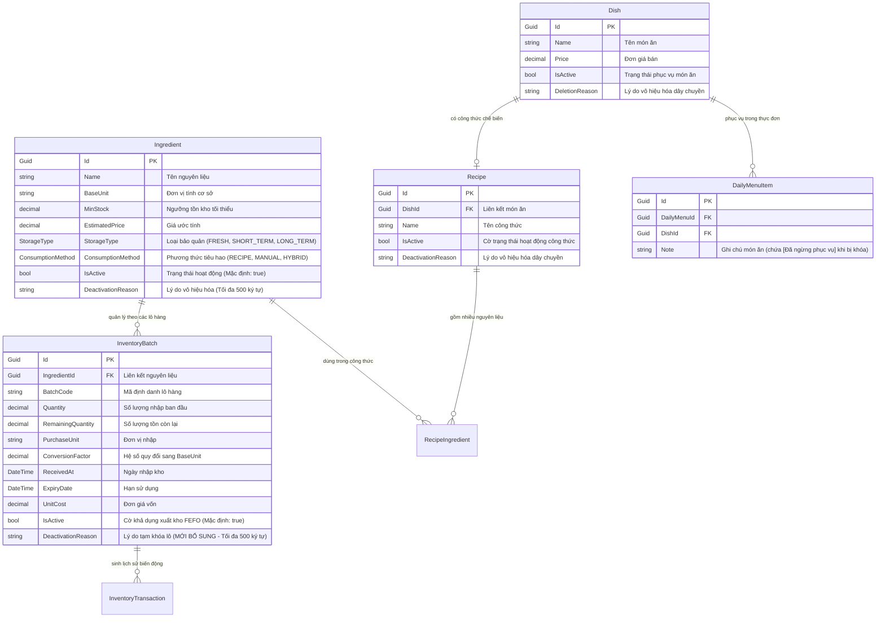

# Giai đoạn 1: Mô hình Dữ liệu (Data Model) - RM-013

**Tính năng**: `RM-013` - Tồn kho - Khóa/Khôi phục (Inventory Deactivate & Restore)  
**Nhánh (Branch)**: `013-rm-013-inventory-deactivate-restore`  
**Ngày cập nhật**: 2026-10-12  

---

## 1. Sơ đồ Thực thể (Entity Relationship Diagram - ERD)

---

## 2. Chi tiết Thuộc tính & Ràng buộc Cơ sở Dữ liệu

### 2.1. Thực thể `Ingredient` (Domain: `Acme.TooHungry.Ingredients`)
Kế thừa: `FullAuditedAggregateRoot<Guid>`

| Tên trường | Kiểu dữ liệu | Bắt buộc | Mặc định | Mô tả & Quy tắc nghiệp vụ |
| :--- | :--- | :---: | :---: | :--- |
| `Id` | `Guid` | Có | Sinh tự động | Khóa chính. |
| `Name` | `string` | Có | - | Tên nguyên liệu (Tối đa 128 ký tự, Unique). |
| `BaseUnit` | `string` | Có | - | Đơn vị đo lường cơ sở (kg, lít, hộp,...). |
| `MinStock` | `decimal` | Có | `0` | Ngưỡng tồn tối thiểu để kích hoạt cảnh báo thiếu hàng. |
| `IsActive` | `bool` | Có | `true` | Cờ trạng thái hoạt động. Khi `false`, mặt hàng bị khóa ở kho và kích hoạt Cascading Deactivation. |
| `DeactivationReason`| `string?` | Không | `null` | Lý do giải trình khi người quản lý thực hiện vô hiệu hóa (Tối đa 500 ký tự). |

**Phương thức Domain**:
- `Deactivate(string reason)`: Chuyển `IsActive = false`, gán `DeactivationReason = reason.Trim()`.
- `Reactivate()`: Chuyển `IsActive = true`, xóa `DeactivationReason = null`.
- `Restore(decimal newMinStock)`: Chuyển `IsActive = true`, xóa `DeactivationReason = null`, cập nhật `MinStock = newMinStock`.

---

### 2.2. Thực thể `InventoryBatch` (Domain: `Acme.TooHungry.Inventories`)
Kế thừa: `FullAuditedAggregateRoot<Guid>`

| Tên trường | Kiểu dữ liệu | Bắt buộc | Mặc định | Mô tả & Quy tắc nghiệp vụ |
| :--- | :--- | :---: | :---: | :--- |
| `Id` | `Guid` | Có | Sinh tự động | Khóa chính. |
| `IngredientId` | `Guid` | Có | - | Khóa ngoại trỏ đến `Ingredient`. |
| `BatchCode` | `string` | Có | - | Mã lô hàng (ví dụ: `BATCH-20261012-001`). |
| `RemainingQuantity`| `decimal` | Có | - | Số lượng còn lại khả dụng xuất kho. |
| `ExpiryDate` | `DateTime` | Có | - | Hạn sử dụng lô hàng (dùng cho thuật toán FEFO). |
| `IsActive` | `bool` | Có | `true` | Khi `false`, thuật toán FEFO tự động bỏ qua lô này khi xuất kho bán hàng. |
| `DeactivationReason`| `string?` | Không | `null` | **(MỚI)** Lý do tạm khóa lô (chọn từ danh mục mẫu hoặc ghi chú, tối đa 500 ký tự). |

**Phương thức Domain**:
- `Deactivate(string reason)`: Chuyển `IsActive = false`, gán `DeactivationReason = reason.Trim()`.
- `Reactivate()`: Chuyển `IsActive = true`, xóa `DeactivationReason = null`.

---

### 2.3. Thực thể `Recipe` & `Dish` (Dây chuyền Cascading)
- **`Recipe.Deactivate(string reason)`**: Chuyển `Recipe.IsActive = false`, lưu lý do: `$"Vô hiệu hóa do nguyên liệu '{Ingredient.Name}' bị vô hiệu hóa: {Reason}"`.
- **`Dish.Deactivate(string reason)`**: Chuyển `Dish.IsActive = false`, lưu lý do: `$"Vô hiệu hóa do nguyên liệu '{Ingredient.Name}' bị vô hiệu hóa: {Reason}"`.
- **`DailyMenuItem`**: Cập nhật `Note` thêm nhãn `[Đã ngừng phục vụ]`, POS ngăn chặn việc chọn món mới.

---

## 3. Danh mục Lý do Tạm khóa Lô hàng Mẫu (Predefined Batch Deactivation Reasons)

| Mã lý do (Key) | Tiếng Việt (`vi.json`) | Tiếng Anh (`en.json`) |
| :--- | :--- | :--- |
| `QUALITY_INSPECTION` | Chờ kiểm định chất lượng an toàn | Awaiting quality inspection |
| `SUSPECTED_SPOILAGE` | Nghi ngờ biến chất / hư hỏng trong lưu kho | Suspected spoilage during storage |
| `PACKAGING_DEFECT` | Lỗi quy cách / rách hỏng bao bì | Packaging defect or damaged container |
| `OTHER` | Lý do khác (yêu cầu ghi chú chi tiết) | Other (detailed note required) |
