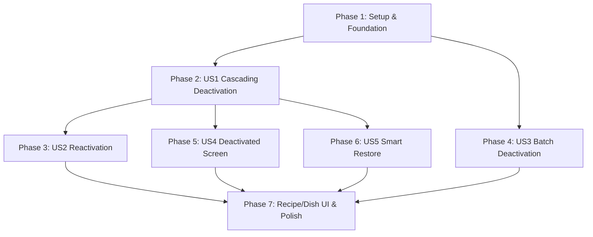

# Danh sách Công việc Triển khai (Tasks): RM-013 Tồn kho - Khóa/Khôi phục (Inventory Deactivate & Restore)

**Tính năng**: `RM-013 — Tồn kho - Khóa/Khôi phục (Inventory Deactivate & Restore)`  
**Nhánh (Branch)**: `013-rm-013-inventory-deactivate-restore` | **Ngày**: 2026-10-12  
**Đặc tả (Spec)**: [spec.md](./spec.md) | **Kế hoạch (Plan)**: [plan.md](./plan.md)

---

## Phase 1: Thiết lập & Nền tảng Dùng chung (Setup & Shared Foundation)

**Mục tiêu**: Chuẩn bị cấu trúc thực thể `InventoryBatch`, EF Core migrations, phân quyền ABP và bộ từ điển song ngữ i18n làm điều kiện tiên quyết cho toàn bộ tính năng.

- [x] T001 [P] Bổ sung trường `DeactivationReason` (`string?`, tối đa 500 ký tự) cùng 2 phương thức domain `Deactivate(string reason)` và `Reactivate()` vào thực thể `InventoryBatch` trong `src/Acme.TooHungry.Domain/Inventories/InventoryBatch.cs`
- [x] T002 [P] Cấu hình ánh xạ thuộc tính `DeactivationReason` (tối đa 500 ký tự, nullable) cho `InventoryBatch` trong `src/Acme.TooHungry.EntityFrameworkCore/EntityFrameworkCore/TooHungryDbContext.cs`
- [x] T003 Thêm EF Core Migration `Add_DeactivationReason_To_InventoryBatches` trong `src/Acme.TooHungry.EntityFrameworkCore` và cập nhật cơ sở dữ liệu qua `Acme.TooHungry.DbMigrator`
- [x] T004 [P] Khai báo và đăng ký phân quyền chi tiết cho quản lý tạm khóa lô hàng trong `src/Acme.TooHungry.Application.Contracts/Permissions/TooHungryPermissions.cs` và `TooHungryPermissionDefinitionProvider.cs` (`TooHungryPermissions.Inventories.DeactivateBatch`)
- [x] T005 [P] Bổ sung toàn bộ từ khóa song ngữ i18n cho nhãn, modal, danh mục lý do mẫu (`QUALITY_INSPECTION`, `SUSPECTED_SPOILAGE`, `PACKAGING_DEFECT`, `OTHER`) và thông báo cảnh báo trong `src/Acme.TooHungry.Domain.Shared/Localization/TooHungry/vi.json` và `en.json`

**Trạm kiểm tra (Checkpoint)**: Database, Entity, Migration và bộ i18n đã sẵn sàng.

---

## Phase 2: User Story 1 - Vô hiệu hóa Mặt hàng Tồn kho & Vô hiệu hóa Dây chuyền (Priority: P1) 🎯 MVP Core

**Mục tiêu**: Khi quản lý bấm tạm ngưng mặt hàng tại Tab 1 (`/inventory`), hệ thống yêu cầu nhập lý do (cảnh báo nếu còn tồn kho), chuyển `IsActive = false`, kích hoạt Cascading Deactivation (tự động khóa Recipe, Dish, đánh dấu DailyMenuItem, chặn gọi món mới trên POS nhưng bảo toàn các đơn dở dang tại bàn).  
**Kiểm thử Độc lập**: Vô hiệu hóa "Thịt bò Kobe" kèm lý do $\rightarrow$ kiểm tra mặt hàng chuyển sang Không khả dụng, Recipe và Dish liên quan chuyển sang Inactive, POS chặn order món mới, đơn đang phục vụ tại bàn vẫn thanh toán bình thường.

### Kiểm thử cho User Story 1 (TDD)
- [x] T006 [P] [US1] Viết Unit Test cho Cascading Deactivation trong `test/Acme.TooHungry.Domain.Tests/Ingredients/IngredientManager_Cascading_Tests.cs` (kiểm tra khóa Ingredient tự động khóa các Recipe và Dish liên quan kèm lý do)
- [x] T007 [P] [US1] Viết Integration Test kiểm tra `DeactivateAsync` trong `test/Acme.TooHungry.Application.Tests/Ingredients/IngredientAppService_Deactivate_Tests.cs` (kiểm tra phân quyền Manager/Admin và cập nhật audit)

### Triển khai User Story 1
- [x] T008 [US1] Cập nhật Domain Service `IngredientManager.cs` trong `src/Acme.TooHungry.Domain/Ingredients/IngredientManager.cs` (`DeactivateAsync`):
  - Chuyển `ingredient.Deactivate(reason)`
  - Tìm tất cả `Recipe` có chứa `ingredient.Id` qua `RecipeIngredient` $\rightarrow$ gọi `recipe.Deactivate(...)`
  - Tìm các `Dish` liên kết $\rightarrow$ gọi `dish.Deactivate(...)`
  - Đánh dấu `[Đã ngừng phục vụ]` trên `DailyMenuItem` tương ứng
  - Bảo toàn không làm gián đoạn các đơn hàng POS dở dang tại bàn
- [x] T009 [US1] Cập nhật `IngredientAppService.DeactivateAsync` trong `src/Acme.TooHungry.Application/Ingredients/IngredientAppService.cs` và `IngredientController.cs` với phân quyền `[Authorize(TooHungryPermissions.Inventories.Edit)]`
- [x] T010 [US1] Cập nhật Tab 1 trong `angular/src/app/inventory/inventory.component.ts` và `inventory.component.html`:
  - Thêm nút Tạm ngưng/Khóa trên cột thao tác cho từng dòng mặt hàng đang hoạt động
  - Mở Modal nhập lý do vô hiệu hóa (kiểm tra `CurrentStock > 0` để hiển thị banner cảnh báo cam nổi bật)
  - Validate bắt buộc nhập lý do trước khi gửi request
- [x] T011 [US1] Bổ sung bộ lọc Trạng thái hoạt động (`Đang hoạt động` mặc định, `Đã tạm ngưng`, `Tất cả`) trên thanh công cụ lọc Tab 1 trong `angular/src/app/inventory/inventory.component.ts` và `inventory.component.html`

**Trạm kiểm tra (Checkpoint)**: Quản lý có thể vô hiệu hóa mặt hàng kèm lý do, hệ thống kích hoạt cascade toàn diện và bảo vệ điểm bán hàng POS.

---

## Phase 3: User Story 2 - Kích hoạt lại Mặt hàng Tồn kho bị Vô hiệu hóa (Priority: P1) 🎯 MVP Core

**Mục tiêu**: Cung cấp nút Kích hoạt lại trên mặt hàng bị vô hiệu hóa kèm Confirm Modal; khôi phục mặt hàng sang `IsActive = true` trong khi giữ nguyên Recipe và Dish ở trạng thái Inactive để Bếp trưởng chủ động rà soát thủ công.  
**Kiểm thử Độc lập**: Bấm nút Kích hoạt lại trên mặt hàng đang bị khóa $\rightarrow$ Confirm Modal hiển thị $\rightarrow$ Đồng ý $\rightarrow$ mặt hàng phục hồi khả dụng đầy đủ tính năng trong kho; Recipe và Dish liên quan vẫn giữ nguyên Inactive.

### Kiểm thử cho User Story 2 (TDD)
- [x] T012 [P] [US2] Viết Unit Test cho `Ingredient.Reactivate()` trong `test/Acme.TooHungry.Domain.Tests/Ingredients/Ingredient_Reactivate_Tests.cs` (kiểm tra `IsActive = true`, xóa `DeactivationReason`)
- [x] T013 [P] [US2] Viết Integration Test kiểm tra `ReactivateAsync` trong `test/Acme.TooHungry.Application.Tests/Ingredients/IngredientAppService_Reactivate_Tests.cs` (xác nhận Recipe và Dish liên quan vẫn Inactive)

### Triển khai User Story 2
- [x] T014 [US2] Cập nhật `IngredientAppService.ReactivateAsync` trong `src/Acme.TooHungry.Application/Ingredients/IngredientAppService.cs` và `IngredientController.cs`
- [x] T015 [US2] Cập nhật giao diện Tab 1 trong `angular/src/app/inventory/inventory.component.ts` và `inventory.component.html`:
  - Đối với các dòng mặt hàng có `isActive === false`: Ẩn các nút thao tác khác, CHỈ hiển thị đúng 2 nút: **Kích hoạt lại** (icon `fa-rotate-right`, mở Confirm Modal) và **Chỉnh sửa** (`MinStock`)
  - Xử lý sự kiện xác nhận kích hoạt lại và reload dữ liệu tức thì

**Trạm kiểm tra (Checkpoint)**: Mặt hàng bị khóa có thể được kích hoạt lại an toàn mà không tự ý mở bán các món ăn khi chưa được kiểm định.

---

## Phase 4: User Story 3 - Tạm khóa & Khôi phục Lô hàng Cụ thể (InventoryBatch) (Priority: P2)

**Mục tiêu**: Cho phép thủ kho tạm khóa một lô hàng cụ thể trên Tab 2 (`/inventory`) kèm lý do mẫu và ghi chú chi tiết; lô bị tạm khóa tự động loại trừ khỏi thuật toán FEFO xuất kho; hỗ trợ khôi phục lô hàng khi kiểm định đạt.  
**Kiểm thử Độc lập**: Tạm khóa Lô A kèm lý do "Chờ kiểm định" $\rightarrow$ Lô A hiển thị huy hiệu Đã tạm ngưng và không được FEFO xuất hàng $\rightarrow$ Khôi phục Lô A $\rightarrow$ Lô A quay lại chu trình FEFO bình thường.

### Kiểm thử cho User Story 3 (TDD)
- [x] T016 [P] [US3] Viết Unit Tests cho `InventoryBatch.Deactivate` / `Reactivate` và kiểm tra FEFO loại trừ lô `IsActive == false` trong `test/Acme.TooHungry.Domain.Tests/Inventories/InventoryBatchDomainTests.cs`
- [x] T017 [P] [US3] Viết Integration Tests cho `DeactivateBatchAsync` và `ReactivateBatchAsync` trong `test/Acme.TooHungry.Application.Tests/Inventories/InventoryAppService_BatchDeactivation_Tests.cs`

### Triển khai User Story 3
- [x] T018 [US3] Định nghĩa `DeactivateBatchDto` và bổ sung trường `DeactivationReason` vào `InventoryBatchDto`, cập nhật `GetInventoryBatchesInput` (bổ sung `IsActive: bool?`) trong `src/Acme.TooHungry.Application.Contracts/Inventories/`
- [x] T019 [US3] Cập nhật thuật toán FEFO trong `src/Acme.TooHungry.Domain/Inventories/InventoryManager.cs` để bỏ qua các lô hàng có `IsActive == false`
- [x] T020 [US3] Triển khai `DeactivateBatchAsync` và `ReactivateBatchAsync` trong `src/Acme.TooHungry.Application/Inventories/InventoryAppService.cs` và `src/Acme.TooHungry.HttpApi/Controllers/InventoryController.cs` kèm phân quyền `[Authorize(TooHungryPermissions.Inventories.Adjust)]`
- [x] T021 [US3] Cập nhật Tab 2 (Danh sách Lô hàng) trong `angular/src/app/inventory/inventory.component.ts` và `inventory.component.html`:
  - Thêm nút Tạm khóa lô (mở Modal chọn lý do mẫu: `Chờ kiểm định`, `Nghi ngờ biến chất`, `Lỗi bao bì`, `Khác` kèm ô nhập ghi chú)
  - Thêm nút Khôi phục lô (Confirm Modal)
  - Hiển thị badge trạng thái `Khả dụng` / `Đã tạm ngưng` trên từng dòng lô hàng

**Trạm kiểm tra (Checkpoint)**: Thủ kho có thể cách ly và khôi phục từng lô hàng cụ thể an toàn, chính xác.

---

## Phase 5: User Story 4 - Màn hình Danh sách Nguyên liệu Bị Vô hiệu hóa (`/ingredients/deactivated`) (Priority: P2)

**Mục tiêu**: Cung cấp màn hình riêng biệt `/ingredients/deactivated` hiển thị bảng 4 cột tinh gọn (STT, Tên nguyên liệu, Lý do, Thao tác Kích hoạt lại), có nút điều hướng qua lại 2 chiều với `/ingredients`.  
**Kiểm thử Độc lập**: Truy cập `/ingredients`, bấm "Xem nguyên liệu vô hiệu hóa" $\rightarrow$ chuyển sang `/ingredients/deactivated` $\rightarrow$ kiểm tra bảng có đúng 4 cột $\rightarrow$ bấm Kích hoạt lại $\rightarrow$ nguyên liệu biến mất khỏi bảng và có thể quay về `/ingredients`.

- [x] T022 [US4] Tối ưu endpoint `GetListAsync` của `IngredientAppService.cs` để hỗ trợ lọc `isActive: false` với hiệu năng cao
- [x] T023 [US4] Xây dựng Angular Component `DeactivatedIngredientsComponent` tại `angular/src/app/ingredient/deactivated-ingredients/`:
  - Bảng dữ liệu đúng **4 cột**: STT, Tên nguyên liệu, Lý do vô hiệu hóa, Thao tác (Nút Kích hoạt lại)
  - Phân trang chuẩn ABP và thanh tìm kiếm
  - Nút điều hướng "Quay lại danh sách nguyên liệu" về `/ingredients`
- [x] T024 [US4] Đăng ký route `/ingredients/deactivated` trong `angular/src/app/ingredient/ingredient-routing.module.ts` và thêm nút điều hướng "Xem nguyên liệu vô hiệu hóa" tại `angular/src/app/ingredient/ingredient.component.html`

**Trạm kiểm tra (Checkpoint)**: Quản lý có thể tra cứu và kích hoạt lại nguyên liệu bị vô hiệu hóa tại màn hình chuyên biệt.

---

## Phase 6: User Story 5 - Khôi phục Thông minh khi Thiết lập Kho (Priority: P1) 🎯

**Mục tiêu**: Khi người dùng thêm mới hoặc thiết lập kho cho một nguyên liệu đã tồn tại nhưng đang bị vô hiệu hóa, hệ thống hiển thị hộp thoại cảnh báo và đề xuất khôi phục lại thay vì báo lỗi trùng lặp dữ liệu.  
**Kiểm thử Độc lập**: Thêm mới nguyên liệu trùng tên với nguyên liệu đang bị vô hiệu hóa $\rightarrow$ popup hỏi khôi phục hiển thị $\rightarrow$ Đồng ý $\rightarrow$ nguyên liệu được khôi phục khả dụng và cập nhật mức tồn tối thiểu mới.

### Kiểm thử cho User Story 5 (TDD)
- [x] T025 [P] [US5] Viết Integration Test cho `SmartRestoreAsync` và kiểm tra ngoại lệ phát hiện trùng nguyên liệu Inactive trong `test/Acme.TooHungry.Application.Tests/Ingredients/IngredientAppService_SmartRestore_Tests.cs`

### Triển khai User Story 5
- [x] T026 [US5] Cập nhật `IngredientAppService.CreateAsync` trong `src/Acme.TooHungry.Application/Ingredients/IngredientAppService.cs`:
  - Khi phát hiện nguyên liệu trùng tên có `IsActive == false`, ném `BusinessException("Ingredient:AlreadyExistsDeactivated")` kèm dữ liệu `IngredientId`
- [x] T027 [US5] Cập nhật Modal thêm mới nguyên liệu/thiết lập kho trong `angular/src/app/ingredient/ingredient.component.ts` và `angular/src/app/inventory/ingredient-modal/ingredient-modal.component.ts`:
  - Bắt mã lỗi `Ingredient:AlreadyExistsDeactivated`
  - Hiển thị Confirm Modal: *"Nguyên liệu này đã tồn tại trong hệ thống nhưng đang bị vô hiệu hóa. Bạn có muốn khôi phục lại nguyên liệu này không?"*
  - Nếu Đồng ý: gọi `SmartRestoreAsync(id, { minStock })` và đóng modal thành công
  - Nếu Từ chối: hiển thị thông báo lỗi và giữ nguyên trạng thái

**Trạm kiểm tra (Checkpoint)**: Luồng khôi phục thông minh hoạt động mượt mà, ngăn ngừa trùng lặp dữ liệu trong hệ thống.

---

## Phase 7: Hoàn thiện Giao diện Recipe/Dish, I18N & Kiểm thử Toàn diện

**Mục tiêu**: Hoàn thiện các chỉ báo cảnh báo trên phân hệ Công thức & Món ăn, trau chuốt bộ từ điển song ngữ và chạy toàn bộ kiểm thử tự động.

- [x] T028 [P] Cập nhật giao diện Quản lý Công thức (`angular/src/app/recipe/recipe.component.html`) và Món ăn (`angular/src/app/dish/dish.component.html`): Hiển thị huy hiệu cảnh báo vàng cam `[Chứa nguyên liệu tạm ngưng]` trên danh sách và highlight màu cam dòng nguyên liệu bị khóa trong modal chi tiết kèm tooltip lý do
- [x] T029 [P] Rà soát và hoàn thiện 100% các chuỗi văn bản, tooltip, placeholder và thông báo trong cả `en.json` và `vi.json` theo đúng quy tắc I18N (không hardcode)
- [x] T030 Chạy toàn bộ test suites (`dotnet test`), kiểm tra build frontend Angular (`npm run build`) và xác minh trọn vẹn 5 kịch bản End-to-End theo [quickstart.md](./quickstart.md)

---

## Thứ tự Phụ thuộc & Thực thi Song song (Dependencies & Parallelism)

- **Có thể thực hiện song song (Parallel Work)**:
  - T001, T002, T004, T005 trong Phase 1 có thể chạy song song.
  - Các bài Unit Test T006, T007, T012, T013, T016, T017, T025 có thể được viết song song trước khi triển khai code.
  - Phase 4 (Lô hàng) và Phase 5 (Màn hình nguyên liệu vô hiệu hóa) có thể được lập trình song song sau khi Phase 1 hoàn tất.
