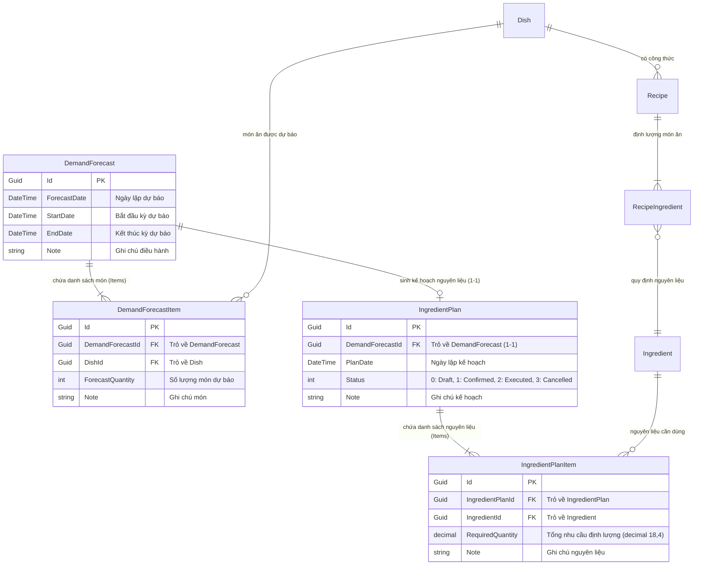

# Mô hình Dữ liệu (Data Model Specification): RM-014 Dự báo Nhu cầu & Kế hoạch Nguyên liệu

**Tính năng**: RM-014 — Dự báo Nhu cầu Món ăn & Kế hoạch Nguyên liệu (Demand Forecasts & Ingredient Requirement Planning)  
**Tài liệu Đặc tả liên quan**: [spec.md](spec.md) | [research.md](research.md)  
**Ngày cập nhật**: 2026-10-15  
**Trạng thái**: Hoàn thiện (Resolved)

---

## 1. Sơ đồ Quan hệ Thực thể (Entity Relationship Diagram - ERD)



---

## 2. Chi tiết Thực thể Cơ sở Dữ liệu (Database Entities)

### 2.1. `DemandForecast` (Aggregate Root)
- **Tên bảng**: `AppDemandForecasts`
- **Kế thừa**: `FullAuditedAggregateRoot<Guid>` (tự động có `CreationTime`, `CreatorId`, `LastModificationTime`, `LastModifierId`, `IsDeleted`, `DeleterId`, `DeletionTime`).
- **Các thuộc tính**:
  | Tên thuộc tính | Kiểu dữ liệu | Bắt buộc | Mặc định | Mô tả |
  |---|---|---|---|---|
  | `Id` | `Guid` | Có | `Guid.NewGuid()` | Khóa chính |
  | `ForecastDate` | `DateTime` | Có | `DateTime.Now` | Ngày giờ lập bản dự báo |
  | `StartDate` | `DateTime` | Có | `DateTime.Now` | Ngày bắt đầu kỳ dự báo |
  | `EndDate` | `DateTime` | Có | `DateTime.Now.AddDays(7)` | Ngày kết thúc kỳ dự báo |
  | `Note` | `string?` | Không | `null` | Ghi chú (tối đa 512 ký tự) |
  | `Items` | `ICollection<DemandForecastItem>` | Có | `new List<>()` | Danh sách các món ăn dự báo |

---

### 2.2. `DemandForecastItem` (Entity)
- **Tên bảng**: `AppDemandForecastItems`
- **Kế thừa**: `FullAuditedEntity<Guid>`.
- **Các thuộc tính**:
  | Tên thuộc tính | Kiểu dữ liệu | Bắt buộc | Mặc định | Mô tả |
  |---|---|---|---|---|
  | `Id` | `Guid` | Có | `Guid.NewGuid()` | Khóa chính |
  | `DemandForecastId` | `Guid` | Có | — | Khóa ngoại liên kết tới `DemandForecast` (Cascade Delete) |
  | `DishId` | `Guid` | Có | — | Khóa ngoại liên kết tới `Dish` (Restrict Delete) |
  | `ForecastQuantity` | `int` | Có | `0` | Số lượng phần ăn dự báo ($\ge 0$) |
  | `Note` | `string?` | Không | `null` | Ghi chú điều chỉnh (tối đa 256 ký tự) |

---

### 2.3. `IngredientPlan` (Aggregate Root)
- **Tên bảng**: `AppIngredientPlans`
- **Kế thừa**: `FullAuditedAggregateRoot<Guid>`.
- **Các thuộc tính**:
  | Tên thuộc tính | Kiểu dữ liệu | Bắt buộc | Mặc định | Mô tả |
  |---|---|---|---|---|
  | `Id` | `Guid` | Có | `Guid.NewGuid()` | Khóa chính |
  | `DemandForecastId` | `Guid` | Có | — | Khóa ngoại liên kết tới `DemandForecast` |
  | `PlanDate` | `DateTime` | Có | `DateTime.Now` | Ngày lập kế hoạch nguyên liệu |
  | `Status` | `PlanStatus` | Có | `PlanStatus.Draft` | Trạng thái kế hoạch (`Draft = 0`, `Confirmed = 1`, `Executed = 2`, `Cancelled = 3`) |
  | `Note` | `string?` | Không | `null` | Ghi chú kế hoạch (tối đa 512 ký tự) |
  | `Items` | `ICollection<IngredientPlanItem>` | Có | `new List<>()` | Danh sách nguyên liệu cần dùng |

---

### 2.4. `IngredientPlanItem` (Entity)
- **Tên bảng**: `AppIngredientPlanItems`
- **Kế thừa**: `FullAuditedEntity<Guid>`.
- **Các thuộc tính**:
  | Tên thuộc tính | Kiểu dữ liệu | Bắt buộc | Mặc định | Mô tả |
  |---|---|---|---|---|
  | `Id` | `Guid` | Có | `Guid.NewGuid()` | Khóa chính |
  | `IngredientPlanId` | `Guid` | Có | — | Khóa ngoại liên kết tới `IngredientPlan` (Cascade Delete) |
  | `IngredientId` | `Guid` | Có | — | Khóa ngoại liên kết tới `Ingredient` (Restrict Delete) |
  | `RequiredQuantity` | `decimal` | Có | `0` | Tổng lượng nguyên liệu cần dùng theo `BaseUnit` (`precision: 18, scale: 4`) |
  | `Note` | `string?` | Không | `null` | Ghi chú định lượng (tối đa 256 ký tự) |

---

## 3. Kiểu Dữ liệu Liệt kê (Enums)

### `PlanStatus`
Nằm tại `Acme.TooHungry.Domain.Shared/Forecasts/PlanStatus.cs`:
```csharp
namespace Acme.TooHungry.Forecasts;

public enum PlanStatus
{
    Draft = 0,       // Bản nháp (Được tạo tự động kèm DemandForecast)
    Confirmed = 1,   // Đã duyệt (Quản lý/Bếp trưởng phê duyệt mua hàng)
    Executed = 2,    // Đã hoàn tất (Thủ kho đã hoàn thành nhập hàng và giao nhận)
    Cancelled = 3    // Đã hủy bỏ
}
```

---

## 4. Các Đối tượng Truyền Dữ liệu (DTOs & ViewModels)

### 4.1. DTO Dự báo Nhu cầu Món ăn
```csharp
public class DemandForecastDto : FullAuditedEntityDto<Guid>
{
    public DateTime ForecastDate { get; set; }
    public DateTime StartDate { get; set; }
    public DateTime EndDate { get; set; }
    public string? Note { get; set; }
    public List<DemandForecastItemDto> Items { get; set; } = new();
    
    // Thuộc tính bổ trợ hiển thị
    public int TotalDishes => Items.Count;
    public int TotalQuantity => Items.Sum(x => x.ForecastQuantity);
    public decimal ProjectedRevenue { get; set; }
    public Guid? IngredientPlanId { get; set; }
    public PlanStatus? IngredientPlanStatus { get; set; }
}

public class DemandForecastItemDto : EntityDto<Guid>
{
    public Guid DemandForecastId { get; set; }
    public Guid DishId { get; set; }
    public string DishName { get; set; } = string.Empty;
    public string? DishImageUrl { get; set; }
    public decimal DishPrice { get; set; }
    public int ForecastQuantity { get; set; }
    public decimal TotalAmount => ForecastQuantity * DishPrice;
    public bool HasRecipe { get; set; }
    public string? Note { get; set; }
}

public class CreateUpdateDemandForecastDto
{
    public DateTime ForecastDate { get; set; } = DateTime.Now;
    public DateTime StartDate { get; set; } = DateTime.Now;
    public DateTime EndDate { get; set; } = DateTime.Now.AddDays(7);
    public string? Note { get; set; }
    public List<CreateUpdateDemandForecastItemDto> Items { get; set; } = new();
}

public class CreateUpdateDemandForecastItemDto
{
    public Guid DishId { get; set; }
    public int ForecastQuantity { get; set; }
    public string? Note { get; set; }
}
```

### 4.2. DTO Thuật toán Sinh Dự báo Tự động (SMA)
```csharp
public class GenerateForecastInputDto
{
    public DateTime StartDate { get; set; } = DateTime.Now;
    public DateTime EndDate { get; set; } = DateTime.Now.AddDays(7);
    public int HistoryDays { get; set; } = 7; // 7, 14, hoặc 30 ngày
}

public class GenerateForecastResultDto
{
    public DateTime StartDate { get; set; }
    public DateTime EndDate { get; set; }
    public int AnalysisDays { get; set; }
    public List<DemandForecastItemDto> SuggestedItems { get; set; } = new();
    public ForecastFinancialSummaryDto FinancialSummary { get; set; } = new();
}
```

### 4.3. DTO Kế hoạch Nguyên liệu & Gợi ý Mua hàng
```csharp
public class IngredientPlanDto : FullAuditedEntityDto<Guid>
{
    public Guid DemandForecastId { get; set; }
    public DateTime PlanDate { get; set; }
    public PlanStatus Status { get; set; }
    public string? Note { get; set; }
    public List<IngredientPlanItemDto> Items { get; set; } = new();
}

public class IngredientPlanItemDto : EntityDto<Guid>
{
    public Guid IngredientPlanId { get; set; }
    public Guid IngredientId { get; set; }
    public string IngredientName { get; set; } = string.Empty;
    public string BaseUnit { get; set; } = string.Empty;
    public decimal RequiredQuantity { get; set; }
    public decimal CurrentStock { get; set; }
    public decimal SuggestedPurchaseQuantity { get; set; }
    public decimal EstimatedPrice { get; set; }
    public decimal EstimatedCost { get; set; }
    public string? Note { get; set; }
}

public class UpdatePlanStatusDto
{
    public PlanStatus Status { get; set; }
}
```

### 4.4. DTO Báo cáo Tài chính Dự toán (Financial Projections)
```csharp
public class ForecastFinancialSummaryDto
{
    public decimal ProjectedRevenue { get; set; }        // Tổng doanh thu dự kiến
    public decimal ProjectedIngredientCost { get; set; } // Tổng giá vốn nguyên liệu lý thuyết
    public decimal FoodCostPercentage { get; set; }      // Tỷ lệ Food Cost %
    public decimal ProjectedPurchaseBudget { get; set; } // Tổng ngân sách mua nguyên liệu thiếu
}
```

---

## 5. Quy tắc Ràng buộc & Chuyển đổi Trạng thái (Validation & State Machine)

### 5.1. Ràng buộc Hợp lệ (Validation Invariants)
- `StartDate` phải nhỏ hơn hoặc bằng `EndDate` (`StartDate <= EndDate`).
- Khoảng cách giữa `StartDate` và `EndDate` tối đa 90 ngày.
- `HistoryDays` thuộc tập hợp hợp lệ `{7, 14, 30}` ngày.
- `ForecastQuantity >= 0` cho mọi món ăn (không cho phép nhập số âm).
- `RequiredQuantity >= 0` với độ chính xác 4 chữ số thập phân.
- Khi xóa bản ghi `DemandForecast`, hệ thống tự động xóa cascade `DemandForecastItem`, `IngredientPlan`, `IngredientPlanItem`.

### 5.2. Chuyển đổi Trạng thái Kế hoạch Nguyên liệu (`IngredientPlan.Status`)
```text
           [Tự động tạo kèm Dự báo]
                      │
                      ▼
                 ┌──────────┐
         ┌──────►│  Draft   ├──────┐
         │       └────┬─────┘      │
         │ (Hủy duyệt)│            │
         │            ▼ (Phê duyệt)│ (Hủy bỏ)
         │       ┌──────────┐      │
         └───────┤Confirmed │      │
                 └────┬─────┘      │
                      │ (Hoàn tất) │
                      ▼            ▼
                 ┌──────────┐ ┌───────────┐
                 │ Executed │ │ Cancelled │
                 └──────────┘ └───────────┘
```

---

## 6. Ánh xạ Đa ngôn ngữ (Localization Keys Mapping)

Toàn bộ các chuỗi giao diện được quản lý trong `vi.json` và `en.json`:
```json
{
  "TooHungry::Forecasts": {
    "Menu": "Dự báo & Kế hoạch",
    "Title": "Dự báo Nhu cầu & Kế hoạch Nguyên liệu",
    "ListTitle": "Danh sách Bản dự báo",
    "Create": "Tạo Bản dự báo Mới",
    "AutoGenerate": "Tự động tính từ Lịch sử",
    "AnalysisWindow": "Kỳ phân tích lịch sử",
    "History7Days": "7 ngày qua (Mặc định)",
    "History14Days": "14 ngày qua",
    "History30Days": "30 ngày qua",
    "StartDate": "Từ ngày",
    "EndDate": "Đến ngày",
    "ForecastDate": "Ngày lập",
    "DishesTab": "Dự báo Món ăn",
    "IngredientsTab": "Kế hoạch Nguyên liệu & Mua hàng",
    "ProjectedRevenue": "Doanh thu dự kiến",
    "ProjectedCost": "Chi phí nguyên liệu dự kiến",
    "FoodCostRate": "Tỷ lệ Food Cost %",
    "PurchaseBudget": "Ngân sách mua hàng",
    "DishName": "Tên món ăn",
    "ForecastQuantity": "Số lượng dự báo",
    "Price": "Giá bán",
    "TotalAmount": "Thành tiền",
    "NoRecipeWarning": "Chưa có công thức",
    "IngredientName": "Nguyên liệu",
    "BaseUnit": "Đơn vị cơ sở",
    "RequiredQuantity": "Nhu cầu chế biến",
    "CurrentStock": "Tồn kho khả dụng",
    "SuggestedPurchase": "Cần mua thêm",
    "EstimatedPrice": "Đơn giá ước tính",
    "EstimatedCost": "Thành tiền dự toán",
    "ExportExcel": "Xuất Excel mua hàng",
    "PrintA4": "In phiếu chuẩn bị bếp",
    "ApprovePlan": "Phê duyệt kế hoạch",
    "Status": {
      "Draft": "Bản nháp",
      "Confirmed": "Đã phê duyệt",
      "Executed": "Đã hoàn tất",
      "Cancelled": "Đã hủy"
    }
  }
}
```
