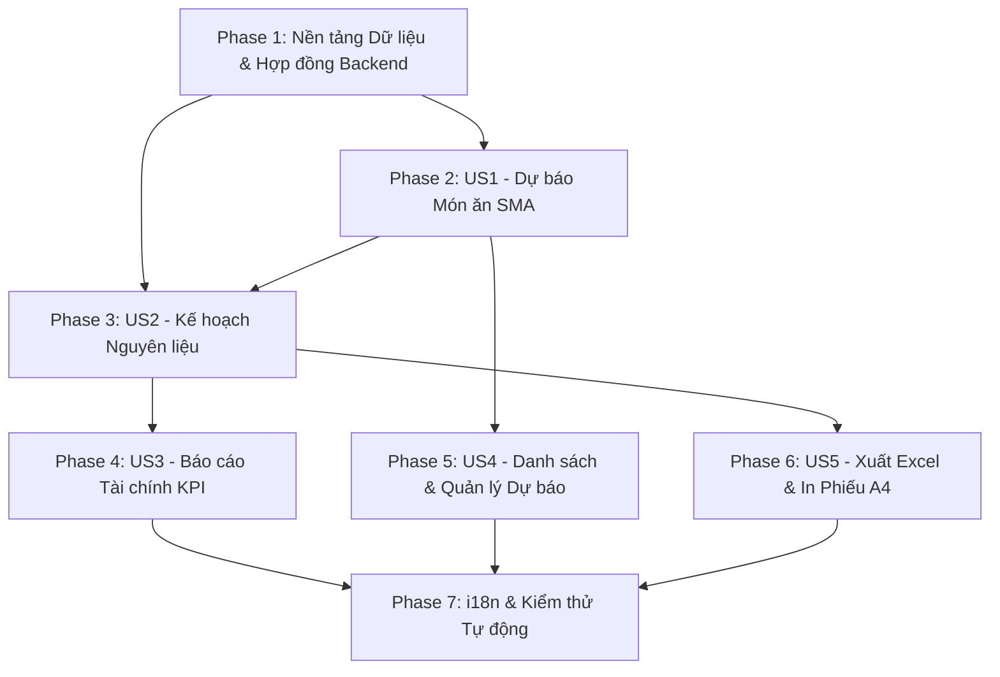

# Danh sách Công việc Triển khai (Tasks): RM-014 Dự báo Nhu cầu & Kế hoạch Nguyên liệu

**Tính năng**: `RM-014 — Dự báo Nhu cầu Món ăn & Kế hoạch Nguyên liệu (Demand Forecasts & Ingredient Requirement Planning)`  
**Nhánh (Branch)**: `014-rm-014-forecasts` | **Ngày**: 2026-10-15  
**Đặc tả (Spec)**: [spec.md](spec.md) | **Kế hoạch (Plan)**: [plan.md](plan.md) | **Mô hình Dữ liệu**: [data-model.md](data-model.md)

---

## Phase 1: Nền tảng Dữ liệu & Hợp đồng Backend (Setup & Data Foundations)

**Mục tiêu**: Chuẩn bị các thực thể Domain, cấu hình Entity Framework Core DbContext, Enums, DTOs, interfaces và phân quyền làm nền tảng cho toàn bộ module Dự báo.

- [x] T001 [P] Khởi tạo thực thể `IngredientPlan` (`DemandForecastId`, `PlanDate`, `Status`, `Note`, `Items`) kế thừa `FullAuditedAggregateRoot<Guid>` trong `src/Acme.TooHungry.Domain/Forecasts/IngredientPlan.cs`
- [x] T002 [P] Khởi tạo thực thể `IngredientPlanItem` (`IngredientPlanId`, `IngredientId`, `RequiredQuantity` [decimal 18, 4], `Note`) kế thừa `FullAuditedEntity<Guid>` trong `src/Acme.TooHungry.Domain/Forecasts/IngredientPlanItem.cs`
- [x] T003 Cập nhật `TooHungryDbContext.cs` trong `src/Acme.TooHungry.EntityFrameworkCore/EntityFrameworkCore/TooHungryDbContext.cs`:
  - Khai báo `public DbSet<IngredientPlan> IngredientPlans { get; set; }`
  - Khai báo `public DbSet<IngredientPlanItem> IngredientPlanItems { get; set; }`
  - Cấu hình Fluent API trong `OnModelCreating`: Bảng `AppIngredientPlans`, `AppIngredientPlanItems`, khóa ngoại `Cascade Delete`, cấu hình `HasPrecision(18, 4)` cho `RequiredQuantity`
- [x] T004 [P] Định nghĩa nhóm quyền `TooHungryPermissions.Forecasts` (`Default`, `Create`, `Edit`, `Delete`, `Approve`) trong `src/Acme.TooHungry.Application.Contracts/Permissions/TooHungryPermissions.cs` và khai báo hiển thị trong `src/Acme.TooHungry.Application.Contracts/Permissions/TooHungryPermissionDefinitionProvider.cs`
- [x] T005 [P] Khởi tạo và mở rộng các DTOs (`DemandForecastDto`, `DemandForecastItemDto`, `CreateUpdateDemandForecastDto`, `IngredientPlanDto`, `IngredientPlanItemDto`, `GenerateForecastInputDto`, `GenerateForecastResultDto`, `ForecastFinancialSummaryDto`, `UpdatePlanStatusDto`) trong `src/Acme.TooHungry.Application.Contracts/Forecasts/ForecastDtos.cs`
- [x] T006 [P] Cập nhật interfaces `IDemandForecastAppService` và `IIngredientPlanAppService` trong `src/Acme.TooHungry.Application.Contracts/Forecasts/IForecastAppServices.cs`

**Trạm kiểm tra (Checkpoint)**: Toàn bộ tầng Domain, EF Core DbContext, DTOs và Quyền hạn Backend đã sẵn sàng để triển khai logic nghiệp vụ các User Stories.

---

## Phase 2: User Story 1 - Tự động Sinh & Điều chỉnh Dự báo Nhu cầu Món ăn theo SMA (Priority: P1) 🎯 MVP Core

**Mục tiêu**: Xây dựng thuật toán phân tích lịch sử bán hàng theo Trung bình động đơn giản (SMA 7/14/30 ngày làm tròn trần) và giao diện cho phép Bếp trưởng điều chỉnh số lượng dự kiến của từng món ăn.  
**Kiểm thử Độc lập**: Gửi yêu cầu `POST /api/app/demand-forecast/generate` với `historyDays = 7` $\rightarrow$ hệ thống trả về danh sách các món ăn kèm số lượng dự báo chính xác; lưu bản dự báo thành công vào cơ sở dữ liệu.

- [x] T007 [US1] Triển khai phương thức `GenerateForecastAsync(GenerateForecastInputDto input)` trong `src/Acme.TooHungry.Application/Forecasts/ForecastAppServices.cs`:
  - Lấy các đơn hàng có `Status == OrderStatus.Completed` trong khoảng thời gian `(Now - HistoryDays)` đến `Now`
  - Nhóm `OrderItem` theo `DishId`, tính tổng số lượng bán và tính trung bình mỗi ngày $\text{DailyAverage} = \sum \text{Quantity} / \text{HistoryDays}$
  - Tính số ngày kỳ dự báo $N = \max(1, \lceil (\text{EndDate} - \text{StartDate}).\text{TotalDays} \rceil)$
  - Gợi ý số lượng dự báo: $\text{ForecastQuantity} = \lceil \text{DailyAverage} \times N \rceil$ (`Math.Ceiling`)
  - Lấy danh mục món ăn đang kích hoạt (`Dish.IsActive = true`) và trả về danh sách đầy đủ
- [x] T008 [US1] Hoàn thiện phương thức `CreateAsync` và `UpdateAsync` trong `DemandForecastAppService` (`src/Acme.TooHungry.Application/Forecasts/ForecastAppServices.cs`):
  - Lưu bản ghi `DemandForecast` cùng danh sách `DemandForecastItem` với số lượng điều chỉnh thủ công
  - Kiểm tra tính hợp lệ: `StartDate <= EndDate` và `ForecastQuantity >= 0`
- [x] T009 [US1] Phơi bày các REST endpoints trong `src/Acme.TooHungry.HttpApi/Controllers/ForecastController.cs`:
  - `POST /api/app/demand-forecast/generate`
  - `POST /api/app/demand-forecast`
  - `PUT /api/app/demand-forecast/{id}`
  - Gắn thuộc tính `[Authorize(TooHungryPermissions.Forecasts.Create)]` và `[Authorize(TooHungryPermissions.Forecasts.Edit)]`
- [x] T010 [P] [US1] Tạo Angular Proxy Service `DemandForecastService` trong `angular/src/app/proxy/forecasts/forecast.service.ts` và khai báo models trong `angular/src/app/proxy/forecasts/models.ts`
- [x] T011 [US1] Xây dựng màn hình/modal tạo dự báo `ForecastCreateComponent` trong `angular/src/app/forecast/forecast-create/`:
  - Form chọn khoảng thời gian (`StartDate` - `EndDate`) và dropdown chọn kỳ phân tích SMA (7, 14, 30 ngày)
  - Nút `[⚡ Tự động tính từ Lịch sử]` gọi API `generate`
  - Bảng danh sách món ăn cho phép Bếp trưởng chỉnh sửa trực tiếp số lượng `ForecastQuantity` và ghi chú `Note`
  - Nút `[Lưu bản dự báo]` gửi dữ liệu lưu về Backend

**Trạm kiểm tra (Checkpoint)**: Thuật toán gợi ý SMA và chức năng tạo/sửa bản dự báo món ăn hoạt động hoàn hảo, kiểm thử được độc lập qua giao diện và API.

---

## Phase 3: User Story 2 - Tự động Tính toán Nhu cầu Nguyên liệu & Gợi ý Mua hàng (Priority: P1) 🎯 MVP Core

**Mục tiêu**: Tự động bóc tách công thức định lượng (Recipe Explosion) của từng món dự báo để sinh Kế hoạch nguyên liệu (`IngredientPlan`), đối soát tồn kho khả dụng (`CurrentStock`), tính số lượng gợi ý cần mua thêm và quản lý trạng thái phê duyệt.  
**Kiểm thử Độc lập**: Lưu bản dự báo món ăn $\rightarrow$ hệ thống tự sinh `IngredientPlan` ở trạng thái `Draft`; gọi API xem chi tiết $\rightarrow$ hiển thị chính xác tổng nhu cầu, tồn kho thực tế và số lượng cần mua thêm; bấm duyệt $\rightarrow$ chuyển trạng thái sang `Confirmed`.

- [x] T012 [US2] Triển khai logic bóc tách định lượng công thức (Recipe Explosion) trong `DemandForecastAppService` (`src/Acme.TooHungry.Application/Forecasts/ForecastAppServices.cs`):
  - Duyệt qua từng món ăn có `ForecastQuantity > 0`, truy vấn `Recipe` đang kích hoạt (`IsActive = true`) phiên bản mới nhất
  - Tổng hợp nhu cầu từng nguyên liệu theo đơn vị chuẩn `BaseUnit`: $\text{RequiredQuantity} = \sum (\text{ForecastQuantity} \times \text{RecipeIngredient.Quantity})$
  - Tự động tạo và lưu bản ghi `IngredientPlan` liên kết với `DemandForecast` cùng danh sách `IngredientPlanItem` với trạng thái `PlanStatus.Draft`
- [x] T013 [US2] Triển khai phương thức `GetByForecastIdAsync(Guid demandForecastId)` trong `IngredientPlanAppService` (`src/Acme.TooHungry.Application/Forecasts/ForecastAppServices.cs`):
  - Lấy danh sách nguyên liệu của kế hoạch
  - Tính tồn kho khả dụng `CurrentStock` từ tổng `RemainingQuantity` của các lô `InventoryBatch` chưa hết hạn (`ExpiryDate >= Now` và `IsActive = true`)
  - Tính số lượng gợi ý cần mua thêm: $\text{SuggestedPurchaseQuantity} = \max(0, \text{RequiredQuantity} - \text{CurrentStock})$
  - Tính thành tiền dự toán mua hàng: $\text{EstimatedCost} = \text{SuggestedPurchaseQuantity} \times (\text{Ingredient.EstimatedPrice} \mathbin{??} 0)$
- [x] T014 [US2] Triển khai phương thức `UpdateStatusAsync(Guid id, UpdatePlanStatusDto input)` trong `IngredientPlanAppService` (`src/Acme.TooHungry.Application/Forecasts/ForecastAppServices.cs`):
  - Hỗ trợ chuyển đổi trạng thái: `Draft` $\rightarrow$ `Confirmed` (Phê duyệt) và `Confirmed` $\rightarrow$ `Executed` (Hoàn tất)
  - Kiểm tra quyền `TooHungryPermissions.Forecasts.Approve`
- [x] T015 [US2] Phơi bày các REST endpoints trong `src/Acme.TooHungry.HttpApi/Controllers/ForecastController.cs`:
  - `GET /api/app/ingredient-plan/by-forecast/{demandForecastId}`
  - `PUT /api/app/ingredient-plan/{id}/status`
- [x] T016 [P] [US2] Bổ sung Proxy Service `IngredientPlanService` trong `angular/src/app/proxy/forecasts/forecast.service.ts`
- [x] T017 [US2] Xây dựng Tab "Kế hoạch Nguyên liệu & Mua hàng" trong `angular/src/app/forecast/forecast-detail/forecast-detail.component.html` và `.ts`:
  - Bảng danh sách nguyên liệu: Mã, Tên, Đơn vị tính cơ sở, Nhu cầu chế biến, Tồn kho khả dụng, Cần mua thêm, Đơn giá ước tính và Thành tiền
  - Badge cảnh báo màu cam cho nguyên liệu thiếu hụt; badge xanh lá cho nguyên liệu đã đủ tồn
  - Cảnh báo "Chưa có công thức" cho các món chưa cấu hình Recipe
  - Nút `[✓ Phê duyệt kế hoạch]` kèm hộp thoại xác nhận

**Trạm kiểm tra (Checkpoint)**: Cả 2 User Story cốt lõi (US1 & US2) hoạt động trơn tru; nhà hàng đã có thể sinh dự báo món ăn và kế hoạch nguyên liệu hoàn chỉnh.

---

## Phase 4: User Story 3 - Báo cáo Phân tích Doanh thu Dự kiến & Food Cost % (Priority: P2)

**Mục tiêu**: Tính toán và hiển thị trực quan 4 thẻ chỉ số tài chính KPI (Doanh thu dự kiến, Chi phí nguyên liệu lý thuyết, Tỷ lệ Food Cost % và Ngân sách mua sắm cần chi trả).  
**Kiểm thử Độc lập**: Mở bản dự báo $\rightarrow$ kiểm tra 4 thẻ KPI tài chính đầu trang hiển thị đúng số liệu doanh thu, chi phí, tỷ lệ % và ngân sách cần nhập kho.

- [x] T018 [US3] Triển khai phương thức `GetFinancialSummaryAsync(Guid id)` trong `DemandForecastAppService` (`src/Acme.TooHungry.Application/Forecasts/ForecastAppServices.cs`):
  - Doanh thu dự kiến: $\text{ProjectedRevenue} = \sum (\text{ForecastQuantity} \times \text{Dish.Price})$
  - Chi phí nguyên liệu lý thuyết: $\text{ProjectedCost} = \sum (\text{RequiredQuantity} \times \text{Ingredient.EstimatedPrice})$
  - Tỷ lệ Food Cost %: $\text{FoodCostPercentage} = \text{ProjectedRevenue} > 0 \ ? \ (\text{ProjectedCost} / \text{ProjectedRevenue}) \times 100 \ : \ 0$
  - Ngân sách mua hàng: $\text{ProjectedPurchaseBudget} = \sum (\text{SuggestedPurchaseQuantity} \times \text{Ingredient.EstimatedPrice})$
- [x] T019 [US3] Phơi bày endpoint `GET /api/app/demand-forecast/{id}/financial-summary` trong `src/Acme.TooHungry.HttpApi/Controllers/ForecastController.cs`
- [x] T020 [US3] Xây dựng khối 4 thẻ KPI tài chính đầu trang trong `angular/src/app/forecast/forecast-detail/forecast-detail.component.html` và `.scss`:
  - Thiết kế thẻ bo góc 12px, bóng đổ nhẹ, biểu tượng màu cam `#EA580C`
  - Thẻ 1: Doanh thu dự kiến (Projected Revenue)
  - Thẻ 2: Chi phí nguyên liệu lý thuyết (Projected Ingredient Cost)
  - Thẻ 3: Tỷ lệ Food Cost % (kèm thanh progress bar trực quan)
  - Thẻ 4: Ngân sách cần nhập hàng (Purchase Budget)

**Trạm kiểm tra (Checkpoint)**: Bức tranh tài chính dự toán hiển thị minh bạch, số liệu tính toán chính xác 100%.

---

## Phase 5: User Story 4 - Tra cứu, Lọc & Quản lý Danh sách Bản dự báo (Priority: P2)

**Mục tiêu**: Xây dựng màn hình quản lý danh sách các bản dự báo phân trang, bộ lọc theo ngày và các thao tác xem chi tiết/xóa bản dự báo.  
**Kiểm thử Độc lập**: Truy cập `/forecasts` $\rightarrow$ danh sách các bản dự báo hiển thị phân trang; lọc theo khoảng ngày $\rightarrow$ dữ liệu lọc đúng; bấm xóa $\rightarrow$ bản dự báo và kế hoạch nguyên liệu liên quan được xóa an toàn.

- [x] T021 [US4] Hoàn thiện phương thức `GetListAsync` và `DeleteAsync` trong `DemandForecastAppService` (`src/Acme.TooHungry.Application/Forecasts/ForecastAppServices.cs`):
  - Phân trang, sắp xếp theo ngày lập mới nhất (`ForecastDate DESC`)
  - Lọc theo khoảng thời gian (`StartDate` đến `EndDate`) và từ khóa ghi chú
  - Xóa mềm (Soft Delete) tự động cascade dọn sạch `IngredientPlan` liên kết
- [x] T022 [US4] Xây dựng màn hình danh sách `ForecastComponent` trong `angular/src/app/forecast/forecast.component.ts`, `.html`, `.scss`:
  - Bảng `SharedTable` chuẩn hóa các cột: Ngày lập, Kỳ dự báo (Từ ngày - Đến ngày), Số lượng món, Tổng doanh thu dự kiến, Trạng thái Kế hoạch nguyên liệu, Ghi chú, Nút Thao tác
  - Bộ lọc chọn khoảng thời gian và ô tìm kiếm từ khóa
  - Nút `[+ Tạo bản dự báo mới]` mở modal `ForecastCreateComponent`
  - Nút `[Xem chi tiết]` điều hướng sang `/forecasts/detail/:id`
  - Nút `[Xóa]` kèm hộp thoại xác nhận an toàn
- [x] T023 [US4] Cấu hình định tuyến và Menu điều hướng trong Angular:
  - Đăng ký tuyến đường `/forecasts` và `/forecasts/detail/:id` trong `angular/src/app/app.routes.ts`
  - Khai báo menu "Dự báo & Kế hoạch" trong `angular/src/app/route.provider.ts` với biểu tượng `fa-chart-line` và bảo vệ bằng `TooHungryPermissions.Forecasts.Default`

**Trạm kiểm tra (Checkpoint)**: Màn hình danh sách dự báo hoạt động hoàn chỉnh, điều hướng mượt mà và phân quyền chuẩn xác.

---

## Phase 6: User Story 5 - Xuất Kế hoạch Mua hàng ra Excel & In Phiếu Chuẩn bị Bếp (Priority: P3)

**Mục tiêu**: Hỗ trợ xuất bảng kê nguyên liệu cần mua ra file Excel (.xlsx / CSV UTF-8 BOM) và in phiếu chuẩn bị bếp khổ A4 thông qua CSS Print chuyên biệt.  
**Kiểm thử Độc lập**: Bấm `[Xuất Excel mua hàng]` $\rightarrow$ file tải về mở trên Excel không bị lỗi font tiếng Việt; bấm `[In phiếu chuẩn bị bếp]` $\rightarrow$ hộp thoại in hiển thị đúng khổ A4 sạch sẽ, không có thanh menu hay nút bấm.

- [x] T024 [US5] Triển khai hàm xuất file Excel bảng kê mua hàng trong `angular/src/app/forecast/forecast-detail/forecast-detail.component.ts`:
  - Tạo file định dạng CSV có tiền tố Byte Order Mark UTF-8 (`\uFEFF`) để Excel hiển thị tiếng Việt có dấu hoàn hảo
  - Đặt tên file tự động theo kỳ dự báo: `KeHoachMuaHang_YYYYMMDD_YYYYMMDD.csv`
  - Đầy đủ các cột: STT, Mã nguyên liệu, Tên nguyên liệu, Đơn vị tính cơ sở, Nhu cầu chế biến, Tồn kho khả dụng, Cần mua thêm, Đơn giá ước tính, Thành tiền dự toán
  - Dòng tổng kết ngân sách mua sắm ở cuối bảng
- [x] T025 [US5] Triển khai tính năng In phiếu chuẩn bị bếp A4 trong `angular/src/app/forecast/forecast-detail/forecast-detail.component.scss` và `.html`:
  - Cấu hình CSS Media Query `@media print` khổ `@page { size: A4 portrait; margin: 15mm; }`
  - Ẩn toàn bộ thanh menu sidebar, topbar, tabs, nút bấm, footer khi in
  - Hiển thị Header phiếu in trang trọng: Tên nhà hàng "Acme.TooHungry", Tiêu đề "PHIẾU CHUẨN BỊ NGUYÊN VẬT LIỆU", Mã dự báo, Kỳ dự báo
  - Bảng danh sách nguyên liệu phân bổ vừa vặn khổ A4, viền nét mảnh, độ tương phản cao
  - Phần chân trang có 2 ô ký tên rõ ràng: "Bếp trưởng" và "Thủ kho / Người mua hàng"

**Trạm kiểm tra (Checkpoint)**: Cả 2 phương thức xuất file Excel và in phiếu A4 hoạt động hoàn hảo, sẵn sàng cho công tác tác nghiệp thực tế tại bếp và kho.

---

## Phase 7: Quốc tế hóa Song ngữ, Kiểm thử Tự động & Trau chuốt (Polish & Quality Gates)

**Mục tiêu**: Hoàn thiện 100% bản dịch song ngữ Tiếng Việt & Tiếng Anh, xây dựng bộ kiểm thử tự động toàn diện và xác thực chất lượng trước khi bàn giao.

- [x] T026 [P] Bổ sung và đồng bộ đầy đủ các khóa từ điển vào `src/Acme.TooHungry.Domain.Shared/Localization/TooHungry/vi.json` và `en.json` dưới tiền tố `TooHungry::Forecasts.*`
- [x] T027 [P] Bổ sung và đồng bộ đầy đủ các khóa từ điển vào `angular/src/assets/i18n/vi.json` và `en.json` dưới tiền tố `TooHungry::Forecasts.*`
- [x] T028 [P] Viết bộ kiểm thử tự động Unit & Integration Tests cho `DemandForecastAppService` và `IngredientPlanAppService` trong `test/Acme.TooHungry.Application.Tests/Forecasts/ForecastAppService_Tests.cs`:
  - Test tính toán thuật toán SMA và làm tròn trần `Ceiling`
  - Test bóc tách định lượng `Recipe` và tính tồn kho an toàn
  - Test kiểm tra phân quyền và chuyển đổi trạng thái `PlanStatus`
- [x] T029 Kiểm tra biên dịch Backend (`dotnet build`) và Frontend (`npm run build`) đảm bảo 0 lỗi cảnh báo cú pháp
- [x] T030 Xác thực toàn diện 6 kịch bản kiểm thử E2E theo [quickstart.md](quickstart.md) và cập nhật trạng thái trong [roadmap.md](../../docs/roadmap.md)

**Trạm kiểm tra (Checkpoint)**: Toàn bộ tính năng RM-014 đạt chuẩn 100% chất lượng, sẵn sàng bàn giao cho người dùng.

---

## Phụ thuộc (Dependencies) & Thứ tự Thực thi

### Cơ hội Triển khai Song song (Parallel Opportunities)
- **T001, T002, T004, T005, T006** trong Phase 1 có thể tạo độc lập song song.
- **T010** (Angular Proxies) có thể tạo song song với **T007, T008** (Backend logic).
- **T016** (Proxy Service) có thể tạo song song với **T012, T013** (Recipe logic).
- **T026, T027, T028** trong Phase 7 có thể viết song song.

---

## Chiến lược Triển khai (Implementation Strategy)

### MVP Trước tiên (Chỉ User Story 1 & 2)
1. Hoàn thành **Phase 1: Nền tảng Dữ liệu**.
2. Hoàn thành **Phase 2: User Story 1 (Dự báo SMA)** và **Phase 3: User Story 2 (Kế hoạch Nguyên liệu)**.
3. **DỪNG và XÁC MINH**: Kiểm thử độc lập luồng sinh dự báo món và bóc tách nguyên liệu $\rightarrow$ Nhà hàng đã có thể vận hành MVP cốt lõi!

### Phân phối Tăng dần (Incremental Delivery)
- **Increment 1 (MVP)**: Phase 1 + Phase 2 + Phase 3 (Dự báo món ăn + Kế hoạch nguyên liệu).
- **Increment 2 (Quản lý & Tài chính)**: Phase 4 + Phase 5 (Thẻ KPI tài chính + Màn hình danh sách dự báo phân trang).
- **Increment 3 (Tác nghiệp & Polish)**: Phase 6 + Phase 7 (Xuất Excel mua hàng + In phiếu A4 + i18n + Automated Tests).
