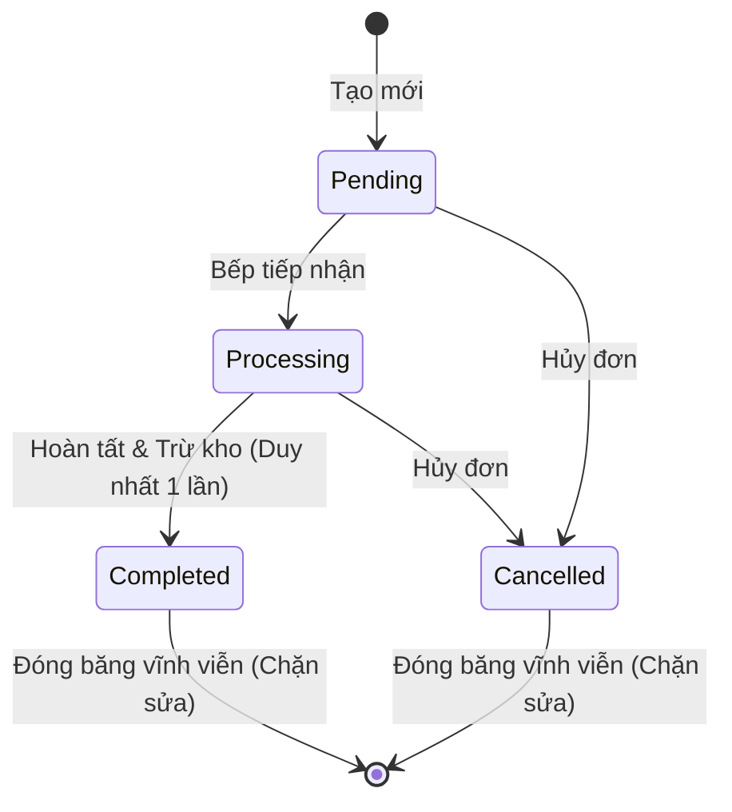
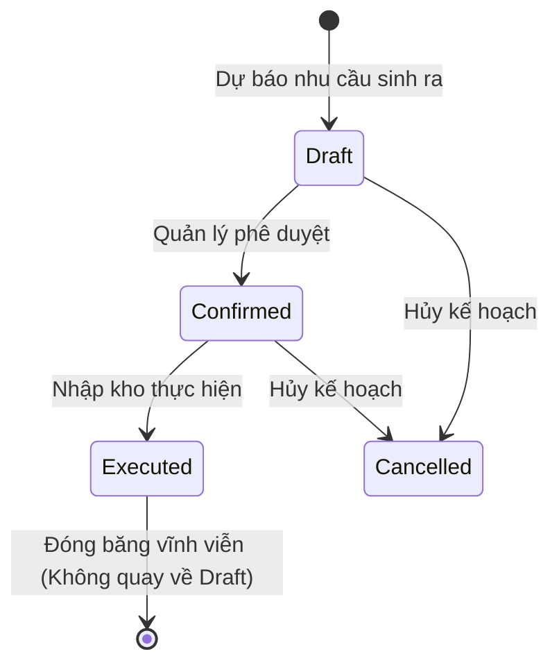

# Thiết kế Dữ liệu & Mô hình Miền (Data Model & Domain Design): RM-022 Ổn định hóa & Vá lỗi Nghiêm trọng Backend

**Mã Tính năng (Feature ID)**: `RM-022`  
**Nhánh (Branch)**: `022-rm-022-backend-hardening`  
**Ngày thực hiện**: 2026-10-22  
**Đặc tả tham chiếu**: [spec.md](spec.md) | **Nghiên cứu**: [research.md](research.md)

---

## 1. Mô hình Thực thể Miền (Domain Aggregate Roots & Entities)

### 1.1. Thực thể `Order` (Aggregate Root)
- **Tập tin**: `src/Acme.TooHungry.Domain/Orders/Order.cs`
- **Mục tiêu**: Chuyển từ Anemic Model sang Rich Domain Model, đóng gói toàn bộ quy tắc chuyển trạng thái và tính toán thành tiền.

```csharp
public class Order : FullAuditedAggregateRoot<Guid>
{
    public string OrderNumber { get; protected set; } = string.Empty;
    public DateTime OrderDate { get; protected set; }
    public OrderStatus Status { get; protected set; } = OrderStatus.Pending;
    public decimal TotalAmount { get; protected set; }
    public string? Note { get; set; }
    public Guid? TableId { get; set; }
    public virtual RestaurantTable? Table { get; set; }
    public virtual ICollection<OrderItem> Items { get; protected set; } = new List<OrderItem>();

    protected Order() { }

    public Order(Guid id, string orderNumber, DateTime orderDate, Guid? tableId, string? note = null)
        : base(id)
    {
        OrderNumber = Check.NotNullOrWhiteSpace(orderNumber, nameof(orderNumber), 64);
        OrderDate = orderDate;
        TableId = tableId;
        Note = note;
        Status = OrderStatus.Pending;
        TotalAmount = 0;
    }

    /// <summary>
    /// Hoàn tất đơn hàng. Chặn nếu đơn đã hoàn tất hoặc đã hủy.
    /// </summary>
    public void Complete()
    {
        if (Status == OrderStatus.Completed)
        {
            throw new BusinessException("TooHungry:Order:AlreadyCompleted");
        }
        if (Status == OrderStatus.Cancelled)
        {
            throw new BusinessException("TooHungry:Order:CannotCompleteCancelledOrder");
        }
        Status = OrderStatus.Completed;
    }

    /// <summary>
    /// Hủy đơn hàng. Chặn nếu đơn đã hoàn tất.
    /// </summary>
    public void Cancel(string? reason = null)
    {
        if (Status == OrderStatus.Completed)
        {
            throw new BusinessException("TooHungry:Order:CannotCancelCompletedOrder");
        }
        Status = OrderStatus.Cancelled;
        if (!string.IsNullOrWhiteSpace(reason))
        {
            Note = string.IsNullOrWhiteSpace(Note) ? $"[Lý do hủy: {reason}]" : $"{Note} | [Lý do hủy: {reason}]";
        }
    }

    /// <summary>
    /// Tính toán lại tổng tiền từ các dòng OrderItem.
    /// </summary>
    public void RecalculateTotal()
    {
        TotalAmount = Items.Sum(x => x.TotalPrice);
    }
}
```

---

### 1.2. Thực thể `RestaurantTable` (Aggregate Root)
- **Tập tin**: `src/Acme.TooHungry.Domain/Tables/RestaurantTable.cs`
- **Mục tiêu**: Đóng gói các thao tác đổi trạng thái bàn ăn, triệt tiêu đoạn mã reset 8 trường dữ liệu rải rác.

```csharp
public class RestaurantTable : FullAuditedAggregateRoot<Guid>
{
    public string Name { get; set; } = string.Empty;
    public int Capacity { get; set; } = 4;
    public TableStatus Status { get; protected set; } = TableStatus.Available;
    public Guid? DiningAreaId { get; set; }
    public virtual DiningArea? DiningArea { get; set; }
    public string? Location { get; set; }

    // Reservation info
    public string? ReservedCustomerName { get; protected set; }
    public string? ReservedCustomerPhone { get; protected set; }
    public DateTime? ReservedTime { get; protected set; }
    public int? ReservedGuestCount { get; protected set; }
    public string? ReservedNote { get; protected set; }
    public DateTime? OccupiedTime { get; protected set; }

    public virtual ICollection<Order> Orders { get; set; } = new List<Order>();
    public virtual ICollection<TableReservation> Reservations { get; set; } = new List<TableReservation>();

    protected RestaurantTable() { }

    public void Occupy(DateTime now)
    {
        Status = TableStatus.Occupied;
        OccupiedTime = now;
        ClearReservationInfo();
    }

    public void Release()
    {
        Status = TableStatus.Available;
        OccupiedTime = null;
        ClearReservationInfo();
    }

    public void MarkCleaning()
    {
        Status = TableStatus.Cleaning;
        OccupiedTime = null;
        ClearReservationInfo();
    }

    public void Reserve(string name, string phone, DateTime time, int guestCount, string? note = null)
    {
        Status = TableStatus.Reserved;
        ReservedCustomerName = name;
        ReservedCustomerPhone = phone;
        ReservedTime = time;
        ReservedGuestCount = guestCount;
        ReservedNote = note;
    }

    private void ClearReservationInfo()
    {
        ReservedCustomerName = null;
        ReservedCustomerPhone = null;
        ReservedTime = null;
        ReservedGuestCount = null;
        ReservedNote = null;
    }
}
```

---

## 2. Cấu hình Cơ sở Dữ liệu & Filtered Indexes (EF Core)

- **Tập tin**: `src/Acme.TooHungry.EntityFrameworkCore/EntityFrameworkCore/TooHungryDbContext.cs`

### 2.1. Filtered Unique Index cho `Order` (Active Orders)
Chỉ cho phép duy nhất một đơn hàng ở trạng thái hoạt động (`Pending = 0` hoặc `Processing = 1`) cho mỗi bàn ăn:

```csharp
builder.Entity<Order>(b =>
{
    // ...
    b.HasIndex(x => x.TableId)
     .IsUnique()
     .HasFilter("[TableId] IS NOT NULL AND [Status] NOT IN (2, 3) AND [IsDeleted] = 0");
});
```

### 2.2. Lọc Soft-Delete cho Unique Indexes (`Table`, `Unit`)
Ngăn ngừa lỗi 500 khi tạo lại tên bàn hoặc tên đơn vị tính đã bị xóa mềm trước đó:

```csharp
builder.Entity<RestaurantTable>(b =>
{
    // ...
    b.HasIndex(x => x.Name)
     .IsUnique()
     .HasFilter("[IsDeleted] = 0");
});

builder.Entity<Unit>(b =>
{
    // ...
    b.HasIndex(x => x.Name)
     .IsUnique()
     .HasFilter("[IsDeleted] = 0");

    b.HasIndex(x => x.Abbreviation)
     .IsUnique()
     .HasFilter("[IsDeleted] = 0");
});
```

---

## 3. Cấu hình DTO & Validation Rules

- **Tập tin**: `src/Acme.TooHungry.Application.Contracts/Orders/OrderDtos.cs`

### 3.1. DTO Món ăn Đầu vào (Không chứa UnitPrice/TotalPrice)
```csharp
public class CreateUpdateOrderItemDto
{
    [Required]
    public Guid DishId { get; set; }

    [Range(1, 999, ErrorMessage = "TooHungry:Order:QuantityOutOfRange")]
    public int Quantity { get; set; }

    [StringLength(512, ErrorMessage = "TooHungry:Order:NoteTooLong")]
    public string? Note { get; set; }
}

public class SubmitOrderItemDto
{
    [Required]
    public Guid DishId { get; set; }

    [Range(1, 999, ErrorMessage = "TooHungry:Order:QuantityOutOfRange")]
    public int Quantity { get; set; }

    [StringLength(512, ErrorMessage = "TooHungry:Order:NoteTooLong")]
    public string? Note { get; set; }
}
```

### 3.2. DTO Đơn hàng Đầu vào (Không chứa TotalAmount)
```csharp
public class SubmitOrderInputDto
{
    public Guid? OrderId { get; set; }

    [Required]
    public Guid TableId { get; set; }

    [StringLength(512)]
    public string? Note { get; set; }

    [Required]
    [MinLength(1, ErrorMessage = "TooHungry:Order:EmptyItems")]
    public List<SubmitOrderItemDto> Items { get; set; } = new();
}

public class CreateUpdateOrderDto
{
    public string OrderNumber { get; set; } = string.Empty;
    public DateTime OrderDate { get; set; }
    public OrderStatus Status { get; set; } = OrderStatus.Pending;

    [StringLength(512)]
    public string? Note { get; set; }

    public Guid? TableId { get; set; }

    [Required]
    [MinLength(1, ErrorMessage = "TooHungry:Order:EmptyItems")]
    public List<CreateUpdateOrderItemDto> Items { get; set; } = new();
}
```

### 3.3. DTO Bàn ăn Đã loại bỏ Mass Assignment
- **Tập tin**: `src/Acme.TooHungry.Application.Contracts/Tables/TableDtos.cs`

```csharp
public class CreateUpdateTableDto
{
    [Required]
    [StringLength(128)]
    public string Name { get; set; } = string.Empty;

    [Range(1, 100)]
    public int Capacity { get; set; } = 4;

    public Guid? DiningAreaId { get; set; }

    [StringLength(128)]
    public string? Location { get; set; }
}
```
*(Đã loại bỏ hoàn toàn: `Status`, `OccupiedTime`, `ReservedCustomerName`, `ReservedCustomerPhone`, `ReservedTime`, `ReservedGuestCount`, `ReservedNote`)*.

---

## 4. Máy Trạng thái (State Machines) & Bất biến

### 4.1. Máy Trạng thái Đơn hàng (`Order`)


### 4.2. Máy Trạng thái Kế hoạch Nguyên liệu (`IngredientPlan`)


---

## 5. Từ điển Quốc tế hóa Song ngữ (i18n Localization Keys)

Các mã lỗi nghiệp vụ mới được bổ sung đồng bộ vào cả hai tệp `vi.json` và `en.json`:

| Mã lỗi định danh | Bản dịch Tiếng Việt (`vi.json`) | Bản dịch Tiếng Anh (`en.json`) |
|---|---|---|
| `TooHungry:Order:AlreadyCompleted` | Đơn hàng này đã hoàn tất, không thể chỉnh sửa hoặc trừ kho lại! | This order is already completed and cannot be edited or deducted again! |
| `TooHungry:Order:AlreadyCancelled` | Đơn hàng này đã bị hủy, không thể hoàn tất hoặc chỉnh sửa! | This order has been cancelled and cannot be completed or edited! |
| `TooHungry:Order:TableAlreadyHasActiveOrder` | Bàn này đã có một đơn hàng đang hoạt động! Đang đồng bộ dữ liệu... | This table already has an active order! Synchronizing data... |
| `TooHungry:Table:TableCurrentlyOccupied` | Bàn ăn hiện đang có khách ngồi dùng bữa, không thể nhận khách đặt bàn đè lên! | The table is currently occupied by guests, cannot check in a reservation over it! |
| `TooHungry:Forecast:CannotRevertExecutedPlan` | Kế hoạch nguyên liệu đã được thực thi, không thể chuyển ngược về bản nháp! | The ingredient plan has already been executed and cannot be reverted to draft! |
| `TooHungry:Order:QuantityOutOfRange` | Số lượng món ăn phải nằm trong khoảng từ 1 đến 999! | Item quantity must be between 1 and 999! |
| `TooHungry:Order:EmptyItems` | Đơn hàng phải có ít nhất một món ăn! | Order must contain at least one item! |
| `TooHungry:Order:NoteTooLong` | Ghi chú không được vượt quá 512 ký tự! | Note cannot exceed 512 characters! |
| `TooHungry:Inventory:InvalidQuantity` | Số lượng biến động kho phải lớn hơn 0! | Inventory transaction quantity must be greater than 0! |
