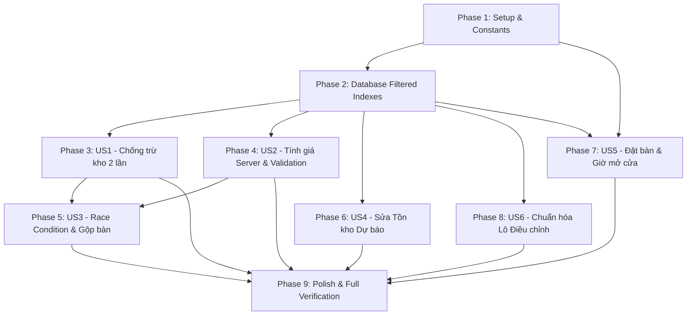

# Danh sách Công việc (Tasks): RM-022 Ổn định hóa & Vá lỗi Nghiêm trọng Backend (Backend Data Integrity & Concurrency Hardening)

**Đặc tả (Spec)**: [spec.md](spec.md) | **Kế hoạch (Plan)**: [plan.md](plan.md) | **Thiết kế Dữ liệu**: [data-model.md](data-model.md)

---

## Bảng Tổng quan Tiến độ (Overview)

| Phase | Mục tiêu | Số Tác vụ | Phụ thuộc |
|---|---|:---:|---|
| **Phase 1** | Thiết lập & Hằng số Toàn cục (Setup) | 4 | Không |
| **Phase 2** | Nền tảng Cơ sở Dữ liệu & Filtered Indexes (Foundational) | 3 | Phase 1 |
| **Phase 3** | User Story 1 (P1): Toàn vẹn Khấu trừ Kho & Ngăn chặn Trừ kho Trùng lặp | 6 | Phase 2 |
| **Phase 4** | User Story 2 (P1): Kiểm soát Chặt chẽ Đơn giá & DTO Validation Phía Server | 4 | Phase 2 |
| **Phase 5** | User Story 3 (P1): Chống Race Condition Bàn ăn, Khắc phục Mass Assignment & Gộp bàn An toàn | 8 | Phase 2, US1, US2 |
| **Phase 6** | User Story 4 (P1): Tính toán Tồn kho Chính xác & Ràng buộc Máy trạng thái Dự báo | 4 | Phase 2 |
| **Phase 7** | User Story 5 (P2): Chuẩn hóa Vòng đời Đặt bàn, Khung giờ Mở cửa & Múi giờ Hệ thống | 6 | Phase 2, Phase 1 |
| **Phase 8** | User Story 6 (P2): Chuẩn hóa Lô Điều chỉnh Kiểm kê Kho & Tính Toàn vẹn Dữ liệu | 4 | Phase 2 |
| **Phase 9** | Trau chuốt (Polish), Kiểm thử Hồi quy Toàn diện & Xác thực Quickstart | 4 | US1 - US6 |
| **Tổng cộng** | | **43** | |

---

## Phase 1: Thiết lập & Hằng số Toàn cục (Setup)

**Mục đích**: Chuẩn bị các cấu hình dùng chung, định nghĩa hằng số giờ mở cửa tập trung và từ điển lỗi song ngữ i18n cho toàn bộ hệ thống.

- [x] T001 [P] Khai báo hằng số khung giờ mở cửa tập trung `BusinessOpeningHour = 8` và `BusinessClosingHour = 22` trong `src/Acme.TooHungry.Domain.Shared/TooHungryConsts.cs`
- [x] T002 [P] Cấu hình múi giờ chuẩn UTC `Configure<AbpClockOptions>(options => options.Kind = DateTimeKind.Utc)` trong `src/Acme.TooHungry.Domain/TooHungryDomainModule.cs`
- [x] T003 [P] Bổ sung các mã lỗi nghiệp vụ mới (`TooHungry:Order:AlreadyCompleted`, `AlreadyCancelled`, `TableAlreadyHasActiveOrder`, `TableCurrentlyOccupied`, `CannotRevertExecutedPlan`, v.v.) vào `src/Acme.TooHungry.Domain.Shared/Localization/TooHungry/vi.json`
- [x] T004 [P] Bổ sung các mã lỗi nghiệp vụ mới tương ứng vào bản dịch Tiếng Anh trong `src/Acme.TooHungry.Domain.Shared/Localization/TooHungry/en.json`

---

## Phase 2: Nền tảng Cơ sở Dữ liệu & Filtered Indexes (Foundational)

**Mục đích**: Cấu hình các chỉ mục lọc duy nhất (Filtered Unique Indexes) trên Entity Framework Core nhằm bảo đảm tính toàn vẹn dữ liệu ở cấp độ cơ sở dữ liệu trước khi triển khai các quy tắc nghiệp vụ tầng ứng dụng.

- [x] T005 Cấu hình Filtered Unique Index cho `Order`: `.HasFilter("[TableId] IS NOT NULL AND [Status] NOT IN (2, 3) AND [IsDeleted] = 0")` bao quát mọi đơn active trong `src/Acme.TooHungry.EntityFrameworkCore/EntityFrameworkCore/TooHungryDbContext.cs`
- [x] T006 Cấu hình bộ lọc Soft-Delete `.HasFilter("[IsDeleted] = 0")` cho Unique Index `Name` của `RestaurantTable` và `Unit` trong `src/Acme.TooHungry.EntityFrameworkCore/EntityFrameworkCore/TooHungryDbContext.cs`
- [x] T007 Tạo và áp dụng Migration EF Core mới `Add_Hardened_Filtered_Indexes` thông qua công cụ `src/Acme.TooHungry.DbMigrator`

---

## Phase 3: User Story 1 - Toàn vẹn Khấu trừ Kho & Ngăn chặn Trừ kho Trùng lặp (Ưu tiên: P1)

**Mục tiêu**: Đóng băng đơn hàng đã hoàn tất hoặc đã hủy, chỉ khấu trừ kho đúng 1 lần duy nhất khi chuyển sang `Completed`, loại bỏ autoSave rải rác và khắc phục retry concurrency trừ kho thừa.

**Kiểm thử Độc lập**: Tạo đơn hàng có món liên kết Recipe, hoàn tất đơn (kho bị trừ), gọi lại cập nhật đơn (hệ thống ném lỗi `TooHungry:Order:AlreadyCompleted`, kho không bị trừ thêm lần nào).

### Kiểm thử cho User Story 1
- [x] T008 [P] [US1] Viết Unit Test kiểm thử phương thức Domain `Order.Complete()` và `Order.Cancel()` (chặn gọi lại khi đã Completed/Cancelled) trong `test/Acme.TooHungry.Domain.Tests/Orders/OrderDomain_Tests.cs`
- [x] T009 [P] [US1] Viết Integration Test kiểm tra `OrderAppService.UpdateAsync` từ chối sửa đơn đã hoàn tất và không trừ kho lần 2 trong `test/Acme.TooHungry.Application.Tests/Orders/OrderAppService_Hardening_Tests.cs`

### Triển khai cho User Story 1
- [x] T010 [US1] Triển khai hai phương thức Domain `Complete()` và `Cancel()` trên Aggregate Root `Order` trong `src/Acme.TooHungry.Domain/Orders/Order.cs`
- [x] T011 [US1] Loại bỏ các lệnh `autoSave: true` rải rác từng lô trong vòng lặp khấu trừ `DeductFefoAsync` trong `src/Acme.TooHungry.Domain/Inventories/InventoryManager.cs`
- [x] T012 [US1] Tái cấu trúc `OrderAppService.UpdateAsync`: Chỉ gọi `ProcessOrderInventoryConsumptionAsync` khi `oldStatus != OrderStatus.Completed && order.Status == OrderStatus.Completed`, chặn sửa đơn khi đã `Completed`/`Cancelled` trong `src/Acme.TooHungry.Application/Orders/OrderAppService.cs`
- [x] T013 [US1] Bọc vòng lặp retry tương tranh `AbpDbConcurrencyException` trong `OrderAppService.cs` và `InventoryAppService.cs` với Unit of Work mới độc lập `_unitOfWorkManager.Begin(requiresNew: true)` trong `src/Acme.TooHungry.Application/Orders/OrderAppService.cs` và `src/Acme.TooHungry.Application/Inventories/InventoryAppService.cs`

**Trạm kiểm tra (Checkpoint)**: Đơn hàng hoàn tất chỉ trừ kho đúng 1 lần, retry concurrency không gây trừ kho lặp lại, và các đơn đã đóng băng không thể bị chỉnh sửa.

---

## Phase 4: User Story 2 - Kiểm soát Chặt chẽ Đơn giá & DTO Validation Phía Server (Ưu tiên: P1)

**Mục tiêu**: Loại bỏ hoàn toàn lỗ hổng Client tự đặt giá bán (`UnitPrice`, `TotalAmount`), tính toán giá 100% tại máy chủ và chặn đứng số lượng âm hoặc 0.

**Kiểm thử Độc lập**: Gửi payload tạo/sửa đơn kèm `UnitPrice = 1000` cho món có giá 85.000đ; xác nhận server ghi nhận giá 85.000đ. Gửi `Quantity = -1` nhận về lỗi 400 Validation Error.

### Kiểm thử cho User Story 2
- [x] T014 [P] [US2] Viết Unit Test kiểm tra tính giá tự động từ `Dish.Price` và từ chối DTO có `Quantity <= 0` trong `test/Acme.TooHungry.Application.Tests/Orders/OrderAppService_Pricing_Tests.cs`

### Triển khai cho User Story 2
- [x] T015 [P] [US2] Xóa bỏ `UnitPrice` và `TotalPrice` khỏi `CreateUpdateOrderItemDto` và `SubmitOrderItemDto`; thêm validation `[Range(1, 999)] Quantity`, `[MinLength(1)] Items`, `[StringLength(512)] Note` trong `src/Acme.TooHungry.Application.Contracts/Orders/OrderDtos.cs`
- [x] T016 [US2] Cập nhật `OrderAppService.CreateAsync`, `UpdateAsync`, và `SubmitOrderAsync` để truy vấn trực tiếp `Dish.Price` từ CSDL, gán `UnitPrice`, tính `TotalPrice` và tính tổng `Order.TotalAmount` trong `src/Acme.TooHungry.Application/Orders/OrderAppService.cs`
- [x] T017 [US2] Cập nhật cấu hình ObjectMapper để không ánh xạ các trường giá từ DTO sang Entity trong `src/Acme.TooHungry.Application/TooHungryApplicationMappers.cs`

**Trạm kiểm tra (Checkpoint)**: Mọi thao tác tạo/sửa đơn đều tính giá từ `Dish.Price` phía server, client không thể gian lận giá bán hay gửi số lượng âm.

---

## Phase 5: User Story 3 - Chống Race Condition Bàn ăn, Khắc phục Mass Assignment & Gộp bàn An toàn (Ưu tiên: P1)

**Mục tiêu**: Đóng gói trạng thái bàn ăn vào Aggregate Root `RestaurantTable`, loại bỏ mass assignment tại `TableDtos.cs`, bảo toàn ghi chú và giá khi gộp bàn, phát SignalR sau khi commit CSDL, và xử lý mượt mà lỗi race condition tạo đơn active.

**Kiểm thử Độc lập**: Gửi đồng thời 2 request tạo đơn cho cùng 1 bàn; request 2 nhận lỗi `TooHungry:Order:TableAlreadyHasActiveOrder` thay vì 500. Gộp 2 bàn có món trùng khác ghi chú; đơn sau gộp chứa đầy đủ ghi chú của cả 2 bàn.

### Kiểm thử cho User Story 3
- [x] T018 [P] [US3] Viết Unit Test kiểm thử các phương thức Domain `Occupy()`, `Release()`, `MarkCleaning()`, `Reserve()` trên `RestaurantTable` trong `test/Acme.TooHungry.Domain.Tests/Tables/RestaurantTableDomain_Tests.cs`
- [x] T019 [P] [US3] Viết Integration Test kiểm thử `TableAppService.MergeTablesAsync` bảo toàn toàn vẹn ghi chú chế biến và tính đúng đơn giá niêm yết trong `test/Acme.TooHungry.Application.Tests/Tables/TableAppService_Merge_Tests.cs`
- [x] T020 [P] [US3] Viết Integration Test kiểm tra `SubmitOrderAsync` bắt `DbUpdateException` chuyển thành `BusinessException("TooHungry:Order:TableAlreadyHasActiveOrder")` trong `test/Acme.TooHungry.Application.Tests/Orders/OrderAppService_RaceCondition_Tests.cs`

### Triển khai cho User Story 3
- [x] T021 [P] [US3] Loại bỏ các trường trạng thái nội bộ (`Status`, `OccupiedTime`, `Reserved*`) khỏi `CreateUpdateTableDto` trong `src/Acme.TooHungry.Application.Contracts/Tables/TableDtos.cs`
- [x] T022 [US3] Triển khai các phương thức Domain `Occupy(now)`, `Release()`, `MarkCleaning()`, `Reserve(...)` và `ClearReservationInfo()` trên Aggregate Root `RestaurantTable` trong `src/Acme.TooHungry.Domain/Tables/RestaurantTable.cs`
- [x] T023 [US3] Cập nhật `TableAppService.cs` và `OrderAppService.cs` chuyển sang gọi các phương thức Domain của `RestaurantTable`, loại bỏ đoạn code reset 8 trường dữ liệu lặp lại trong `src/Acme.TooHungry.Application/Tables/TableAppService.cs` và `src/Acme.TooHungry.Application/Orders/OrderAppService.cs`
- [x] T024 [US3] Tái cấu trúc thuật toán `TableAppService.MergeTablesAsync`: Gom món trùng `DishId` về 1 dòng duy nhất, cộng dồn số lượng, tính lại giá niêm yết và ghép nối ghi chú chế biến `"{primaryItem.Note} | [Gộp từ {secondaryTable.Name}: {secondaryItem.Note}]"` trong `src/Acme.TooHungry.Application/Tables/TableAppService.cs`
- [x] T025 [US3] Bọc toàn bộ các lệnh phát thông báo SignalR trong `CurrentUnitOfWork.OnCompleted(...)` trong `src/Acme.TooHungry.Application/Orders/OrderAppService.cs` và `src/Acme.TooHungry.Application/Tables/TableAppService.cs`

**Trạm kiểm tra (Checkpoint)**: Không thể ghi đè trạng thái bàn qua DTO, gộp bàn bảo toàn 100% ghi chú, không phát sinh thông báo SignalR ảo khi rollback, và race condition tạo đơn được xử lý an toàn.

---

## Phase 6: User Story 4 - Tính toán Tồn kho Chính xác & Ràng buộc Máy trạng thái Dự báo (Ưu tiên: P1)

**Mục tiêu**: Sửa lỗi nhân đôi `ConversionFactor` làm sai lệch số lượng tồn kho khả dụng, cài đặt State Machine một chiều cho kế hoạch nguyên liệu và xử lý chống crash khi input trùng món.

**Kiểm thử Độc lập**: Kiểm tra tồn kho khả dụng trong Kế hoạch dự báo bằng đúng `Sum(RemainingQuantity)` không bị nhân hệ số quy đổi; thử chuyển kế hoạch từ `Executed` về `Draft` bị server từ chối.

### Kiểm thử cho User Story 4
- [x] T026 [P] [US4] Viết Unit Test kiểm tra công thức tính tồn kho không nhân đôi `ConversionFactor` và State Machine kế hoạch nguyên liệu trong `test/Acme.TooHungry.Application.Tests/Forecasts/ForecastAppService_Hardening_Tests.cs`

### Triển khai cho User Story 4
- [x] T027 [US4] Sửa công thức tính tồn kho tại dòng 366 và 556 trong `ForecastAppServices.cs`, xóa bỏ phép nhân `* b.ConversionFactor` và chỉ tính `Sum(b => b.RemainingQuantity)` trong `src/Acme.TooHungry.Application/Forecasts/ForecastAppServices.cs`
- [x] T028 [US4] Cài đặt State Machine một chiều trong `UpdateStatusAsync`: Chặn tuyệt đối việc chuyển trạng thái từ `Executed` ngược về `Draft` hoặc `Confirmed` trong `src/Acme.TooHungry.Application/Forecasts/ForecastAppServices.cs`
- [x] T029 [US4] Sửa lỗi crash `ToDictionary(x => x.DishId)` tại dòng 433 bằng cách gom nhóm `GroupBy(x => x.DishId)` trước khi tạo từ điển trong `src/Acme.TooHungry.Application/Forecasts/ForecastAppServices.cs`

**Trạm kiểm tra (Checkpoint)**: Số liệu tồn kho trong kế hoạch dự báo hoàn toàn khớp với thực tế kho, kế hoạch đã thực thi không bị sửa đổi trái phép và không crash khi trùng món.

---

## Phase 7: User Story 5 - Chuẩn hóa Vòng đời Đặt bàn, Khung giờ Mở cửa & Múi giờ Hệ thống (Ưu tiên: P2)

**Mục tiêu**: Bàn đặt trước chỉ tự động chuyển `Reserved` trước giờ hẹn 60 phút, check-in kiểm tra bàn có đang có khách ngồi không, thống nhất khung giờ mở cửa và đảm bảo tính nguyên tử cho worker hủy bàn tự động.

**Kiểm thử Độc lập**: Đặt bàn trước 3 ngày (bàn vẫn `Available`); đặt bàn trước 30 phút (bàn chuyển `Reserved`); check-in vào bàn đang `Occupied` nhận cảnh báo; worker hủy bàn quá hạn chạy atomic trong `[UnitOfWork]`.

### Kiểm thử cho User Story 5
- [x] T030 [P] [US5] Viết Unit & Integration Tests kiểm tra vòng đời đặt bàn (khóa trước 60 phút, check-in guard khi Occupied) trong `test/Acme.TooHungry.Application.Tests/Reservations/TableReservation_Hardening_Tests.cs`

### Triển khai cho User Story 5
- [x] T031 [US5] Tái cấu trúc `TableReservationManager.ValidateReservationTime`: Sử dụng hằng số `TooHungryConsts.BusinessOpeningHour` (8) và `BusinessClosingHour` (22) thay vì hardcode trong `src/Acme.TooHungry.Domain/Reservations/TableReservationManager.cs`
- [x] T032 [US5] Cập nhật logic tạo đặt bàn trong `TableReservationManager.CreateReservationAsync`: Bàn chỉ tự động chuyển `Reserved` nếu thời gian đặt trong vòng 60 phút tới (`reservationTime <= now.AddMinutes(60)`) trong `src/Acme.TooHungry.Domain/Reservations/TableReservationManager.cs`
- [x] T033 [US5] Cập nhật `TableReservationManager.CheckInAsync`: Kiểm tra nếu `table.Status == TableStatus.Occupied` thì ném `BusinessException("TooHungry:Table:TableCurrentlyOccupied")` trong `src/Acme.TooHungry.Domain/Reservations/TableReservationManager.cs`
- [x] T034 [US5] Cập nhật validation giờ đặt bàn trong `TableAppService.cs` đồng bộ sử dụng `TooHungryConsts` trong `src/Acme.TooHungry.Application/Tables/TableAppService.cs`
- [x] T035 [US5] Bổ sung attribute `[UnitOfWork]` cho phương thức `ProcessOverdueReservationsAsync` trong `src/Acme.TooHungry.Application/Reservations/ReservationAutoCancelBackgroundWorker.cs`

**Trạm kiểm tra (Checkpoint)**: Bàn ăn không bị khóa sớm trước 7 ngày, check-in an toàn không đè bàn có khách, và worker chạy atomic.

---

## Phase 8: User Story 6 - Chuẩn hóa Lô Điều chỉnh Kiểm kê Kho & Tính Toàn vẹn Dữ liệu (Ưu tiên: P2)

**Mục tiêu**: Chuẩn hóa thông tin lô hàng điều chỉnh tăng khi kiểm kê (`PurchaseUnit` chuẩn, `UnitCost` chuẩn, hạn dùng hợp lý), sinh mã lô duy nhất và chặn số lượng âm trong khấu trừ kho.

**Kiểm thử Độc lập**: Thực hiện kiểm kê kho tăng; xác minh lô `ADJ-*` sinh ra có đơn vị đo lường và giá vốn thật của nguyên liệu, hạn dùng không bị cộng 1 năm bừa bãi.

### Kiểm thử cho User Story 6
- [x] T036 [P] [US6] Viết Unit Test kiểm tra tính hợp lệ dữ liệu của lô điều chỉnh tăng `ADJ-*` trong `test/Acme.TooHungry.Domain.Tests/Inventories/InventoryManager_Adjustment_Tests.cs`

### Triển khai cho User Story 6
- [x] T037 [US6] Cập nhật `InventoryManager.AdjustStockAsync`: Gán `PurchaseUnit = ingredient.BaseUnit`, `UnitCost = ingredient.EstimatedPrice` cho lô điều chỉnh tăng trong `src/Acme.TooHungry.Domain/Inventories/InventoryManager.cs`
- [x] T038 [US6] Cập nhật quy tắc hạn sử dụng cho lô điều chỉnh tăng: Lấy theo hạn sử dụng xa nhất của các lô còn hạn của nguyên liệu đó trong kho (hoặc mặc định `Clock.Now.AddDays(30)`), mã lô `$"ADJ-{now:yyyyMMddHHmmss}-{Guid.NewGuid():N}"[..24]` trong `src/Acme.TooHungry.Domain/Inventories/InventoryManager.cs`
- [x] T039 [US6] Bổ sung kiểm tra chặn số lượng âm (`quantity <= 0`) trong các phương thức khấu trừ kho của `src/Acme.TooHungry.Domain/Inventories/InventoryManager.cs`

**Trạm kiểm tra (Checkpoint)**: Lô điều chỉnh tăng có đầy đủ thông tin chuẩn mực kế toán, không gán literal giả lập và chặn đứng số lượng âm.

---

## Phase 9: Trau chuốt (Polish), Kiểm thử Hồi quy Toàn diện & Xác thực Quickstart

**Mục đích**: Hoàn tất dọn dẹp mã nguồn rác, chạy toàn bộ bộ kiểm thử tự động, xác minh 6 kịch bản quickstart và cập nhật tài liệu kỹ thuật.

- [x] T040 Dọn dẹp toàn bộ các điểm gọi `DateTime.Now` và `DateTime.UtcNow` rải rác trong `OrderAppService.cs`, `TableAppService.cs` và `DashboardAppService.cs`, chuyển sang dùng thống nhất `Clock.Now`
- [x] T041 Chạy toàn bộ 6 kịch bản kiểm thử độc lập trong `specs/022-rm-022-backend-hardening/quickstart.md`
- [x] T042 [P] Chạy toàn bộ bộ test tự động của solution: `dotnet test d:\DFT\Acme.TooHungry\test\Acme.TooHungry.Application.Tests` và `test\Acme.TooHungry.Domain.Tests`
- [x] T043 Cập nhật trạng thái và nhật ký nợ phát sinh của `RM-022` trong `d:\DFT\Acme.TooHungry\docs\roadmap.md`

---

## Phụ thuộc (Dependencies) & Thứ tự Thực thi

### Chiến lược Triển khai Tối ưu (Implementation Strategy)

1. **MVP Cốt lõi (Khóa lỗ hổng tiền & kho)**:
   - Hoàn thành Phase 1 (Setup) $\rightarrow$ Phase 2 (Filtered Indexes) $\rightarrow$ Phase 3 (US1: Trừ kho 1 lần) $\rightarrow$ Phase 4 (US2: Tính giá server).
   - Tại trạm này, hệ thống triệt tiêu 100% rủi ro thất thoát kho và gian lận giá bán.
2. **Giai đoạn 2 (Toàn vẹn Bàn ăn & Dự báo)**:
   - Triển khai Phase 5 (US3: Gộp bàn, Race Condition) và Phase 6 (US4: Sửa tồn kho dự báo).
3. **Giai đoạn 3 (Vận hành chuẩn mực & Polish)**:
   - Triển khai Phase 7 (US5: Đặt bàn 60 phút) và Phase 8 (US6: Kiểm kê kho).
   - Chạy toàn bộ test tự động và nghiệm thu theo `quickstart.md`.
