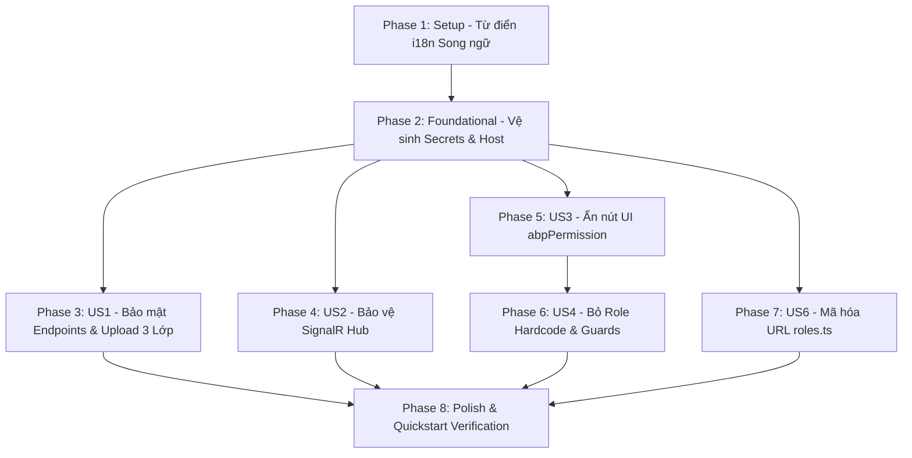

# Danh sách Công việc (Tasks): RM-023 Bảo mật & Chuẩn hóa Phân quyền Hệ thống (Security & Authorization Enforcement)

**Đặc tả (Spec)**: [spec.md](spec.md) | **Kế hoạch (Plan)**: [plan.md](plan.md) | **Thiết kế Dữ liệu**: [data-model.md](data-model.md) | **Hợp đồng**: [security-contracts.md](contracts/security-contracts.md)

---

## Bảng Tổng quan Tiến độ (Overview)

| Phase | Mục tiêu | Số Tác vụ | Phụ thuộc |
|---|---|:---:|---|
| **Phase 1** | Thiết lập & Hằng số Từ điển Song ngữ (Setup) | 4 | Không |
| **Phase 2** | Nền tảng Vệ sinh Bí mật & An toàn Host (Foundational) | 3 | Phase 1 |
| **Phase 3** | User Story 1 (P1): Bảo mật Endpoints Backend & Kiểm soát Upload Tệp An toàn | 8 | Phase 2 |
| **Phase 4** | User Story 2 (P1): Bảo vệ Kênh Kết nối Thời gian thực SignalR Hub | 3 | Phase 2 |
| **Phase 5** | User Story 3 (P1): Kiểm soát Hiển thị Nút Thao tác Angular qua `*abpPermission` | 7 | Phase 2 |
| **Phase 6** | User Story 4 (P2): Chuẩn hóa Cơ chế Kiểm tra Quyền & Loại bỏ Role Name Hardcode | 5 | Phase 2, US3 |
| **Phase 7** | User Story 6 (P3): Chuẩn hóa Quản trị Quyền Role & Khắc phục API Thiếu Mã hóa | 2 | Phase 2 |
| **Phase 8** | Trau chuốt (Polish), Kiểm thử Hồi quy Toàn diện & Xác thực Quickstart | 4 | US1 - US6 |
| **Tổng cộng** | | **36** | |

---

## Phase 1: Thiết lập & Hằng số Từ điển Song ngữ (Setup)

**Mục đích**: Khởi tạo đầy đủ các thông điệp lỗi bảo mật, thông báo từ chối truy cập và cảnh báo tệp giả mạo trong từ điển ngôn ngữ i18n ở cả Backend và Frontend.

- [x] T001 [P] Bổ sung các thông điệp lỗi bảo mật mới (`TooHungry:Security:FileRequired`, `FileSizeExceeded`, `InvalidFileType`, `InvalidFileSignature`, `CloudinaryNotConfigured`, `ProductionSecretsMissing`) vào `src/Acme.TooHungry.Domain.Shared/Localization/TooHungry/vi.json`
- [x] T002 [P] Bổ sung các thông điệp lỗi bảo mật mới tương ứng vào bản dịch Tiếng Anh trong `src/Acme.TooHungry.Domain.Shared/Localization/TooHungry/en.json`
- [x] T003 [P] Bổ sung các thông điệp cảnh báo bảo mật phía client vào `angular/src/assets/i18n/vi.json`
- [x] T004 [P] Bổ sung các thông điệp cảnh báo bảo mật phía client vào `angular/src/assets/i18n/en.json`

---

## Phase 2: Nền tảng Vệ sinh Bí mật & An toàn Host (Foundational)

**Mục đích**: Loại bỏ bí mật khỏi git repository, cấu hình phân tầng nạp bí mật an toàn .NET, tắt ShowPII và Swagger UI trên môi trường Production.

- [x] T005 [P] Thay thế các mật mã nhạy cảm (`CertificatePassPhrase`, `DefaultPassPhrase`) trong `src/Acme.TooHungry.HttpApi.Host/appsettings.json` bằng placeholder an toàn `'__CONFIGURE_VIA_ENV_OR_USER_SECRETS__'`
- [x] T006 [P] Tạo tệp mẫu hướng dẫn cấu hình bí mật cục bộ `src/Acme.TooHungry.HttpApi.Host/appsettings.secrets.example.json`
- [x] T007 Cập nhật `src/Acme.TooHungry.HttpApi.Host/TooHungryHttpApiHostModule.cs`: Tắt `ShowPII = false` ở môi trường ngoài Development, chỉ kích hoạt `app.UseSwagger()` và `app.UseAbpSwaggerUI()` khi `env.IsDevelopment()`, và kích hoạt chốt chặn Fail-fast Startup trên Production nếu thiếu passphrase

---

## Phase 3: User Story 1 - Bảo mật Endpoints Backend & Kiểm soát Upload Tệp An toàn (Ưu tiên: P1) 🎯 MVP Core

**Mục tiêu**: Bịt kín toàn bộ các endpoint Backend đang hở hoặc thiếu quyền hạn, áp dụng xác thực upload ảnh 3 lớp (Extension, MIME, Magic Bytes) và đổi tên file bằng GUID chống Path Traversal.

**Kiểm thử Độc lập**: Gọi ẩn danh tới `POST /api/app/media/upload-dish-image`, `GET /api/app/daily-menu`, `GET /api/app/recipe/by-dish/{dishId}`, `POST /api/app/table-orders/complete/{tableId}` đều nhận HTTP 401; upload tệp `.php` đổi đuôi thành `.jpg` bị chặn với lỗi Magic Bytes.

### Kiểm thử cho User Story 1
- [x] T008 [P] [US1] Viết Integration Tests kiểm tra từ chối truy cập nặc danh (HTTP 401) và kiểm tra phân quyền hạt nhân từng endpoint trong `test/Acme.TooHungry.Application.Tests/Security/EndpointAuthorization_Tests.cs`
- [x] T009 [P] [US1] Viết Unit Tests kiểm tra bộ xác thực tệp 3 lớp (chặn sai đuôi, sai MIME, sai Magic Bytes) trong `test/Acme.TooHungry.Application.Tests/Security/SafeImageValidator_Tests.cs`

### Triển khai cho User Story 1
- [x] T010 [P] [US1] Xây dựng lớp tiện ích xác thực tệp ảnh 3 lớp `SafeImageFileValidator` (kiểm tra size <= 5MB, extension whitelist, MIME image/*, và Magic Bytes header: JPEG `FF D8 FF`, PNG `89 50 4E 47`, GIF `47 49 46 38`, WEBP `RIFF...WEBP`) trong `src/Acme.TooHungry.HttpApi/Controllers/SafeImageFileValidator.cs`
- [x] T011 [US1] Tái cấu trúc `UploadDishImageAsync` trong `src/Acme.TooHungry.HttpApi/Controllers/MediaController.cs`: Thêm `[Authorize(TooHungryPermissions.Dishes.Edit)]`, gọi `SafeImageFileValidator`, đổi tên file thành GUID ngẫu nhiên duy nhất `Guid.NewGuid().ToString("N") + ext` trước khi đẩy lên Cloudinary
- [x] T012 [P] [US1] Thêm thuộc tính `[Authorize(TooHungryPermissions.Dishes.Default)]` ở cấp class cho `src/Acme.TooHungry.Application/DailyMenus/DailyMenuAppService.cs`
- [x] T013 [P] [US1] Thêm thuộc tính `[Authorize(TooHungryPermissions.Recipes.Default)]` cho endpoint `GetActiveByDishIdAsync` trong `src/Acme.TooHungry.HttpApi/Controllers/RecipeController.cs`
- [x] T014 [P] [US1] Gắn quyền hạt nhân `TooHungryPermissions.DishCategories.*` trên các phương thức CRUD (`GetAsync`, `GetListAsync`, `CreateAsync`, `UpdateAsync`, `DeleteAsync`) của `DishCategoryAppService` trong `src/Acme.TooHungry.Application/Dishes/DishAppServices.cs`
- [x] T015 [P] [US1] Gắn `[Authorize(TooHungryPermissions.Orders.Default)]` cho `GetActiveOrderByTableIdAsync` và `[Authorize(TooHungryPermissions.Orders.Edit)]` cho `CompleteActiveOrderByTableIdAsync` trong `src/Acme.TooHungry.HttpApi/Controllers/TableOrderController.cs`

**Trạm kiểm tra (Checkpoint)**: Toàn bộ API Backend nhạy cảm đều được bảo vệ bởi đúng mã quyền ABP, upload tệp giả mạo bị chặn 100%.

---

## Phase 4: User Story 2 - Bảo vệ Kênh Kết nối Thời gian thực SignalR Hub (Ưu tiên: P1) 🎯 MVP Core

**Mục tiêu**: Kích hoạt xác thực Bearer token trên `TableHub`, thiết lập `accessTokenFactory` và quản trị vòng đời kết nối theo trạng thái đăng nhập phía client Angular.

**Kiểm thử Độc lập**: Kết nối WebSocket tới `/signalr-hubs/table` không có token bị từ chối 401; đăng nhập trên giao diện Waiter kết nối thành công và nhận cập nhật realtime; khi token hết hạn tự động refresh và tái kết nối.

### Kiểm thử cho User Story 2
- [x] T016 [P] [US2] Viết Unit Test cho `TableSignalRService` xác thực việc truyền token qua `accessTokenFactory` và ngắt kết nối khi logout trong `angular/src/app/shared/services/table-signalr.service.spec.ts`

### Triển khai cho User Story 2
- [x] T017 [US2] Thêm thuộc tính `[Authorize]` trên lớp `TableHub` trong `src/Acme.TooHungry.HttpApi.Host/Hubs/TableHub.cs`
- [x] T018 [US2] Tái cấu trúc `TableSignalRService` trong `angular/src/app/shared/services/table-signalr.service.ts`: Cấu hình `accessTokenFactory: () => this.oAuthService.getAccessToken()`, chỉ kết nối khi `hasValidAccessToken() === true`, bắt lỗi 401 tự động gọi `oAuthService.refreshToken()` để tái kết nối nền, gọi `stopConnection()` khi đăng xuất

**Trạm kiểm tra (Checkpoint)**: Kênh Realtime SignalR an toàn tuyệt đối, kết nối tự phục hồi mượt mà không làm đứt quãng trải nghiệm phục vụ.

---

## Phase 5: User Story 3 - Kiểm soát Hiển thị Nút Thao tác Angular qua `*abpPermission` (Ưu tiên: P1) 🎯 MVP Core

**Mục tiêu**: Gắn chỉ thị `*abpPermission` lên toàn bộ nút hành động nhạy cảm trên 8 phân hệ màn hình Angular, bảo đảm người dùng chỉ nhìn thấy các chức năng mình được cấp quyền.

**Kiểm thử Độc lập**: Đăng nhập tài khoản `waiter`: Màn hình `/dishes` và `/dish-categories` không hiển thị nút Thêm/Sửa/Xóa; màn hình `/inventory` không hiển thị nút Nhập kho/Điều chỉnh. Đăng nhập `manager`: Thấy đầy đủ các nút nghiệp vụ.

- [x] T019 [P] [US3] Gắn `*abpPermission` lên các nút Thêm (`TooHungry.Dishes.Create`), Sửa (`TooHungry.Dishes.Edit`), Xóa (`TooHungry.Dishes.Delete`) trong `angular/src/app/dish/dish.component.html`
- [x] T020 [P] [US3] Gắn `*abpPermission` lên các nút Thêm (`TooHungry.DishCategories.Create`), Sửa (`TooHungry.DishCategories.Edit`), Xóa (`TooHungry.DishCategories.Delete`) trong `angular/src/app/dish-category/dish-category.component.html`
- [x] T021 [P] [US3] Gắn `*abpPermission` lên các nút Tạo đơn (`TooHungry.Orders.Create`), Sửa đơn (`TooHungry.Orders.Edit`), Hủy đơn (`TooHungry.Orders.Cancel`) trong `angular/src/app/order/order.component.html`
- [x] T022 [P] [US3] Gắn `*abpPermission` lên các nút Thêm/Sửa/Xóa bàn (`TooHungry.Tables.*`), Cập nhật trạng thái (`TooHungry.Tables.UpdateStatus`), và Khu vực (`TooHungry.DiningAreas.*`) trong `angular/src/app/table/table.component.html` và `angular/src/app/dining-area/dining-area.component.html`
- [x] T023 [P] [US3] Gắn `*abpPermission` lên các nút Nhập kho (`TooHungry.Inventories.Batch`), Điều chỉnh (`TooHungry.Inventories.Adjust`), Xuất hủy (`TooHungry.Inventories.Discard`), Khóa lô (`TooHungry.Inventories.DeactivateBatch`) trong `angular/src/app/inventory/inventory.component.html`
- [x] T024 [P] [US3] Gắn `*abpPermission` lên các nút Thêm (`TooHungry.Recipes.Create`), Sửa (`TooHungry.Recipes.Edit`), Xóa (`TooHungry.Recipes.Delete`) trong `angular/src/app/recipe/recipe.component.html`
- [x] T025 [P] [US3] Gắn `*abpPermission` lên các nút Thêm/Sửa/Xóa người dùng và vai trò (`AbpIdentity.Users.*`, `AbpIdentity.Roles.*`) trong `angular/src/app/identity/users/users.component.html` và `angular/src/app/identity/roles/roles.component.html`

**Trạm kiểm tra (Checkpoint)**: Giao diện 8 phân hệ tự động ẩn toàn bộ các nút thao tác ngoài phạm vi quyền hạn của người dùng.

---

## Phase 6: User Story 4 - Chuẩn hóa Cơ chế Kiểm tra Quyền & Loại bỏ Role Name Hardcode (Ưu tiên: P2)

**Mục tiêu**: Xóa bỏ hoàn toàn việc kiểm tra chuỗi role name tĩnh `['Manager', 'Administrator', 'admin']` tại Guards và Navigation Services, chuyển sang phân luồng 100% dựa trên Granular Policies của ABP.

**Kiểm thử Độc lập**: Tạo vai trò mới `"ShiftSupervisor"` cấp quyền `Tables` và `Orders` (không cấp `Dashboard`), người dùng đăng nhập tự động được điều hướng vào `/waiter/tables` và thao tác bình thường.

- [x] T026 [P] [US4] Loại bỏ `allowedRoles` hardcode, chuyển sang kiểm tra `permissionService.getGrantedPolicy$('TooHungry.Tables.Default')` trong `angular/src/app/waiter/guards/waiter-auth.guard.ts`
- [x] T027 [P] [US4] Loại bỏ `isManagerOrAdmin` role hardcode, chuyển sang kiểm tra `permissionService.getGrantedPolicy$('TooHungry.Dashboard')` trong `angular/src/app/shared/guards/dashboard.guard.ts`
- [x] T028 [US4] Tái cấu trúc `UserRoleNavigationService` trong `angular/src/app/shared/services/user-role-navigation.service.ts`: Xóa bỏ hàm `isManagerOrAdmin(roles)`, chuyển sang phân luồng điều hướng (`Dashboard` -> `/`, `Tables/Orders` -> `/waiter/tables`, `Inventories` -> `/inventory-keeper`) và kiểm tra quyền quản trị 100% dựa trên Granular Policies của ABP
- [x] T029 [P] [US4] Cập nhật logic hiển thị nút 'Về Quản trị' trong `angular/src/app/waiter/layout/waiter-layout.component.ts` và `angular/src/app/inventory-keeper/layout/inventory-keeper-layout.component.ts` sử dụng `userRoleNavigationService.canNavigateToAdmin$()`
- [x] T030 [P] [US4] Cập nhật Unit Tests cho `UserRoleNavigationService` phản ánh cơ chế phân luồng theo Policies trong `angular/src/app/shared/services/user-role-navigation.service.spec.ts`

**Trạm kiểm tra (Checkpoint)**: Hệ thống cho phép tự do tạo và gán vai trò mới mà không bao giờ bị phụ thuộc vào tên role cố định.

---

## Phase 7: User Story 6 - Chuẩn hóa Quản trị Quyền Role & Khắc phục API Thiếu Mã hóa (Ưu tiên: P3)

**Mục tiêu**: Mã hóa URL an toàn tham số `providerKey` trong `roles.ts`, loại bỏ các cuộc gọi API trùng lặp và dependency thừa trong `users.ts`.

**Kiểm thử Độc lập**: Mở modal phân quyền cho vai trò có tên tiếng Việt "Quản lý ca": URL được mã hóa chuẩn xác, lưu quyền thành công không lỗi 400.

- [x] T031 [US6] Mã hóa URL an toàn `encodeURIComponent(providerKey)` và `encodeURIComponent(providerName)` khi gửi yêu cầu tới `/api/permission-management/permissions` trong `angular/src/app/identity/roles/roles.ts`
- [x] T032 [P] [US6] Tối ưu hóa `users.ts` trong `angular/src/app/identity/users/users.ts`: Loại bỏ inject `HttpClient` thừa, so sánh danh sách vai trò hiện tại và mới để chặn gửi yêu cầu `updateRoles` dư thừa

**Trạm kiểm tra (Checkpoint)**: Quản trị vai trò tiếng Việt hoạt động trơn tru, không còn lỗi cú pháp URL hoặc request dư thừa.

---

## Phase 8: Trau chuốt (Polish), Kiểm thử Hồi quy Toàn diện & Xác thực Quickstart

**Mục đích**: Hoàn tất tài liệu hướng dẫn, kiểm thử tự động toàn diện và nghiệm thu 6 kịch bản quickstart.

- [x] T033 [P] Cập nhật tài liệu hướng dẫn cấu hình biến môi trường và nạp secrets trong `docs/roadmap.md`
- [x] T034 Chạy kiểm thử tự động toàn diện Backend (`dotnet test`) bảo đảm 100% tests PASS và không có hồi quy
- [x] T035 Chạy kiểm tra lint và build phía Angular (`npm run build`) xác nhận không có lỗi biên dịch
- [x] T036 Thực thi kiểm thử và xác nhận đạt 6 kịch bản nghiệm thu độc lập theo hướng dẫn trong `specs/023-rm-023-security-and-authorization/quickstart.md`

---

## Phụ thuộc (Dependencies) & Thứ tự Thực thi

### Cơ hội Thực thi Song song (Parallel Opportunities)
- T001, T002, T003, T004 (Từ điển i18n) chạy song song độc lập.
- T005, T006 (Secrets placeholder & example file) chạy song song.
- T010, T012, T013, T014, T015 (Gắn [Authorize] trên các AppService & Controller khác nhau) chạy song song độc lập.
- T019 đến T025 (Gắn `*abpPermission` trên các file HTML khác nhau) chạy song song độc lập.
- T026, T027, T029, T030 (Cập nhật Guards và Layouts độc lập) chạy song song.

---

## Chiến lược Triển khai (Implementation Strategy)

### Phạm vi MVP Cốt lõi (MVP Core Scope)
1. **Hoàn thành Phase 1 & Phase 2**: Nền tảng secrets sạch sẽ, chuẩn bị i18n.
2. **Triển khai Phase 3 (US1)**: Bịt kín toàn bộ lỗ hổng Anonymous Endpoints và Upload tệp giả mạo.
3. **Triển khai Phase 4 (US2)**: Bảo vệ Realtime Hub SignalR.
4. **Triển khai Phase 5 (US3)**: Gắn `*abpPermission` bảo vệ các nút hành động trên UI.
5. **Nghiệm thu MVP**: Đảm bảo toàn bộ bề mặt tấn công chính được khóa chặt trước khi tiếp tục tối ưu hóa Guards (Phase 6) và Roles (Phase 7).
