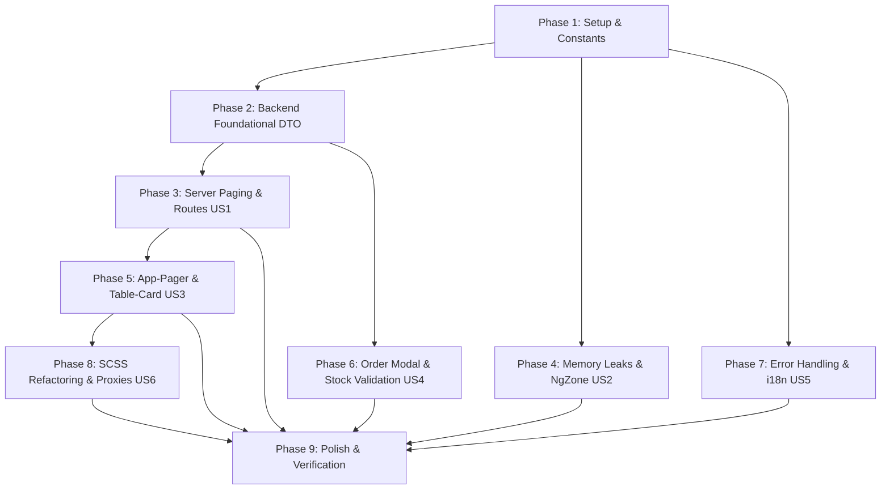

# Danh sách Công việc (Tasks): RM-024 Tối ưu Hiệu năng & Tái cấu trúc Frontend Angular (Angular Architecture & Performance Refactoring)

**Đặc tả (Spec)**: [spec.md](spec.md) | **Kế hoạch (Plan)**: [plan.md](plan.md) | **Thiết kế Dữ liệu**: [data-model.md](data-model.md) | **Hợp đồng**: [frontend-refactoring-contracts.md](contracts/frontend-refactoring-contracts.md) | **Hướng dẫn Khởi chạy**: [quickstart.md](quickstart.md)

---

## Bảng Tổng quan Tiến độ (Overview)

| Phase | Mục tiêu | Số Tác vụ | Trạng thái |
|---|---|:---:|:---:|
| **Phase 1** | Thiết lập & Hằng số Từ điển Song ngữ (Setup) | 3 | Hoàn thành |
| **Phase 2** | Nền tảng Phân trang Backend DTO (Foundational) | 3 | Hoàn thành |
| **Phase 3** | User Story 1 (P1): Phân trang Máy chủ Đơn hàng & Tuyến đường Thu ngân 🎯 MVP Core | 4 | Hoàn thành |
| **Phase 4** | User Story 2 (P1): Triệt tiêu Rò rỉ Bộ nhớ & Tối ưu Change Detection 🎯 MVP Core | 3 | Hoàn thành |
| **Phase 5** | User Story 3 (P2): Xây dựng & Tích hợp `<app-pager>`, `<app-table-card>` | 8 | Hoàn thành |
| **Phase 6** | User Story 4 (P2): Tối ưu Template, Cache & Xác thực Tồn kho Máy chủ | 5 | Hoàn thành |
| **Phase 7** | User Story 5 (P2): Chuẩn hóa Xử lý Lỗi, i18n & Đổi Ngôn ngữ Không Reload | 6 | Hoàn thành |
| **Phase 8** | User Story 6 (P3): Tái cấu trúc SCSS < 25KB, Dọn dẹp `!important` & Độc lập Proxy | 5 | Hoàn thành |
| **Phase 9** | Trau chuốt (Polish), Kiểm thử Hồi quy Toàn diện & Xác thực Quickstart | 3 | Hoàn thành |
| **Tổng cộng** | | **40** | **40 / 40 (100%)** |

---

## Phase 1: Thiết lập & Hằng số Từ điển Song ngữ (Setup)

**Mục đích**: Khởi tạo hằng số giờ mở cửa nhà hàng và bổ sung toàn bộ các khóa ngôn ngữ mới vào từ điển i18n ở cả Backend và Frontend.

- [x] T001 [P] Tạo tệp hằng số cấu hình khung giờ hoạt động `RESTAURANT_BUSINESS_HOURS` trong `angular/src/app/shared/constants/business-hours.constant.ts`
- [x] T002 [P] Bổ sung 15 khóa ngôn ngữ mới (phân trang, ca làm việc, thông báo kho) vào `src/Acme.TooHungry.Domain.Shared/Localization/TooHungry/vi.json` và `angular/src/assets/i18n/vi.json`
- [x] T003 [P] Bổ sung 15 khóa ngôn ngữ Tiếng Anh tương ứng vào `src/Acme.TooHungry.Domain.Shared/Localization/TooHungry/en.json` và `angular/src/assets/i18n/en.json`

---

## Phase 2: Nền tảng Phân trang Backend DTO (Foundational)

**Mục đích**: Bổ sung hỗ trợ tìm kiếm và lọc trạng thái đơn hàng có phân trang từ máy chủ, làm nền tảng cho việc sửa triệt để lỗi phân trang tại `order.component.ts`.

- [x] T004 [P] Khởi tạo DTO `GetOrdersInputDto` kế thừa `PagedAndSortedResultRequestDto` có thuộc tính `Filter` và `Status` trong `src/Acme.TooHungry.Application.Contracts/Orders/OrderDtos.cs`
- [x] T005 Cập nhật phương thức `GetListAsync(GetOrdersInputDto input)` trong interface `src/Acme.TooHungry.Application.Contracts/Orders/IOrderAppService.cs`
- [x] T006 Cập nhật `OrderAppService.GetListAsync(GetOrdersInputDto input)` trong `src/Acme.TooHungry.Application/Orders/OrderAppService.cs` thực thi lọc theo `Filter` (OrderNumber, Note, TableName) và `Status` trước khi phân trang

---

## Phase 3: User Story 1 - Phân trang Máy chủ Đơn hàng & Tuyến đường Thu ngân (Ưu tiên: P1) 🎯 MVP Core

**Mục tiêu**: Xóa bỏ hoàn toàn việc lọc mảng trên client hiện tại và ghi đè `totalCount = items.length` tại `order.component.ts`; bảo toàn `totalCount` máy chủ; xóa bỏ tuyến đường chết `/table/layout` và phân luồng động Thu ngân an toàn.

**Kiểm thử Độc lập**:
- Vào `/orders`: danh sách có hơn 10 đơn hiển thị đúng thanh phân trang, chuyển sang trang 2 xem tiếp đơn hàng bình thường; tìm kiếm/lọc trạng thái gửi request máy chủ và trả về đúng `totalCount`.
- Đăng nhập với tài khoản Thu ngân (Cashier): tự động chuyển hướng vào `/tables` (nếu có quyền quản trị bàn) hoặc `/waiter/tables` (nếu có quyền phục vụ), không còn bị lỗi chuyển hướng vào `/table/layout`.

### Triển khai cho User Story 1
- [x] T007 [US1] Tái cấu trúc `angular/src/app/order/order.component.ts`: Cấu hình `streamCreator` truyền `filter: this.searchTerm` và `status: this.selectedStatus` vào `this.orderService.getList(...)`, giữ nguyên `this.data = res`, xóa bỏ hoàn toàn việc cắt mảng `items.filter(...)` và ghi đè `totalCount = items.length`
- [x] T008 [P] [US1] Xóa bỏ tuyến đường chết `/table/layout` trong `angular/src/app/app.component.ts:63`, thay thế bằng phân luồng động: nếu có quyền quản trị bàn (`TooHungry.Tables.Create` hoặc Admin) thì điều hướng về `/tables`, nếu không thì điều hướng về `/waiter/tables`
- [x] T009 [P] [US1] Cập nhật `angular/src/app/shared/services/user-role-navigation.service.ts` và `angular/src/app/shared/guards/dashboard.guard.ts`: Xóa bỏ `/table/layout`, chuyển hướng Thu ngân an toàn theo quyền hạn vào `/tables` hoặc `/waiter/tables`
- [x] T010 [P] [US1] Bảo đảm định tuyến Wildcard `**` trỏ về `ErrorPageComponent` với status 404 trong `angular/src/app/app.routes.ts`

**Trạm kiểm tra (Checkpoint)**: Phân trang màn hình Đơn hàng hoạt động chuẩn xác 100% theo dữ liệu máy chủ; tuyến đường chết `/table/layout` được triệt tiêu hoàn toàn.

---

## Phase 4: User Story 2 - Triệt tiêu Rò rỉ Bộ nhớ & Tối ưu Change Detection (Ưu tiên: P1) 🎯 MVP Core

**Mục tiêu**: Triệt tiêu rò rỉ bộ nhớ từ các subscription tích lũy khi chuyển tab trình duyệt tại `app.component.ts`; đưa các tác vụ hẹn giờ lặp lại tại `sidebar-widgets.component.ts` ra ngoài `NgZone` và chặn interval thăm dò DOM chạy vô tận.

**Kiểm thử Độc lập**:
- Chuyển tab qua lại 20 lần: Không phát sinh thêm subscription rò rỉ, `refreshAppState()` không bị gọi dồn dập.
- Kiểm tra `sidebar-widgets`: Timer 1s cập nhật đồng hồ mà không làm kích hoạt Change Detection của toàn ứng dụng; interval thăm dò DOM dừng lại sau tối đa 10 lần thử.

### Triển khai cho User Story 2
- [x] T011 [US2] Tái cấu trúc bộ lắng nghe sự kiện `visibilitychange` tại `angular/src/app/app.component.ts`: Thêm `.pipe(filter(u => !!u?.isAuthenticated), take(1))` khi đọc `currentUser` từ `configState`, triệt tiêu rò rỉ subscription
- [x] T012 [P] [US2] Tối ưu hóa `angular/src/app/sidebar-widgets/sidebar-widgets.component.ts`: Bao bọc timer 1s bằng `this.ngZone.runOutsideAngular(() => ...)`, chỉ gọi `this.ngZone.run(() => this.cdr.markForCheck())` khi cần cập nhật giao diện đồng hồ
- [x] T013 [P] [US2] Cập nhật `sidebar-widgets.component.ts`: Sửa điều kiện dừng thăm dò DOM LeptonX thành `injected || attempts >= 10`, tự động hủy bỏ interval 300ms tránh chạy ngầm vô hạn ở layout không có sidebar

**Trạm kiểm tra (Checkpoint)**: Ứng dụng chạy ổn định qua nhiều ca làm việc mà không bị phình dung lượng RAM hay tiêu tốn CPU lãng phí.

---

## Phase 5: User Story 3 - Xây dựng & Tích hợp `<app-pager>`, `<app-table-card>` (Ưu tiên: P2)

**Mục tiêu**: Xây dựng component phân trang dùng chung `<app-pager>` chuẩn Cam & Trắng (hỗ trợ Two-Way Binding và ListService Adapter) thay thế mã boilerplate ở 7 màn hình; xây dựng `TableStateService`, `<app-table-card>` và `TableStatusPipe` dùng chung giữa `/tables` và `/waiter/tables`.

**Kiểm thử Độc lập**:
- Các màn hình `/orders`, `/dishes`, `/dish-categories`, `/units`, `/ingredients`, `/recipes`, `/tables` đều sử dụng chung `<app-pager>`, đổi kích thước trang và chuyển trang mượt mà; không còn mã hack `window.dispatchEvent(resize)`.
- Đổi trạng thái bàn ăn: Cả màn hình Admin và Waiter đều cập nhật đồng thời qua `TableStateService` và hiển thị thẻ bàn `<app-table-card>` đồng bộ.

### Triển khai cho User Story 3
- [x] T014 [P] [US3] Xây dựng standalone component phân trang dùng chung `<app-pager>` chuẩn nhận diện Cam & Trắng trong `angular/src/app/shared/components/pager/pager.component.ts` (kèm `.html` và `.scss`), hỗ trợ cả Two-Way Binding `[(page)]`/`[(pageSize)]` và ABP `ListService` Adapter
- [x] T015 [P] [US3] Xây dựng dịch vụ quản lý trạng thái bàn tập trung `TableStateService` trong `angular/src/app/shared/services/table-state.service.ts`, quản lý Signals danh sách bàn, sự kiện Realtime SignalR và các computed counts đếm bàn theo trạng thái
- [x] T016 [P] [US3] Xây dựng pipe `TableStatusPipe` trong `angular/src/app/shared/pipes/table-status.pipe.ts` để chuẩn hóa nhãn và lớp màu CSS badge bàn ăn
- [x] T017 [P] [US3] Xây dựng component thẻ bàn dùng chung `<app-table-card>` trong `angular/src/app/shared/components/tables/table-card/table-card.component.ts` (kèm `.html` và `.scss`), hỗ trợ hiển thị đồng nhất cho cả Admin lẫn Waiter
- [x] T018 [US3] Tích hợp `<app-pager>` vào `angular/src/app/order/order.component.html` và loại bỏ mã hack `window.dispatchEvent(resize)` cùng timer trễ trong `order.component.ts`
- [x] T019 [P] [US3] Tích hợp `<app-pager>` vào các màn hình Master Data: `angular/src/app/dish/dish.component.html`, `angular/src/app/dish-category/dish-category.component.html`, `angular/src/app/unit/unit.component.html`, `angular/src/app/ingredient/ingredient.component.html`, `angular/src/app/recipe/recipe.component.html`, loại bỏ mã hack resize
- [x] T020 [US3] Tích hợp `TableStateService`, `<app-table-card>` và `<app-pager>` vào màn hình Quản lý bàn Admin `angular/src/app/table/table.component.ts` và `angular/src/app/table/table.component.html`
- [x] T021 [P] [US3] Tích hợp `TableStateService` và `<app-table-card>` vào giao diện Phục vụ `angular/src/app/waiter/tables/waiter-tables.component.ts` và `angular/src/app/waiter/tables/waiter-tables.component.html`

**Trạm kiểm tra (Checkpoint)**: Toàn bộ hệ thống áp dụng đồng nhất component phân trang `<app-pager>` và thẻ bàn `<app-table-card>`.

---

## Phase 6: User Story 4 - Tối ưu Template, Cache & Xác thực Tồn kho Máy chủ (Ưu tiên: P2)

**Mục tiêu**: Loại bỏ việc tải 1000 recipes và 1000 ingredients ở client khi mở modal tạo đơn; gọi API server `orderService.validateStock` có debounce 300ms; loại bỏ client tự sinh mã đơn và gửi unitPrice; chống XSS; tối ưu getter template và thuật toán sắp xếp kho.

**Kiểm thử Độc lập**:
- Bấm "Tạo đơn hàng": Modal mở tức thì dưới 100ms mà không tải 1000 recipes/ingredients; thay đổi số lượng món vượt tồn kho nhận cảnh báo realtime từ server; mã đơn do server tự sinh.
- Cảnh báo thiếu nguyên liệu hiển thị qua text an toàn, không thực thi mã độc qua `[innerHTML]`.

### Triển khai cho User Story 4
- [x] T022 [US4] Tái cấu trúc modal tạo/sửa đơn hàng trong `angular/src/app/order/order.component.ts`: Xóa bỏ hàm `loadRecipesAndIngredients()`, không tải 1000 recipes và 1000 ingredients về client; tích hợp gọi API máy chủ `this.orderService.validateStock` với cơ chế Debounce 300ms khi thay đổi giỏ hàng
- [x] T023 [P] [US4] Cập nhật `order.component.ts`: Bỏ việc client tự sinh mã đơn random `ORD-` (để máy chủ tự sinh) và loại bỏ `unitPrice`/`totalAmount` khỏi payload gửi lên server khi lưu đơn hàng
- [x] T024 [P] [US4] Cập nhật `angular/src/app/order/order.component.html`: Thay thế `` bằng chuỗi nội suy văn bản an toàn `{{ warning }}` để triệt tiêu nguy cơ XSS
- [x] T025 [P] [US4] Tối ưu hóa các getter template (`categoryOptions`, `groupedDishes`, `pageSizeOptions`) bằng Angular Signals `computed()` hoặc memoized cache, loại bỏ việc sinh mảng mới mỗi chu kỳ Change Detection
- [x] T026 [P] [US4] Tối ưu thuật toán sắp xếp O(n^2) trong bảng tồn kho `angular/src/app/inventory/inventory.component.ts`, tạo trước Map tra cứu dữ liệu O(1)

**Trạm kiểm tra (Checkpoint)**: Modal Đơn hàng mở tức thì, loại bỏ hoàn toàn tải dữ liệu thừa và triệt tiêu nguy cơ XSS.

---

## Phase 7: User Story 5 - Chuẩn hóa Xử lý Lỗi, i18n & Đổi Ngôn ngữ Không Reload (Ưu tiên: P2)

**Mục tiêu**: Khắc phục lỗi hiện 2 lần bằng `{ skipHandleError: true }`; chuyển 100% chuỗi hardcode sang từ điển; đổi ngôn ngữ trong `waiter-layout` không reload trang; định dạng tiền tệ chuẩn `currency:'VND'`; sửa ngày lệch UTC; khử lồng nhau RxJS.

**Kiểm thử Độc lập**:
- Đổi ngôn ngữ giữa Tiếng Việt và Tiếng Anh tại giao diện Waiter: Toàn bộ nhãn cập nhật mượt mà không reload trang; tiền tệ hiển thị ký hiệu đồng bộ qua pipe `currency:'VND'`.
- Lưu đơn hàng không hợp lệ: Chỉ duy nhất 1 toast lỗi hiển thị, không bị hiện modal lỗi ABP đè lên.

### Triển khai cho User Story 5
- [x] T027 [US5] Cập nhật xử lý lưu đơn hàng trong `order.component.ts`: Truyền `{ skipHandleError: true }` vào request ABP RestService và trích xuất thông điệp lỗi chính xác từ `err?.error?.error?.message` để tránh hiện 2 popup lỗi đè lên nhau
- [x] T028 [P] [US5] Tái cấu trúc `angular/src/app/waiter/layout/waiter-layout.component.ts`: Loại bỏ `window.location.reload()` trong hàm `switchLanguage()`, sử dụng `this.sessionState.setLanguage(langCode)` để đổi ngôn ngữ mượt mà
- [x] T029 [P] [US5] Cập nhật định dạng tiền tệ trong `waiter-layout.component.html` và các template liên quan: Thay thế việc nối chuỗi `' đ'` bằng pipe `{{ amount | currency:'VND':'symbol':'1.0-0' }}`
- [x] T030 [P] [US5] Chuẩn hóa xử lý ngày tháng địa phương an toàn trong `order.component.ts` và `inventory.component.ts`, thay thế `toISOString().split('T')[0]` để chống lệch ngày giữa 0h và 7h sáng giờ Việt Nam
- [x] T031 [P] [US5] Rà soát và chuyển đổi 100% chuỗi toast tiếng Việt hardcode trong `inventory.component.ts`, `order.component.ts`, `ingredient.component.ts` sang từ điển `vi.json`/`en.json`
- [x] T032 [P] [US5] Khử lồng nhau (flattening) các subscription 3 tầng tại `waiter-tables.component.ts` và `inventory.component.ts` bằng toán tử `filter` + `switchMap`

**Trạm kiểm tra (Checkpoint)**: Trải nghiệm người dùng mượt mà, thông báo lỗi duy nhất và quốc tế hóa song ngữ 100%.

---

## Phase 8: User Story 6 - Tái cấu trúc SCSS < 25KB, Dọn dẹp `!important` & Độc lập Proxy (Ưu tiên: P3)

**Mục tiêu**: Tối ưu hóa file SCSS khổng lồ `table.component.scss` xuống dưới 25KB; dọn dẹp các chỉ thị `!important`; đưa giờ mở cửa 9-23 vào hằng số tập trung; di dời code tùy biến ra khỏi `proxy/`.

**Kiểm thử Độc lập**:
- Kiểm tra dung lượng tệp `table.component.scss`: Giảm xuống dưới 25KB (giảm hơn 75% so với 100KB ban đầu).
- Chạy thử `abp generate-proxy` trong môi trường kiểm thử: Không làm mất code tùy biến do đã đưa vào `ExtendedIngredientService`.

### Triển khai cho User Story 6
- [x] T033 [US6] Tái cấu trúc tệp CSS `angular/src/app/table/table.component.scss`: Di dời toàn bộ khối CSS thẻ bàn sang `<app-table-card>` và CSS modal sang các modal con, tinh gọn stylesheet layout chính xuống dưới 25KB, xóa bỏ các chỉ thị `!important` thừa
- [x] T034 [P] [US6] Dọn dẹp chỉ thị `!important` trong `angular/src/styles.scss`, tối ưu hóa độ ưu tiên của selector và chuẩn hóa CSS variables/tokens
- [x] T035 [P] [US6] Thay thế giá trị hardcode khung giờ mở cửa 9-23 ở 4 nơi (`sidebar-widgets.ts`, `table.ts`, `home.ts`, `waiter-layout.ts`) bằng hằng số `RESTAURANT_BUSINESS_HOURS`
- [x] T036 [P] [US6] Tạo `angular/src/app/shared/services/extended-ingredient.service.ts` để chứa các hàm mở rộng tùy biến, khôi phục thư mục `angular/src/app/proxy/` về trạng thái nguyên bản an toàn cho việc sinh proxy ABP tự động
- [x] T037 [P] [US6] Tái cấu trúc `angular/src/app/shared/services/custom-toaster.service.ts`: Loại bỏ việc can thiệp vào `(this as any).toasts` và `(this as any).containerComponentRef`, sử dụng tùy chọn chuẩn của ABP Theme Shared

**Trạm kiểm tra (Checkpoint)**: CSS gọn gàng, module hóa cao và bảo vệ an toàn các service proxy tự động.

---

## Phase 9: Trau chuốt (Polish), Kiểm thử Hồi quy Toàn diện & Xác thực Quickstart

**Mục đích**: Chạy kiểm thử tự động toàn diện trên cả Backend và Frontend, xác thực biên dịch sạch và hoàn tất kiểm thử hồi quy theo hướng dẫn `quickstart.md`.

- [x] T038 [P] Chạy toàn bộ Unit & Integration tests Backend: `dotnet test test/Acme.TooHungry.Application.Tests` đảm bảo 100% tests PASS
- [x] T039 [P] Chạy kiểm tra biên dịch Frontend: `npm run build` trong thư mục `angular/` đảm bảo không phát sinh bất kỳ lỗi cú pháp hoặc cảnh báo nào
- [x] T040 Thực hiện kiểm thử toàn diện 5 kịch bản theo tài liệu `specs/024-rm-024-angular-architecture-and-performance-refactoring/quickstart.md`

---

## Phụ thuộc (Dependencies) & Thứ tự Thực thi

