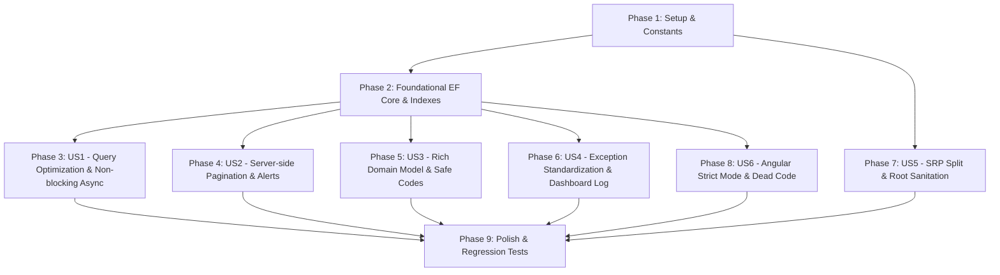

# Danh sách Công việc (Tasks): RM-025 Tối ưu Hóa Truy vấn Cơ sở Dữ liệu & Clean Code (Database Query Optimization & Clean Code)

**Đặc tả (Spec)**: [spec.md](spec.md) | **Kế hoạch (Plan)**: [plan.md](plan.md) | **Thiết kế Dữ liệu**: [data-model.md](data-model.md) | **Hợp đồng**: [database-optimization-contracts.md](contracts/database-optimization-contracts.md) | **Hướng dẫn Khởi chạy**: [quickstart.md](quickstart.md)

---

## Bảng Tổng quan Tiến độ (Overview)

| Phase | Mục tiêu | Số Tác vụ | Trạng thái |
|---|---|:---:|:---:|
| **Phase 1** | Thiết lập & Hằng số Từ điển Song ngữ (Setup) | 4 | Hoàn thành |
| **Phase 2** | Nền tảng CSDL EF Core, Indexes & Code Generator (Foundational) | 4 | Hoàn thành |
| **Phase 3** | User Story 1 (P1): Tối ưu Hiệu năng Truy vấn & Bất đồng bộ Không chặn 🎯 MVP Core | 5 | Hoàn thành |
| **Phase 4** | User Story 2 (P1): Phân trang Máy chủ Kho & Tối ưu Cảnh báo Tồn kho 🎯 MVP Core | 4 | Hoàn thành |
| **Phase 5** | User Story 3 (P2): Đóng gói Rich Domain Model & Sinh Mã An toàn Kèm Salt | 5 | Hoàn thành |
| **Phase 6** | User Story 4 (P2): Chuẩn hóa Ngoại lệ Nghiệp vụ, i18n & Nhật ký Dashboard | 5 | Hoàn thành |
| **Phase 7** | User Story 5 (P3): Đơn Trách Nhiệm Tệp (SRP) & Dọn dẹp Mã rác Thư mục Gốc | 4 | Hoàn thành |
| **Phase 8** | User Story 6 (P3): Chuẩn hóa Frontend Angular & Chế độ TypeScript Strict Mode | 4 | Hoàn thành |
| **Phase 9** | Trau chuốt (Polish), Kiểm thử Hồi quy Toàn diện & Xác thực Quickstart | 3 | Hoàn thành |
| **Tổng cộng** | | **38** | **38 / 38 (100%)** |

---

## Phase 1: Thiết lập & Hằng số Từ điển Song ngữ (Setup)

**Mục đích**: Khai báo tập trung toàn bộ các hằng số mã lỗi nghiệp vụ mới, cập nhật bản dịch song ngữ `vi.json`/`en.json` và đăng ký namespace lỗi cho ABP.

- [x] T001 [P] Khai báo tập trung các hằng số mã lỗi nghiệp vụ mới (nhóm Table, Dish, Category, Unit, Forecast, Recipe) trong `src/Acme.TooHungry.Domain.Shared/TooHungryDomainErrorCodes.cs`
- [x] T002 [P] Bổ sung 100% bản dịch Tiếng Việt cho các mã lỗi mới vào `src/Acme.TooHungry.Domain.Shared/Localization/TooHungry/vi.json`
- [x] T003 [P] Bổ sung 100% bản dịch Tiếng Anh tương ứng vào `src/Acme.TooHungry.Domain.Shared/Localization/TooHungry/en.json`
- [x] T004 [P] Cấu hình `options.MapCodeNamespace("RecipeIngredient", typeof(TooHungryResource))` trong `src/Acme.TooHungry.Domain.Shared/TooHungryDomainSharedModule.cs`

---

## Phase 2: Nền tảng CSDL EF Core, Indexes & Code Generator (Foundational)

**Mục đích**: Thiết lập lớp tiện ích sinh mã số ngẫu nhiên an toàn, cấu hình các chỉ mục hiệu năng CSDL, và tinh giản `AutoInclude` quá mức trong `TooHungryDbContext`.

- [x] T005 [P] Xây dựng phương thức tiện ích sinh mã số an toàn kèm salt ngẫu nhiên `GenerateOrderNumber(DateTime)` và `GenerateBatchCode(DateTime)` trong `src/Acme.TooHungry.Domain/TooHungryConsts.cs`
- [x] T006 Cập nhật `src/Acme.TooHungry.EntityFrameworkCore/EntityFrameworkCore/TooHungryDbContext.cs`: Bổ sung composite index `IX_AppOrders_Status_OrderDate`, unique index `IX_AppOrders_OrderNumber` (`[IsDeleted] = 0`), và filtered unique index `IX_AppRecipes_DishId_IsActive_Unique_Active` (`[DishId] IS NOT NULL AND [IsActive] = 1 AND [IsDeleted] = 0`)
- [x] T007 Cập nhật `src/Acme.TooHungry.EntityFrameworkCore/EntityFrameworkCore/TooHungryDbContext.cs`: Gỡ bỏ `AutoInclude` ở tất cả các quan hệ xuyên Aggregate (`Order.Table`, `OrderItem.Dish`, `Dish.DishCategory`, `RestaurantTable.DiningArea`, `DailyMenuItem.Dish`, `InventoryBatch.Ingredient`, `InventoryTransaction.Ingredient`), chỉ duy trì cho các con nội bộ Aggregate Root
- [x] T008 Tạo EF Core Migration `Add_RM025_Indexes_And_Optimizations` trong `src/Acme.TooHungry.EntityFrameworkCore` và thực thi áp dụng vào CSDL qua `src/Acme.TooHungry.DbMigrator`

---

## Phase 3: User Story 1 - Tối ưu Hiệu năng Truy vấn & Bất đồng bộ Không chặn (Ưu tiên: P1) 🎯 MVP Core

**Mục tiêu**: Xóa bỏ hoàn toàn các vòng lặp N+1 query tại các service Dự báo, Công thức và Đơn hàng; chuyển đổi 100% các câu lệnh EF Core đồng bộ chặn thread sang `AsyncExecuter`.

**Kiểm thử Độc lập**:
- Xem log SQL của `GetFinancialSummaryAsync` và `GetByForecastIdAsync`: chỉ sinh ra đúng 1 câu lệnh `WHERE Id IN (...)` cho món và nguyên liệu, không chạy lặp theo từng dòng DTO.
- Kiểm tra mã nguồn `TableAppService.cs` và `InventoryManager.cs`: không còn bất kỳ lệnh `.ToList()` hay `.FirstOrDefault()` đồng bộ nào chạy trên `IQueryable`.

### Triển khai cho User Story 1
- [x] T009 [US1] Tối ưu hóa truy vấn tại `src/Acme.TooHungry.Application/Forecasts/ForecastAppServices.cs`: Thay thế `_dishRepository.GetListAsync()` tải cả bảng và `FindAsync` lặp lại bằng gom nhóm ID `distinctDishIds` và tra cứu Map trong bộ nhớ với độ phức tạp $O(1)$
- [x] T010 [P] [US1] Tối ưu hóa truy vấn tại `src/Acme.TooHungry.Application/Recipes/RecipeAppService.cs`: Nạp danh mục đơn vị tính `Unit` một lần duy nhất trước vòng lặp DTO đưa vào Dictionary, triệt tiêu N+1 query lặp lại
- [x] T011 [P] [US1] Tối ưu hóa truy vấn tại `src/Acme.TooHungry.Application/Orders/OrderAppService.cs`: Khi kiểm tra công thức hoặc xác thực tồn kho, chỉ lọc các Recipe có `DishId` nằm trong đơn hàng (`orderDishIds.Contains(r.DishId)`), không nạp toàn bộ công thức nhà hàng
- [x] T012 [P] [US1] Chuyển đổi toàn bộ truy vấn đồng bộ chặn thread (`.FirstOrDefault(...)` dòng 50, `.ToList()` dòng 128 và 612) trong `src/Acme.TooHungry.Application/Tables/TableAppService.cs` sang `await AsyncExecuter.FirstOrDefaultAsync(...)` và `await AsyncExecuter.ToListAsync(...)`
- [x] T013 [P] [US1] Chuyển đổi toàn bộ truy vấn đồng bộ chặn thread (`.ToList()` dòng 55 và 132) trong `src/Acme.TooHungry.Domain/Inventories/InventoryManager.cs` sang `await AsyncExecuter.ToListAsync(...)`

**Trạm kiểm tra (Checkpoint)**: Toàn bộ các thao tác CSDL trọng yếu chạy non-blocking async, log EF Core không còn các vòng lặp N+1 lặp lại.

---

## Phase 4: User Story 2 - Phân trang Máy chủ Kho & Tối ưu Cảnh báo Tồn kho (Ưu tiên: P1) 🎯 MVP Core

**Mục tiêu**: Nâng cấp API lịch sử giao dịch kho sang phân trang máy chủ `PagedResultDto<InventoryTransactionDto>`; tối ưu hóa thuật toán cảnh báo kho tính toán gom nhóm trực tiếp từ SQL.

**Kiểm thử Độc lập**:
- Gọi `GET /api/app/inventory/transactions?ingredientId=...&skipCount=0&maxResultCount=10`: trả về đúng 10 bản ghi kèm `totalCount` tổng thể chính xác, thời gian phản hồi < 100ms.
- Gọi `GET /api/app/inventory/alerts`: CSDL gom nhóm tính toán trực tiếp trên SQL, chỉ trả về các nguyên liệu vi phạm ngưỡng hoặc cận hạn.

### Triển khai cho User Story 2
- [x] T014 [US2] Cập nhật hợp đồng giao diện `GetTransactionsAsync` nhận `PagedAndSortedResultRequestDto input` và trả về `PagedResultDto<InventoryTransactionDto>` trong `src/Acme.TooHungry.Application.Contracts/Inventories/IInventoryAppService.cs`
- [x] T015 [US2] Triển khai phân trang phía máy chủ cho `GetTransactionsAsync` trong `src/Acme.TooHungry.Application/Inventories/InventoryAppService.cs`: Sử dụng `PageBy(input.SkipCount, input.MaxResultCount)` và sắp xếp mặc định `CreationTime DESC`
- [x] T016 [US2] Tối ưu hóa `GetAlertsAsync` trong `src/Acme.TooHungry.Application/Inventories/InventoryAppService.cs`: Thay thế vòng lặp $O(n \times m)$ trong RAM bằng truy vấn SQL gom nhóm trực tiếp từ CSDL (`GroupBy(b => b.IngredientId).Select(...)`)
- [x] T017 [US2] Cập nhật lời gọi API lịch sử giao dịch kho trên giao diện Angular trong `angular/src/app/inventory/components/inventory-transaction-tab/inventory-transaction-tab.component.ts` để truyền tham số phân trang tới API mới

**Trạm kiểm tra (Checkpoint)**: Phân trang kho vận hành chuẩn xác theo dữ liệu máy chủ, cảnh báo kho phản hồi nhanh dưới 50ms.

---

## Phase 5: User Story 3 - Đóng gói Rich Domain Model & Sinh Mã An toàn Kèm Salt (Ưu tiên: P2)

**Mục tiêu**: Đóng kín public setters của các thực thể domain; gom toàn bộ 8 đoạn code reset bàn lặp lại vào `table.Release()`; hoàn thiện Clone Snapshot lưu vết lịch sử Recipe khi BumpVersion; sinh mã `ORD-` và `BATCH-` kèm salt4 chống va chạm.

**Kiểm thử Độc lập**:
- Gọi `table.Release()`: bàn chuyển sang `Available`, `OccupiedTime` và 5 trường đặt bàn đều bị làm sạch hoàn toàn.
- Cập nhật công thức món ăn: CSDL ghi nhận 2 bản ghi (bản ghi cũ `IsActive = 0` làm snapshot lịch sử, bản ghi mới `Version++` và `IsActive = 1`).
- Tạo 50 đơn hàng/lô kho đồng thời: 100% mã số sinh ra có hậu tố hex ngẫu nhiên và không bị trùng lặp.

### Triển khai cho User Story 3
- [x] T018 [P] [US3] Đóng kín public setters thành `protected set;` và bổ sung các domain methods `Occupy(DateTime)`, `Release()`, `MarkCleaning()` trong `src/Acme.TooHungry.Domain/Tables/RestaurantTable.cs`
- [x] T019 [US3] Thay thế toàn bộ 8 vị trí reset trạng thái bàn thủ công trong `OrderAppService.cs`, `TableAppService.cs`, và `ReservationAutoCancelBackgroundWorker.cs` bằng lời gọi tập trung `table.Release()`
- [x] T020 [P] [US3] Đóng kín public setters thành `protected set;` và bổ sung các domain methods `Complete()`, `Cancel()`, `SetTable(Guid?)`, `RecalculateTotalAmount()` trong `src/Acme.TooHungry.Domain/Orders/Order.cs`
- [x] T021 [P] [US3] Áp dụng `CodeGenerator.GenerateOrderNumber` và `GenerateBatchCode` có kèm hậu tố ngẫu nhiên 4 ký tự hex an toàn trong `src/Acme.TooHungry.Application/Orders/OrderAppService.cs` và `src/Acme.TooHungry.Application/Inventories/InventoryAppService.cs`
- [x] T022 [US3] Tái cấu trúc `RecipeManager.UpdateAsync` trong `src/Acme.TooHungry.Domain/Recipes/RecipeManager.cs`: Kiểm tra 100% nguyên liệu tồn tại/active, clone bản ghi cũ thành `IsActive = false` làm snapshot lịch sử, tăng `Version++` trên bản ghi chính `IsActive = true`

**Trạm kiểm tra (Checkpoint)**: Domain entities được bảo vệ đóng gói chặt chẽ, không còn mã reset bàn lặp lại, lịch sử công thức được bảo toàn.

---

## Phase 6: User Story 4 - Chuẩn hóa Ngoại lệ Nghiệp vụ, i18n & Nhật ký Dashboard (Ưu tiên: P2)

**Mục tiêu**: Thay thế toàn bộ ~25 vị trí ném `UserFriendlyException` tiếng Việt hardcode bằng `BusinessException(TooHungryDomainErrorCodes.XYZ)`; ghi log cảnh báo trên Dashboard và định kiểu mạnh qua C# `record OrderTrendSummary`.

**Kiểm thử Độc lập**:
- Chuyển giao diện sang Tiếng Anh, kích hoạt các vi phạm nghiệp vụ bàn ăn/món ăn/đơn vị: 100% thông báo trả về Tiếng Anh chuẩn từ `en.json`.
- Tắt module kho tạm thời khi mở Dashboard: log hệ thống ghi nhận `Logger.LogWarning`, Dashboard vẫn hiển thị an toàn các chỉ số doanh thu khác mà không bị lỗi 500.

### Triển khai cho User Story 4
- [x] T023 [P] [US4] Thay thế toàn bộ 15 vị trí ném `UserFriendlyException` hardcode tiếng Việt trong `src/Acme.TooHungry.Application/Tables/TableAppService.cs` bằng `BusinessException(TooHungryDomainErrorCodes.XYZ)`
- [x] T024 [P] [US4] Thay thế các vị trí `UserFriendlyException` hardcode tiếng Việt trong `src/Acme.TooHungry.Domain/Units/UnitManager.cs`, `src/Acme.TooHungry.Domain/Dishes/DishManager.cs`, `src/Acme.TooHungry.Domain/Dishes/DishCategoryManager.cs`, và `src/Acme.TooHungry.HttpApi/Controllers/MediaController.cs` bằng `BusinessException`
- [x] T025 [P] [US4] Thay thế các vị trí `UserFriendlyException` trong module Dự báo nhu cầu tại `src/Acme.TooHungry.Application/Forecasts/ForecastAppServices.cs` bằng `BusinessException`
- [x] T026 [US4] Tái cấu trúc `src/Acme.TooHungry.Application/Dashboard/DashboardAppService.cs`: Thay thế khối `catch { }` rỗng bằng `Logger.LogWarning(ex, "...")`; thay thế kiểu `dynamic` bằng C# `record OrderTrendSummary(DateTime OrderDate, decimal TotalAmount)`
- [x] T027 [P] [US4] Chuẩn hóa `OrderAppService` kế thừa từ `TooHungryAppService` trong `src/Acme.TooHungry.Application/Orders/OrderAppService.cs`

**Trạm kiểm tra (Checkpoint)**: Toàn bộ ngoại lệ hệ thống được định kiểu mạnh, hỗ trợ song ngữ 100%, Dashboard ghi log minh bạch.

---

## Phase 7: User Story 5 - Đơn Trách Nhiệm Tệp (SRP) & Dọn dẹp Mã rác Thư mục Gốc (Ưu tiên: P3)

**Mục tiêu**: Tách các tệp chứa nhiều class thành các tệp đơn trách nhiệm; xóa bỏ toàn bộ các tập tin rác/mật khẩu ở thư mục gốc và dọn 7 nhóm permission mồ côi.

**Kiểm thử Độc lập**:
- Thư mục gốc không còn tồn tại các tệp `test.cs`, `Reflect.cs`, `fix.js`, `translate.js`, `perf-test.ps1`, `Logs/logs.txt`.
- Mỗi tệp service chỉ chứa đúng 1 class chính tương ứng; giải pháp biên dịch trơn tru không lỗi tham chiếu.

### Triển khai cho User Story 5
- [x] T028 [US5] Tách tệp `DishAppServices.cs` thành `src/Acme.TooHungry.Application/Dishes/DishAppService.cs` và `src/Acme.TooHungry.Application/Dishes/DishCategoryAppService.cs` độc lập
- [x] T029 [US5] Tách tệp `ForecastAppServices.cs` thành `src/Acme.TooHungry.Application/Forecasts/DemandForecastAppService.cs` và `src/Acme.TooHungry.Application/Forecasts/IngredientPlanAppService.cs` độc lập
- [x] T030 [P] [US5] Xóa bỏ 7 nhóm permission mồ côi (`Receivings`, `Wastes`, `Stocktakings`, `Bills`, `Payments`, `UnitConversions`, `StockAdjustments`) khỏi `src/Acme.TooHungry.Application.Contracts/Permissions/TooHungryPermissions.cs` và `src/Acme.TooHungry.Application.Contracts/Permissions/TooHungryPermissionDefinitionProvider.cs`
- [x] T031 [P] [US5] Xóa bỏ toàn bộ các tập tin rác và bí mật ở thư mục gốc: `test.cs`, `Reflect.cs`, `fix.js`, `translate.js`, `perf-test.ps1`, `Logs/logs.txt`

**Trạm kiểm tra (Checkpoint)**: Cấu trúc mã nguồn đạt chuẩn Single Responsibility, bảo mật thư mục gốc được làm sạch hoàn toàn.

---

## Phase 8: User Story 6 - Chuẩn hóa Frontend Angular & Chế độ TypeScript Strict Mode (Ưu tiên: P3)

**Mục tiêu**: Xóa dead code trên Angular; loại bỏ `HttpClientModule` thừa; kích hoạt `"strict": true` trong `tsconfig.json` và xử lý triệt để các cảnh báo kiểu dữ liệu.

**Kiểm thử Độc lập**:
- Chạy `npm run build` trong `angular/`: quá trình biên dịch hoàn tất thành công 100% với cấu hình `"strict": true` mà không phát sinh lỗi ép kiểu `any`.

### Triển khai cho User Story 6
- [x] T032 [P] [US6] Xóa các thư mục và component mồ côi trên Angular: `angular/src/app/auth/login/*`, `angular/src/app/shared/layout/*`, `angular/src/app/shared/components/modal/`, `angular/src/app/shared/components/spinner/`, `angular/src/app/shared/shared-module.ts`, `angular/permissions.json`, `angular/e2e/`
- [x] T033 [P] [US6] Dọn dẹp `angular/src/app/app.config.ts`: Xóa bỏ `HttpClientModule` (deprecated) và `FormsModule` thừa khỏi `importProvidersFrom`
- [x] T034 [P] [US6] Dọn dẹp các lệnh `console.error` còn sót lại tại `angular/src/app/home/home.component.ts` và `angular/src/app/recipe/recipe.component.ts`
- [x] T035 [US6] Kích hoạt cấu hình `"strict": true` toàn diện trong `angular/tsconfig.json` và chuẩn hóa type-safety cho toàn bộ các điểm truy cập dữ liệu trên Frontend

**Trạm kiểm tra (Checkpoint)**: Ứng dụng Angular đạt tiêu chuẩn TypeScript Strict Mode cao nhất, không còn dead code hay module deprecated.

---

## Phase 9: Trau chuốt (Polish), Kiểm thử Hồi quy Toàn diện & Xác thực Quickstart

**Mục đích**: Cập nhật tiến độ vào roadmap tổng thể, thực thi toàn bộ test suites tự động và xác thực 7 kịch bản kiểm thử theo `quickstart.md`.

- [x] T036 [P] Cập nhật tiến độ tại `docs/roadmap.md`: Đánh dấu hoàn thành toàn bộ các hạng mục của RM-025 và cập nhật trạng thái "hoàn thành"
- [x] T037 Chạy kiểm thử tự động toàn bộ giải pháp Backend (`dotnet test`) bảo đảm 100% các bài test hiện tại và mới đều vượt qua (Green)
- [x] T038 Thực thi xác thực toàn bộ 7 kịch bản kiểm thử trọng yếu theo hướng dẫn trong `specs/025-rm-025-database-query-optimization-and-clean-code/quickstart.md`

---

## Phụ thuộc (Dependencies) & Thứ tự Thực thi

### Cơ hội Thực thi Song song (Parallel Opportunities)
- **Trong Phase 1**: T001, T002, T003, T004 có thể thực thi song song hoàn toàn.
- **Trong Phase 2**: T005 có thể làm song song với T006, T007.
- **Sau Phase 2**:
  - US1 (Phase 3) và US2 (Phase 4) có thể tiến hành song song.
  - US5 (Phase 7 - Sanitation & SRP) và US6 (Phase 8 - Angular Strict Mode) có thể chạy song song độc lập với các tác vụ CSDL.
- **Trong Phase 6**: T023, T024, T025 thay thế ngoại lệ trên các service khác nhau có thể thực thi song song.

---

## Chiến lược Triển khai (Implementation Strategy)

### Phạm vi MVP Cốt lõi (Tối thiểu Khả dụng)
1. Hoàn thành **Phase 1: Thiết lập** + **Phase 2: Nền tảng EF Core**.
2. Hoàn thành **Phase 3: User Story 1** (Triệt tiêu N+1 & Non-blocking Async).
3. Hoàn thành **Phase 4: User Story 2** (Phân trang máy chủ kho & Cảnh báo SQL).
4. 👉 **Dừng và Xác minh MVP**: Chạy kiểm thử hiệu năng truy vấn và phân trang kho. Đây là hạt nhân cốt lõi giải quyết các lỗi tắc nghẽn nghiêm trọng nhất.

### Gia tăng Giá trị Tuần tự (Incremental Delivery)
- **Tăng cường Domain & An toàn** (Phase 5): Đóng gói Rich Domain Model, bảo vệ bàn ăn và sinh mã chống va chạm.
- **Chuẩn hóa Quốc tế hóa** (Phase 6): Triệt tiêu toàn bộ `UserFriendlyException` hardcode, hoàn thiện hỗ trợ song ngữ 100%.
- **Vệ sinh & Nâng cấp Chất lượng Code** (Phase 7 & 8): Tách tệp SRP, xóa tệp rác thư mục gốc và bật TypeScript Strict Mode trên Frontend.
- **Hoàn thiện & Đóng gói** (Phase 9): Chạy toàn bộ regression test và cập nhật roadmap.
