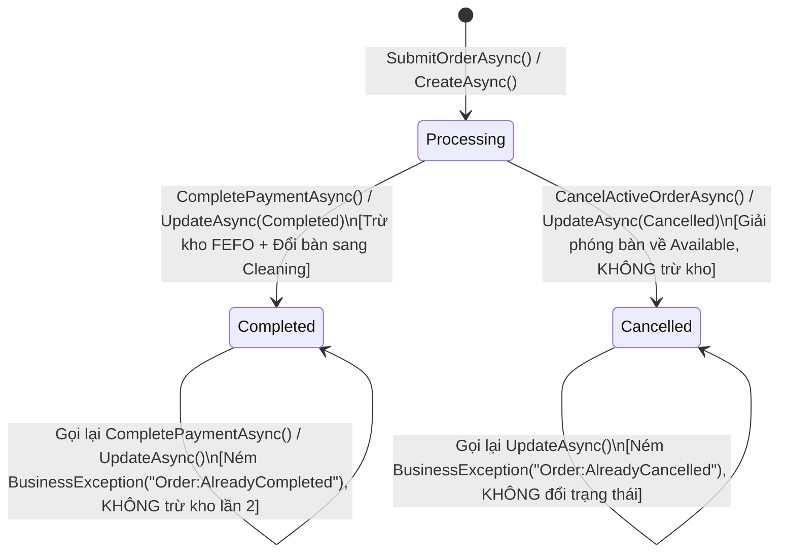

# Mô hình Dữ liệu Kiểm thử & Ma trận Trạng thái (Test Data Model & State Matrix): RM-026

**Tính năng**: `RM-026 Bộ Kiểm Thử Tự Động Phân Quyền & Bất Biến`  
**Ngày lập**: 2026-10-23 | **Tác giả**: ADAM

---

## 1. Ma trận Định danh & Phân quyền Thời gian chạy (User Personas & Security Matrix)

Ma trận dưới đây định nghĩa cấu trúc Claims, Roles và tập hợp quyền hạn (Permissions) được nạp vào test context để kiểm thử `EndpointAuthorization_Runtime_Tests` và `RoleBasedAuthorization_Tests`:

| Persona / Role | Claims Thiết lập (Claims Principal) | Quyền hạn Được cấp (Granted Permissions) | Quyền hạn Bị từ chối (Denied Permissions) | Kỳ vọng khi gọi Action Nhạy cảm |
|---|---|---|---|---|
| **Anonymous (Chưa xác thực)** | `IsAuthenticated = false`, Claims rỗng | Không có bất kỳ quyền hạn nào | Toàn bộ quyền hạn hệ thống | Ném `AbpAuthorizationException` (HTTP 401/403) ngay tại Interceptor |
| **Waiter (Nhân viên phục vụ)** | `Role = "Waiter"`, `UserId = Guid` | `TooHungryPermissions.Orders.Create`<br>`TooHungryPermissions.Orders.Default`<br>`TooHungryPermissions.Tables.UpdateStatus`<br>`TooHungryPermissions.Dishes.Default` | `TooHungryPermissions.Orders.Delete`<br>`TooHungryPermissions.Ingredients.Edit`<br>`TooHungryPermissions.DishCategories.Delete`<br>`TooHungryPermissions.Tables.Edit` | - Tạo đơn & Chuyển bàn: **Thành công**<br>- Xóa đơn, Xóa danh mục, Sửa kho: **Bị chặn bằng `AbpAuthorizationException`** |
| **InventoryKeeper (Thủ kho)** | `Role = "InventoryKeeper"`, `UserId = Guid` | `TooHungryPermissions.Inventory.Default`<br>`TooHungryPermissions.Inventory.CreateBatch`<br>`TooHungryPermissions.Inventory.StockAdjustment`<br>`TooHungryPermissions.Inventory.DiscardBatch` | `TooHungryPermissions.Orders.Edit`<br>`TooHungryPermissions.Tables.Edit`<br>`TooHungryPermissions.Dishes.Create` | - Nhập lô & Kiểm kê kho: **Thành công**<br>- Thanh toán đơn, Sửa bàn, Thêm món: **Bị chặn bằng `AbpAuthorizationException`** |
| **Admin / Manager (Quản trị viên)** | `Role = "admin"`, `Role = "Manager"` | Toàn bộ các nhóm quyền `TooHungryPermissions.*` | Không có | Mọi lời gọi API đều **Thành công 100%** |

---

## 2. Máy Trạng thái Thực thể & Rào Chắn Nghiệp vụ (State Machines & Domain Guards)

### 2.1. Vòng đời Đơn hàng & Rào chắn Bất biến (Order Lifecycle & Idempotency Guard)



### 2.2. Vòng đời Bàn ăn khi Chuyển bàn & Gộp bàn (Table Transition Matrix)

| Thao tác Nghiệp vụ | Bàn Nguồn (Source Table) | Bàn Đích (Target Table) | Đơn hàng Bàn Nguồn | Đơn hàng Bàn Đích |
|---|---|---|---|---|
| **Chuyển bàn (`TransferTableAsync`)** | `Occupied` → **`Cleaning`** (nếu có đơn) hoặc **`Available`** | `Available` → **`Occupied`** (kế thừa `OccupiedTime`) | Trỏ `TableId` sang Bàn Đích, bổ sung note chuyển bàn | Đơn hàng chuyển sang bàn đích quản lý |
| **Gộp bàn (`MergeTablesAsync`)** | Bàn phụ: `Occupied` → **`Cleaning`** | Bàn chính: `Occupied` (giữ nguyên khách ngồi) | Đơn phụ: **`Cancelled`** (ghi rõ `[Đã gộp vào Bàn chính]`) | Đơn chính: Nhận toàn bộ món ăn, cộng dồn số lượng, nối ghi chú |
| **Hủy đơn (`CancelActiveOrderAsync`)** | `Occupied` → **`Available`** | N/A | Đơn: **`Cancelled`**, kho không đổi | N/A |

---

## 3. Cấu trúc Dữ liệu Mẫu Khởi tạo Kiểm thử (Test Fixture Entities)

Mỗi test case sử dụng bộ khởi tạo dữ liệu mẫu độc lập để tránh phụ thuộc:

### 3.1. Dữ liệu Danh mục & Bàn ăn
```csharp
public record TableTestFixture(
    DiningArea DiningArea,
    RestaurantTable TableSource,
    RestaurantTable TableTarget,
    RestaurantTable TableExtra
);
```
- `TableSource`: `Name = $"Bàn A {Guid.NewGuid():N}"[..10]`, `Status = TableStatus.Occupied`, `OccupiedTime = DateTime.UtcNow.AddHours(-1)`.
- `TableTarget`: `Name = $"Bàn B {Guid.NewGuid():N}"[..10]`, `Status = TableStatus.Available`.

### 3.2. Dữ liệu Nguyên liệu & Lô kho Đa tầng (FEFO Batches)
```csharp
public record InventoryTestFixture(
    Ingredient IngredientX,
    InventoryBatch BatchEarlyExpiry,
    InventoryBatch BatchLateExpiry,
    InventoryBatch BatchExpired
);
```
- `IngredientX`: `Name = "Thịt bò Kobe"`, `BaseUnit = "kg"`, `MinStock = 5m`, `EstimatedPrice = 300000m`, `StorageType = StorageType.Frozen`.
- `BatchEarlyExpiry`: `BatchCode = "BATCH-EARLY"`, `RemainingQuantity = 3m`, `ExpirationDate = Clock.Now.AddDays(3)`.
- `BatchLateExpiry`: `BatchCode = "BATCH-LATE"`, `RemainingQuantity = 10m`, `ExpirationDate = Clock.Now.AddDays(30)`.
- `BatchExpired`: `BatchCode = "BATCH-EXPIRED"`, `RemainingQuantity = 5m`, `ExpirationDate = Clock.Now.AddDays(-1)`.

### 3.3. Dữ liệu Món ăn & Công thức Tiêu hao (Recipe Fixture)
```csharp
public record DishRecipeTestFixture(
    Dish Dish1,
    Recipe Recipe1
);
```
- `Dish1`: `Name = "Bò né đặc biệt"`, `Price = 120000m`, `IsActive = true`.
- `Recipe1`: `DishId = Dish1.Id`, `IsActive = true`, gồm 1 nguyên liệu: `IngredientX` định lượng `0.5kg` / phần.

---

## 4. Mô hình Trạng thái Tương tranh (Concurrency Execution Paths)

### Kịch bản A: Race Condition Tạo đơn Trên Cùng Bàn (`SubmitOrder`)
```text
Client 1 (Waiter 1)          Server / SQLite In-Memory               Client 2 (Waiter 2)
      |                                 |                                 |
      |-- SubmitOrder(Table A) -------->|                                 |
      |   [Scope 1: Transaction Start]  |<-- SubmitOrder(Table A) --------|
      |                                 |   [Scope 2: Transaction Start]  |
      |   Insert Order 1 (Active)       |                                 |
      |   Update Table A (Occupied)     |   Thử Insert Order 2 / Update   |
      |   Commit Scope 1: SUCCESS       |   Unique Filtered Index Chặn    |
      |<-- Trả về HTTP 200 (Order 1) ---|   Hoặc Bắt DbUpdateException    |
      |                                 |-- Ném BusinessException ------->|
      |                                 |   (TableAlreadyOccupied/Active) |
```

### Kịch bản B: Khấu trừ Kho FEFO Tương tranh Đa luồng (`DeductFefoAsync`)
```text
Lô ban đầu: Batch 1 (Hạn 3 ngày, Tồn: 10kg)
Mỗi đơn yêu cầu: 2kg
--------------------------------------------------------------------------------------
Luồng 1 (Order 1)  -> Đọc Stamp 1 -> Trừ 2kg -> Lưu Stamp 2 -> Thành công (Còn 8kg)
Luồng 2 (Order 2)  -> Đọc Stamp 1 -> Xung đột Stamp 2! -> Kích hoạt UoW Retry (requiresNew: true)
                   -> Đọc Stamp 2 -> Trừ 2kg -> Lưu Stamp 3 -> Thành công (Còn 6kg)
Luồng 3 (Order 3)  -> Đọc Stamp 2 -> Xung đột Stamp 3! -> Kích hoạt UoW Retry
                   -> Đọc Stamp 3 -> Trừ 2kg -> Lưu Stamp 4 -> Thành công (Còn 4kg)
Luồng 4 (Order 4)  -> Đọc Stamp 3 -> Xung đột Stamp 4! -> Kích hoạt UoW Retry
                   -> Đọc Stamp 4 -> Trừ 2kg -> Lưu Stamp 5 -> Thành công (Còn 2kg)
--------------------------------------------------------------------------------------
Kết quả cuối cùng: Cả 4 luồng hoàn tất, Tồn kho chính xác = 2kg, Không âm kho!
```
