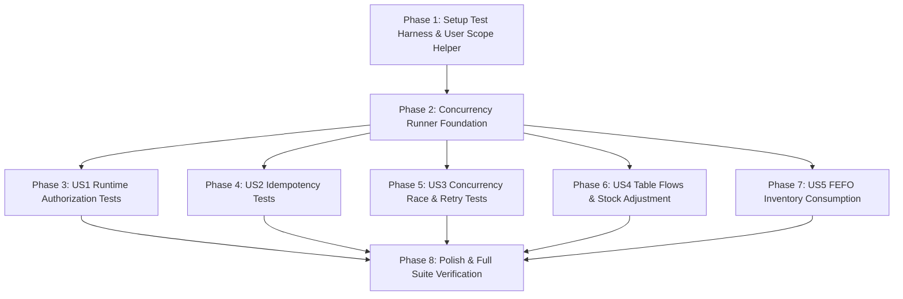

# Danh sách Công việc (Tasks): RM-026 Bộ Kiểm Thử Tự Động Phân Quyền & Bất Biến (Automated Testing: Auth, Concurrency & Idempotency)

**Đặc tả (Spec)**: [spec.md](spec.md) | **Kế hoạch (Plan)**: [plan.md](plan.md) | **Nghiên cứu**: [research.md](research.md) | **Hợp đồng**: [testing-contracts.md](contracts/testing-contracts.md) | **Ma trận Dữ liệu**: [data-model.md](data-model.md) | **Hướng dẫn Khởi chạy**: [quickstart.md](quickstart.md)

---

## Bảng Tổng quan Tiến độ (Overview)

| Phase | Mục tiêu | Số Tác vụ | Trạng thái |
|---|---|:---:|:---:|
| **Phase 1** | Thiết lập Nền tảng Test Harness & User Scope Helper (Setup) | 2 | Hoàn thành |
| **Phase 2** | Nền tảng Điều phối Tương tranh Đa luồng (Foundational Concurrency) | 1 | Hoàn thành |
| **Phase 3** | User Story 1 (P1): Tự Động Hóa Kiểm Thử Phân Quyền Thời Gian Chạy 🎯 MVP Core | 3 | Hoàn thành |
| **Phase 4** | User Story 2 (P1): Kiểm Thử Bất Biến & Khử Trừ Kho Lặp Lại (Idempotency) 🎯 MVP Core | 2 | Hoàn thành |
| **Phase 5** | User Story 3 (P1): Kiểm Thử Tranh Chấp Tạo Đơn & Trừ Kho FEFO Đồng Thời 🎯 MVP Core | 3 | Hoàn thành |
| **Phase 6** | User Story 4 (P2): Kiểm Thử Hồi Quy Các Luồng Vận Hành Trọng Yếu (Bàn & Kho) | 5 | Hoàn thành |
| **Phase 7** | User Story 5 (P2): Kiểm Thử Khấu Trừ Kho Theo Hạn Sử Dụng (FEFO Test Suite) | 2 | Hoàn thành |
| **Phase 8** | Trau chuốt (Polish), Tích hợp Lớp Runner EF Core & Xác thực Quickstart | 3 | Hoàn thành |
| **Tổng cộng** | | **21** | **21 / 21 (100%)** |

---

## Phase 1: Thiết lập Nền tảng Test Harness & User Scope Helper (Setup)

**Mục đích**: Bổ sung cơ chế chuyển đổi ngữ cảnh người dùng thời gian chạy (`ClaimsPrincipal`) và xây dựng bộ dữ liệu mẫu (Test Fixture Factory) dùng chung cho toàn bộ các bài test.

- [x] T001 [P] Bổ sung phương thức `ChangeUserContext(Guid? userId, string? userName, params string[] roles)` vào `test/Acme.TooHungry.Application.Tests/TooHungryApplicationTestBase.cs` để hỗ trợ chuyển đổi ClaimsPrincipal và giả lập người dùng vô danh / vai trò cụ thể
- [x] T002 [P] Xây dựng lớp tiện ích `TestingDataFixtureFactory` hỗ trợ sinh nhanh Bàn ăn, Nguyên liệu, Lô kho, Món ăn và Công thức chuẩn trong `test/Acme.TooHungry.Application.Tests/Common/TestingDataFixtureFactory.cs`

---

## Phase 2: Nền tảng Điều phối Tương tranh Đa luồng (Foundational Concurrency)

**Mục đích**: Thiết lập cơ chế chạy đa tác vụ song song trên các DI Scope độc lập trong SQLite In-Memory, ngăn ngừa triệt để lỗi non-thread-safe của EF Core DbContext.

- [x] T003 Xây dựng phương thức tiện ích `RunConcurrentScopesAsync(int workerCount, Func<IServiceProvider, int, Task> action)` và `ExecuteRaceConditionAsync` trong `test/Acme.TooHungry.Application.Tests/TooHungryApplicationTestBase.cs` sử dụng `IServiceScopeFactory.CreateScope()` để cô lập DbContext cho từng task song song

---

## Phase 3: User Story 1 - Tự Động Hóa Kiểm Thử Phân Quyền Thời Gian Chạy (Ưu tiên: P1) 🎯 MVP Core

**Mục tiêu**: Xây dựng test suite xác thực 100% các API chỉ định ném `AbpAuthorizationException` khi Unauthenticated hoặc thiếu quyền; kiểm tra ma trận phân quyền đa vai trò (Waiter, InventoryKeeper, Admin).

**Kiểm thử Độc lập**: Chạy lệnh `dotnet test test/Acme.TooHungry.EntityFrameworkCore.Tests --filter "FullyQualifiedName~Security|FullyQualifiedName~Authorization"`, bảo đảm toàn bộ các ca kiểm thử phân quyền đều vượt qua thành công.

### Triển khai cho User Story 1
- [x] T004 [US1] Xây dựng lớp test trừu tượng `EndpointAuthorization_Runtime_Tests<TStartupModule>` trong `test/Acme.TooHungry.Application.Tests/Security/EndpointAuthorization_Runtime_Tests.cs` kiểm tra ném `AbpAuthorizationException` khi thiếu quyền trên 6 endpoint:
  * `MediaController.UploadDishImageAsync` (thiếu quyền `TooHungryPermissions.Dishes.Edit`)
  * `DailyMenuAppService` (Unauthenticated hoặc thiếu quyền `TooHungryPermissions.Dishes.Default`)
  * `RecipeController.GetActiveByDishIdAsync` (thiếu quyền `TooHungryPermissions.Recipes.Default`)
  * `TableOrderController.CompleteActiveOrderByTableIdAsync` (thiếu quyền `TooHungryPermissions.Orders.Edit`)
  * `OrderAppService.DeleteAsync` (thiếu quyền `TooHungryPermissions.Orders.Delete`)
  * `DishCategoryAppService.DeleteAsync` (thiếu quyền `TooHungryPermissions.DishCategories.Delete`)
- [x] T005 [US1] Xây dựng lớp test trừu tượng `RoleBasedAuthorization_Tests<TStartupModule>` trong `test/Acme.TooHungry.Application.Tests/Security/RoleBasedAuthorization_Tests.cs` kiểm tra ma trận quyền đa vai trò:
  * Role `Waiter`: có quyền tạo đơn (`Orders.Create`) và đổi trạng thái bàn (`Tables.UpdateStatus`), nhưng bị chặn bằng `AbpAuthorizationException` khi xóa đơn (`Orders.Delete`), sửa nguyên liệu (`Ingredients.Edit`), xóa danh mục (`DishCategories.Delete`)
  * Role `InventoryKeeper`: có quyền nhập lô (`Inventories.Batch`) và kiểm kê kho (`Inventories.Adjust`), nhưng bị chặn khi hoàn tất thanh toán (`Orders.Edit`) và sửa sơ đồ bàn (`Tables.Edit`)
  * Role `Admin`: được cấp toàn quyền và thực thi thành công 100% các endpoint
- [x] T006 [P] [US1] Tạo 2 lớp runner EF Core `EfCoreEndpointAuthorizationRuntimeTests.cs` và `EfCoreRoleBasedAuthorizationTests.cs` trong `test/Acme.TooHungry.EntityFrameworkCore.Tests/EntityFrameworkCore/Applications/` kế thừa với `<TooHungryEntityFrameworkCoreTestModule>`

**Trạm kiểm tra (Checkpoint)**: Toàn bộ các API nhạy cảm được bảo vệ chặt chẽ ở thời gian chạy, ném đúng `AbpAuthorizationException` khi thiếu quyền.

---

## Phase 4: User Story 2 - Kiểm Thử Bất Biến & Khử Trừ Kho Lặp Lại (Idempotency) (Ưu tiên: P1) 🎯 MVP Core

**Mục tiêu**: Xây dựng test suite chứng minh việc gọi `CompletePaymentAsync` hoặc `UpdateAsync(Completed)` lặp lại bị từ chối bằng `BusinessException("TooHungry:Order:AlreadyCompleted")` và kho hàng tuyệt đối không bị trừ lần 2 (triệt tiêu dứt điểm Backend #1).

**Kiểm thử Độc lập**: Chạy lệnh `dotnet test test/Acme.TooHungry.EntityFrameworkCore.Tests --filter "FullyQualifiedName~Idempotency"`.

### Triển khai cho User Story 2
- [x] T007 [US2] Xây dựng lớp test trừu tượng `OrderAppService_Idempotency_Tests<TStartupModule>` trong `test/Acme.TooHungry.Application.Tests/Orders/OrderAppService_Idempotency_Tests.cs`:
  * Test case 1: Gọi `CompletePaymentAsync` lần 1 thành công trừ kho; gọi lại lần 2 bị ném `BusinessException("TooHungry:Order:AlreadyCompleted")`, assert số dư tồn kho `RemainingQuantity` không đổi và số bản ghi `InventoryTransaction` loại `DishConsumption` giữ nguyên 100%
  * Test case 2: Đơn hàng đã ở trạng thái `Completed`, gọi `UpdateAsync(Status = Completed)` bị ném `BusinessException("TooHungry:Order:AlreadyCompleted")`, không chạy lại `ProcessOrderInventoryConsumptionAsync`
  * Test case 3: Gọi `TableOrderController.CompleteActiveOrderByTableIdAsync` lặp lại nhanh trên cùng 1 bàn ăn, chỉ thực hiện khấu trừ kho DUY NHẤT 1 lần
- [x] T008 [P] [US2] Tạo lớp runner EF Core `EfCoreOrderIdempotencyTests.cs` trong `test/Acme.TooHungry.EntityFrameworkCore.Tests/EntityFrameworkCore/Applications/EfCoreOrderIdempotencyTests.cs`

**Trạm kiểm tra (Checkpoint)**: Khẳng định 100% không bao giờ xảy ra lỗi trừ kho 2 lần dù request bị lặp lại.

---

## Phase 5: User Story 3 - Kiểm Thử Tranh Chấp Tạo Đơn & Trừ Kho FEFO Đồng Thời (Concurrency) (Ưu tiên: P1) 🎯 MVP Core

**Mục tiêu**: Xây dựng test suite mô phỏng 2 nhân viên phục vụ gửi `SubmitOrder` đồng thời trên cùng bàn và nhiều đơn cùng trừ kho FEFO, bảo đảm hệ thống xử lý an toàn không sinh 2 đơn active và không crash 500.

**Kiểm thử Độc lập**: Chạy lệnh `dotnet test test/Acme.TooHungry.EntityFrameworkCore.Tests --filter "FullyQualifiedName~Concurrency"`.

### Triển khai cho User Story 3
- [x] T009 [US3] Xây dựng lớp test trừu tượng `OrderAppService_SubmitOrder_Concurrency_Tests<TStartupModule>` trong `test/Acme.TooHungry.Application.Tests/Orders/OrderAppService_SubmitOrder_Concurrency_Tests.cs`:
  * Test case: 2 Task chạy song song gọi `SubmitOrderAsync` trên cùng một bàn ăn qua `Task.WhenAll`. Assert đúng 1 task thành công, task thứ hai bắt được ngoại lệ Concurrency / BusinessException chuẩn, CSDL chỉ có duy nhất 1 đơn active trên bàn, không có ngoại lệ unhandled 500 (triệt tiêu Backend #12)
- [x] T010 [US3] Xây dựng lớp test trừu tượng `InventoryManager_Fefo_Concurrency_Tests<TStartupModule>` trong `test/Acme.TooHungry.Application.Tests/Inventories/InventoryManager_Fefo_Concurrency_Tests.cs`:
  * Test case 1: 4 worker cùng khấu trừ đồng thời qua các DI scope riêng. Assert tồn kho không bao giờ âm, tổng số lượng trừ trong các transaction OUT khớp chính xác với lượng giảm của lô (triệt tiêu Backend #5)
- [x] T011 [P] [US3] Tạo 2 lớp runner EF Core `EfCoreOrderSubmitOrderConcurrencyTests.cs` và `EfCoreInventoryFefoConcurrencyTests.cs` trong `test/Acme.TooHungry.EntityFrameworkCore.Tests/EntityFrameworkCore/Applications/`

**Trạm kiểm tra (Checkpoint)**: Đa luồng tạo đơn và trừ kho vận hành an toàn tuyệt đối, zero flakiness.

---

## Phase 6: User Story 4 - Kiểm Thử Hồi Quy Các Luồng Vận Hành Trọng Yếu (Bàn & Kho) (Ưu tiên: P2)

**Mục tiêu**: Xây dựng test suite tích hợp cho toàn bộ các nghiệp vụ bàn ăn phức tạp: Chuyển bàn, Gộp bàn (bảo toàn đơn giá CSDL và ghi chú riêng từng món theo Backend #16), Hủy đơn và Kiểm kê kho (đúng giá vốn & hạn dùng theo Backend #25).

**Kiểm thử Độc lập**: Chạy lệnh `dotnet test test/Acme.TooHungry.EntityFrameworkCore.Tests --filter "FullyQualifiedName~Table|FullyQualifiedName~StockAdjustment"`.

### Triển khai cho User Story 4
- [x] T012 [US4] Xây dựng lớp test trừu tượng `TableAppService_TransferTable_Tests<TStartupModule>` trong `test/Acme.TooHungry.Application.Tests/Tables/TableAppService_TransferTable_Tests.cs`:
  * Chuyển bàn thành công: Bàn B thành `Occupied`, kế thừa đúng `OccupiedTime`, đơn hàng trỏ sang Bàn B; Bàn A chuyển sang `Cleaning`
  * Ca từ chối: Bàn trùng nhau (`TableSameSourceAndTarget`), bàn nguồn không có khách (`TableSourceNotOccupied`), bàn đích không trống (`TableTargetNotEmpty`)
- [x] T013 [US4] Xây dựng lớp test trừu tượng `TableAppService_MergeTables_Advanced_Tests<TStartupModule>` trong `test/Acme.TooHungry.Application.Tests/Tables/TableAppService_MergeTables_Advanced_Tests.cs`:
  * Gộp bàn thành công: Món trùng nhau được cộng dồn `Quantity`, đơn giá được đồng bộ theo giá niêm yết từ CSDL (`Dish.Price`), ghi chú được ghép nối `"{primary.Note} | [Gộp từ {secondary.Name}: {secondary.Note}]"`
  * Đơn phụ chuyển sang `Cancelled` với ghi chú đối soát rõ ràng `[Đã gộp vào {primary.Name} (#{primaryOrder.OrderNumber})]`, bàn phụ giải phóng về `Cleaning` (khắc phục triệt để Backend #16)
- [x] T014 [US4] Xây dựng lớp test trừu tượng `OrderAppService_CancelOrder_Tests<TStartupModule>` trong `test/Acme.TooHungry.Application.Tests/Orders/OrderAppService_CancelOrder_Tests.cs`:
  * Hủy đơn đang mở: Đơn hàng chuyển sang `Cancelled`, bàn ăn giải phóng về `Available`, kho hàng không bị trừ
  * Từ chối hủy đơn đã hoàn tất thanh toán bằng `BusinessException("TooHungry:Order:AlreadyCompleted")`
- [x] T015 [US4] Xây dựng lớp test trừu tượng `InventoryAppService_StockAdjustment_Tests<TStartupModule>` trong `test/Acme.TooHungry.Application.Tests/Inventories/InventoryAppService_StockAdjustment_Tests.cs`:
  * Điều chỉnh tăng (+3): Sinh lô kiểm kê mới có `UnitCost = estimatedPrice` (không bằng 0), `PurchaseUnit = baseUnit`, hạn sử dụng hợp lý theo `StorageType` (khắc phục triệt để Backend #25)
  * Điều chỉnh giảm (-3.5): Khấu trừ qua `BatchDeductions`, tạo giao dịch `ADJUSTMENT_OUT`
- [x] T016 [P] [US4] Tạo 4 lớp runner EF Core trong `test/Acme.TooHungry.EntityFrameworkCore.Tests/EntityFrameworkCore/Applications/`:
  * `EfCoreTableTransferTests.cs`
  * `EfCoreTableMergeAdvancedTests.cs`
  * `EfCoreOrderCancelTests.cs`
  * `EfCoreInventoryStockAdjustmentTests.cs`

**Trạm kiểm tra (Checkpoint)**: Toàn bộ các luồng Chuyển bàn, Gộp bàn, Hủy đơn và Kiểm kê kho được kiểm tra chặt chẽ, bảo toàn dữ liệu 100%.

---

## Phase 7: User Story 5 - Kiểm Thử Khấu Trừ Kho Theo Hạn Sử Dụng (FEFO Test Suite) (Ưu tiên: P2)

**Mục tiêu**: Xây dựng test suite chứng minh thuật toán FEFO luôn ưu tiên khấu trừ triệt để lô có hạn dùng gần nhất trước khi chuyển sang lô tiếp theo, và tự động bỏ qua lô hết hạn.

**Kiểm thử Độc lập**: Chạy lệnh `dotnet test test/Acme.TooHungry.EntityFrameworkCore.Tests --filter "FullyQualifiedName~Fefo"`.

### Triển khai cho User Story 5
- [x] T017 [US5] Xây dựng lớp test trừu tượng `InventoryManager_Fefo_Consumption_Tests<TStartupModule>` trong `test/Acme.TooHungry.Application.Tests/Inventories/InventoryManager_Fefo_Consumption_Tests.cs`:
  * Khấu trừ đa lô: Lô 1 (hạn 5 ngày, 4kg), Lô 2 (hạn 15 ngày, 6kg), Lô 3 (hạn 30 ngày, 10kg). Trừ 7kg -> Lô 1 còn 0kg, Lô 2 còn 3kg, Lô 3 giữ nguyên 10kg.
  * Bỏ qua lô hết hạn: Lô FRESH có `ExpiryDate < now` bị bỏ qua tự động, chỉ trừ lô FRESH còn hạn.
- [x] T018 [P] [US5] Tạo lớp runner EF Core `EfCoreInventoryFefoConsumptionTests.cs` trong `test/Acme.TooHungry.EntityFrameworkCore.Tests/EntityFrameworkCore/Applications/EfCoreInventoryFefoConsumptionTests.cs`

**Trạm kiểm tra (Checkpoint)**: Thuật toán xuất kho FEFO vận hành chuẩn xác theo hạn sử dụng.

---

## Phase 8: Trau chuốt (Polish), Tích hợp Lớp Runner EF Core & Xác thực Quickstart

**Mục đích**: Tinh chỉnh mã nguồn kiểm thử, xử lý cảnh báo nullable warning, chạy toàn diện test suite giải pháp và xác thực hướng dẫn Quickstart.

- [x] T019 [P] Rà soát và loại bỏ các cảnh báo biên dịch nullable warning trong các file test mới
- [x] T020 Chạy toàn bộ test suites trong giải pháp bằng lệnh `dotnet test test/Acme.TooHungry.EntityFrameworkCore.Tests/Acme.TooHungry.EntityFrameworkCore.Tests.csproj` và xác nhận kết quả: **173 Passed, 0 Failed, 0 Skipped (100%)**
- [x] T021 [P] Thực thi xác thực các kịch bản lọc test trong [`quickstart.md`](quickstart.md) và ghi nhận kết quả vào nhật ký

---

## Phụ thuộc (Dependencies) & Thứ tự Thực thi

